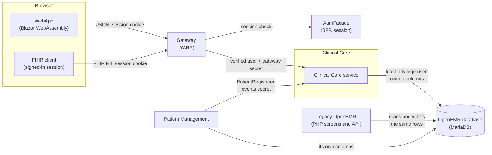

# Clinical Care: context map

- **Part of:** the Clinical Care design set (`README.md` in this folder)
- **Reads with:** doc 06 (what is shared at the table level) and diagram D1 in doc 07

## 1. The map

## 2. Relationships

Patterns are the standard DDD names. Each row says who leads, what crosses, and what is shared.

| Neighbour | Pattern | Direction | What crosses | Contract and guard |
|---|---|---|---|---|
| **Legacy OpenEMR** | **Shared kernel, forced**, with an **anti-corruption layer** on this side. Legacy leads: the table shapes are its, and this service conforms | Both read and write the same tables | Rows of `form_encounter`, `forms`, `form_vitals`, `lists`, `immunizations`, `form_soap`, `form_clinical_notes` and others (doc 06) | Column-level grants; every update conditional on the version read; tolerant reads; legacy's own flags for delete; a shadow comparison against legacy's own writers (docs 01, 12) |
| **Patient Management** | **Customer / supplier**: it is the upstream supplier of *who exists*; this service is the downstream customer and **conforms to** the event's shape, using only `eventId`, `patientUuid`, `patientPid` and the time | PM to Clinical Care, one way | `PatientRegistered`, over HTTP from PM's outbox relay | `POST /internal/events`, `X-Internal-Events-Secret` (its own secret, not the gateway's); idempotent on `eventId`; a different uuid claiming a held pid fails loudly |
| **Gateway and AuthFacade** | **Open host** at the edge: the gateway is the one entry point; it checks the session and **forwards the verified user** | Gateway to Clinical Care | The OpenEMR user's uuid in `X-Authenticated-User`, with `X-Internal-Gateway-Secret` | ADR 0075. The service trusts the header only with the secret, resolves the uuid to a user, and refuses an inactive account |
| **WebApp** | **Published language**: the OpenAPI document. The WebApp is a conformist client of it | WebApp to Clinical Care, through the gateway | JSON under `/api/v1`, `ETag`/`If-Match`, `Idempotency-Key` | A generated NSwag client from the committed OpenAPI snapshot (ADR 0031); a generated client throws on any status the document does not declare, so the document must state the real success status |
| **FHIR clients** | **Published language**: FHIR R4, US Core profiles | Clients read; none write | Five resources and `_lastUpdated` search | Same session gate as the JSON API; no bearer path (deliberately, until there is a client to design it for); tests validate against US Core |
| **Consumers of Clinical Care's events** | None yet | Would be Clinical Care to others | The outbox rows | The outbox is written in the same transaction as every change, but **nothing relays it**: no service consumes these events, so unpublished rows are kept 365 days and then purged (doc 05) |
| **Future services** (documents, pharmacy, labs, billing) | Not started | | Medications share `lists` with problems and allergies | Every statement here names its own `type`, so a medication row is untouched; an architecture test enforces it |

## 3. What crosses each boundary, and what is refused

| Boundary | Allowed | Refused |
|---|---|---|
| Into Clinical Care from the gateway | A request with the gateway secret *and* a verified user | A request with no secret (401); with the secret but no usable `X-Authenticated-User` (401); with a user uuid that matches no OpenEMR user, or an account OpenEMR has deactivated (403) |
| Into Clinical Care from Patient Management | One `PatientRegistered` event at a time with the events secret | The gateway's secret (a different scheme), an event with no `eventId`, a patient with an empty uuid or a non-positive pid |
| Into the database | The grants in doc 06, nothing wider | A `DELETE` on anything but `lists` and `issue_encounter`; an `UPDATE` of any column not named |
| Out to Patient Management | **Nothing.** Clinical Care never calls it and never reads `patient_data` | n/a: the interim `patient_data` lookup was removed in slice 3 |
| Out to clients | Views built here; FHIR resources mapped here | A patient's demographics (not held); a clinical note's linked documents (not modelled) |

## 4. Coupling to be aware of

- **Shared database.** The strongest coupling in the system, and a decision (ADR 0064): the legacy UI must stay live while services are extracted. It is contained behind the ports, so replacing it is an adapter change, not a domain change.
- **Legacy's ACL is read, not replicated in a table of our own.** Delete permission comes from the `gacl_*` tables on every delete, uncached, so an administrator's change in OpenEMR applies at once (ADR 0076).
- **One shared id counter.** Encounter numbers come from legacy's `sequences` table under an atomic update, so this service and legacy can never hand out the same number.
- **`pid` is carried.** `PatientReference` holds the legacy `pid` because legacy tables still join on it. It is dropped from public contracts when the shared database ends.
- **Two clocks.** The database server, both services and legacy's PHP default are all UTC, which is why storing UTC digits is correct (ADR 0083).
