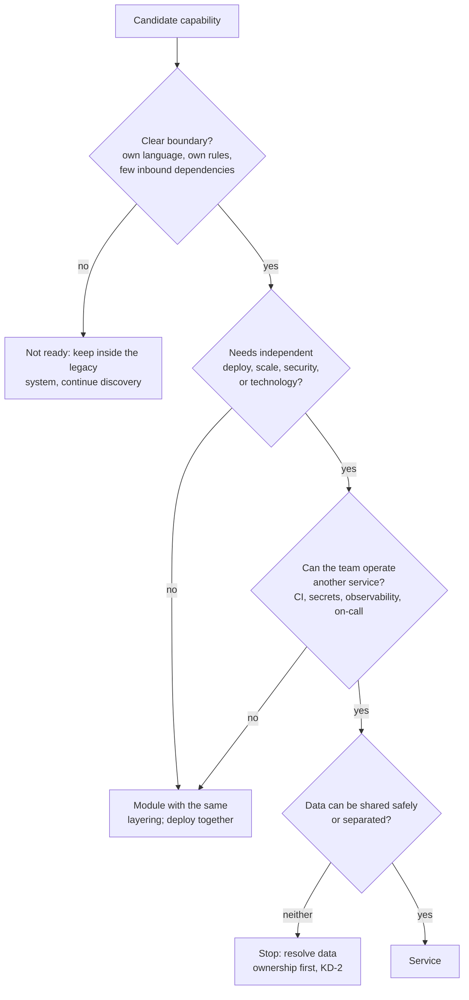
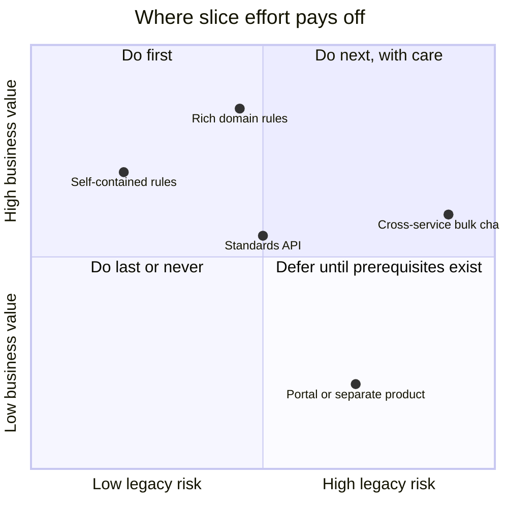

# 01. Principles and decision framework

- **Part of:** the Microservice Migration Playbook ([README](README.md))
- **Read this if:** you are deciding *whether* and *how* to start, or you need to defend the approach.

## 1. Principles

Each principle has a reason. If you cannot defend the reason in your context, you may be in a context where
the principle does not apply; record that as an exception rather than ignoring it.

**P-1 — Migrate in vertical slices, never in a rewrite.**
*Why:* a rewrite delays all feedback until the end and makes rollback impossible. A slice delivers one
capability through every layer to the real runtime, so the first slice finds the problems in your pipeline,
your security model, and your data assumptions while they are still cheap. Pattern: the *strangler*: new
code takes over one capability at a time while the legacy system keeps running.

**P-2 — Treat the legacy system as a compatibility constraint, not as the target.**
*Why:* its tables, names, and quirks encode history, not intent. Copying them into the new model imports
the debt. Honor the *behavior* people rely on; translate the *representation* at one boundary (the
anti-corruption layer, [05](05-legacy-integration-and-data.md)).

**P-3 — Domain first, technology last.**
*Why:* business rules outlive frameworks, databases, and transports. Keeping the domain model free of
technology makes the rules testable in microseconds, portable, and readable by the people who own them.

**P-4 — Enforce architecture mechanically.**
*Why:* a convention survives until the first deadline. A dependency rule that **fails the build** survives
turnover. Every structural rule in [03](03-hexagonal-service-architecture.md) and
[04](04-tactical-domain-modeling.md) has a test, not just a paragraph.

**P-5 — Decide explicitly, record the alternatives, never edit history.**
*Why:* the cost of a decision is paid by someone who was not in the room. A record that lists the options
rejected, and why, lets a successor change the decision for the right reasons instead of repeating the
analysis or, worse, reversing it by accident. Decisions are superseded by a new record, not edited.

**P-6 — Verify against the real thing.**
*Why:* documentation lies, memory lies, and "it should work" is the most expensive sentence in migration.
Run the legacy system, read its source, query its real data, and run your code against a real database with
the real permissions. Label what you did **not** verify. (Several of this project's worst defects were
claims that were never run: [12](12-lessons-learned.md).)

**P-7 — Fail closed and fail fast.**
*Why:* a service that starts with a missing secret, an empty connection string, or an open gate is worse
than one that refuses to start. Validate configuration at startup; deny access unless explicitly granted.

**P-8 — Least privilege, everywhere, and prove it by testing as that principal.**
*Why:* a shared database is only as safe as the narrowest grant you can live with. The grant you *wrote*
and the grant your tests *used* are different things unless you make them the same
([05](05-legacy-integration-and-data.md) LEG-6).

**P-9 — Security, audit, and failure behavior ship with the first slice.**
*Why:* retrofitting them later means changing every endpoint, every test, and every contract, and the
service is exposed in the meantime. A slice that is not safe to expose is not done.

**P-10 — Be honest about what is built.**
*Why:* a design that reads as finished invites reliance on things that do not exist. Use the status words
(Built, Target, Deferred, Unverified) and keep a findings register. "The event is published exactly once"
is false if nothing delivers the event.

**P-11 — Prefer a module over a service unless independent deployment pays for itself.**
*Why:* a service adds a network, a deployment unit, a failure mode, and an operations burden. Take them on
only for a measured benefit (section 2).

**P-12 — Every step is reversible, and temporary scaffolding has a removal date.**
*Why:* migration is long; temporary things become permanent by neglect. Name the stand-in's removal
criterion when you build it, and delete it when the criterion is met.

**P-13 — Document in the same change as the code.**
*Why:* a backfilled document describes what someone remembers, not what was decided. Decision records,
glossary entries, changelogs, and roadmap updates ship with the code that motivated them.

## 2. Should this be a service at all?

A bounded context ([02](02-discovery-and-strategic-design.md)) can be implemented as a **module** inside the
existing system, a **library**, or a **deployable service**. Boundaries come from the domain; deployment
comes from operations. Do not conflate them.

| Pressure | Favors a service | Favors a module |
|---|---|---|
| Release cadence differs from the monolith | yes | |
| Different scaling profile | yes | |
| Different security boundary (stricter data, separate audit) | yes | |
| Team can run CI, secrets, health, logs, rollback for it | yes | |
| Rules change together with surrounding monolith code | | yes |
| Heavy transactional coupling to other data | | yes |
| Small team, no operations capacity | | yes |
| Boundary still uncertain | | yes (modules are cheap to move) |

**Honest note.** A service that shares its database with the legacy system ([KD-2](#kd-2--where-does-the-data-live))
is **not independently deployable in the data sense**. It is a process boundary, not a data boundary. That
can still be right (it isolates code, enables the strangler, and lets you secure the edge), but be clear
about what you bought. Do not claim "microservice benefits" you do not have.

## 3. The decisions to make early

Nine decisions shape everything. Make each one deliberately, write it down (template in
[13](13-templates.md)), and note the **revisit trigger**: the observable event that should reopen it.

### KD-1 — What is the unit: module, library, or service?

See section 2. Recommendation: **start as a service only if** the pressures above clearly apply; otherwise
build the same layered structure as a module. The layering ([03](03-hexagonal-service-architecture.md))
is identical, so promotion later is cheap.
*Revisit when:* the boundary moves, or operations capacity changes.

### KD-2 — Where does the data live?

The central decision of a legacy migration. Options, with the cost of each:

| Option | Description | Strength | Cost / risk |
|---|---|---|---|
| **A. Shared legacy database, direct** | Service reads and writes the legacy tables via its own narrow user | Fastest; no sync; transactional with the outbox; the legacy system sees your writes immediately | Coupling to a schema you do not own; legacy keeps writing; two writers; no schema freedom |
| **B. Own database, legacy remains source** | Service reads a replica/CDC/ETL copy, writes via legacy API | Isolated schema; independent evolution | Staleness; double-model; write path still goes through legacy |
| **C. Own database, service is source** | Data is migrated; legacy reads from the new service | The "real" end state | Large cutover; legacy must be changed; hardest rollback |
| **D. Hybrid (expand/contract)** | A first, then move ownership table by table to C | Reversible steps | Needs discipline and a migration plan ([05](05-legacy-integration-and-data.md) §10) |

**Recommendation:** **A, as a deliberate stage on the way to D**, when (1) the legacy UI for that capability
will be retired (single writer), (2) you can restrict the service to a least-privilege user, and (3) the
outbox must be atomic with the business write. **Why:** the outbox guarantee ("the change and its event
commit together or not at all") needs one local transaction. Splitting the data across two databases turns
"exactly once" into a distributed-transaction problem. Choosing A removed that problem for the first slice.
*Revisit when:* a second service needs to own part of the same tables, the legacy schema blocks a needed
rule, or legacy writers cannot be retired.

> **Single-writer claim, corrected.** "We retired the legacy registration screen, so we are the only
> writer" was **false**: the legacy system's own REST API was an enabled second write path. Inventory
> **every** writer ([05](05-legacy-integration-and-data.md) LEG-8), not just the UI you remember.

### KD-3 — Who may call the service, and how is trust established?

Options for service-to-service trust, in increasing strength: a **shared secret header** from a gateway;
**network isolation** (no published port); **mutual TLS**; a **signed token** validated by the service. For
end-user identity: the gateway or edge **verifies** the caller and **forwards a signed or trusted caller
context**; the service never trusts identity fields supplied in a request body.
**Recommendation:** start with network isolation plus a shared secret *and* a real "must be signed in"
check at the edge; plan identity forwarding before the first user-facing screen ([07](07-security-and-compliance.md)).
*Why:* a shared secret proves "the call came through the gateway", **not** "a signed-in user is behind it".
Treating the two as equal is how a service ends up reachable by anyone.
*Revisit when:* a second service appears, an external caller appears, or the compliance posture changes.

### KD-4 — How do services communicate?

| Need | Use | Why |
|---|---|---|
| Query now, need the answer | Synchronous call (HTTP) through the gateway or directly, with a circuit breaker | Simple; failure is visible |
| Announce a fact others may react to | **Asynchronous event** via the outbox | Decouples availability; the producer does not know its consumers |
| Multi-step change across services | Saga / process manager | No distributed transaction; explicit compensation |

**Rule of thumb:** command and query across a boundary = sync; *"this happened"* = event. Put the transport
(broker or otherwise) behind an interface so it can change ([06](06-apis-gateway-and-events.md) EVT-8).
*Revisit when:* a second consumer appears, or latency or availability coupling becomes the bottleneck.

### KD-5 — What is the public contract style?

Domain-shaped REST/JSON for your own screens, **plus** a standards-based surface (for example, a health or
finance interchange standard) where outside systems require it. Keep the standard in an adapter at the
edge; do not let its vocabulary leak into the domain ([04](04-tactical-domain-modeling.md) DOM-14).
*Why:* standards change on their own schedule and their types are wire-shaped, not business-shaped.

### KD-6 — How will tests touch the database?

| Pattern | Use for | Cost |
|---|---|---|
| **Black-box against the running stack** | Routing, gateway, login flows, read-mostly services | Slow; shared state; needs the whole stack |
| **Disposable database container per test run** | Anything that **writes** shared or legacy state | Needs a container runtime; slower start |
| **In-memory substitute** | Never for a legacy mapping | A "nicer" database proves nothing about the real quirks |

**Recommendation:** use disposable containers for write paths, with a **schema copied from the real legacy
schema, including its anti-patterns**, and run as the **same restricted principal production uses**
([08](08-quality-and-testing.md) QLT-8). Pick deliberately; do not default to the last pattern you used.

### KD-7 — Parity or improvement?

Do you reproduce legacy behavior exactly, or take the chance to fix it? **Recommendation:** parity first,
improvement second, and **mark every behavior change "(new)"** so it needs a decision. *Why:* users and
downstream systems depend on behavior you have not discovered. A "fix" that changes it is a regression in
disguise. Where legacy behavior is unsafe (for example a non-transactional bulk merge), do **not** copy it;
record the decision to diverge.

### KD-8 — What is out of scope, and what is deferred?

State both, with reasons. *Excluded:* belongs to a different context (in this project, a patient-facing
login system). *Deferred:* belongs here but is blocked, with the **precondition named** (a merge across
tables other services will own). *Why:* silent omissions get mistaken for oversights, and silent inclusions
inflate scope. A named deferral is a plan; an unnamed one is a hole.

### KD-9 — What is the deployment and environment model?

One definition of the whole local stack (containers), configuration from the environment with validation at
start, one-shot idempotent provisioning for database users and seed data, CI that brings the real stack up.
Details in [09](09-delivery-and-operations.md).
*Why:* "works on my machine" is a migration risk multiplier; a single command that reproduces the stack
lets anyone, including CI, find the integration bugs.

## 4. How to make a decision

1. **Name the question** in one sentence, and what it blocks.
2. **List at least two real options**, including "do nothing" and the cheapest.
3. **State the criteria** (risk, reversibility, cost, evidence available).
4. **Gather evidence** by running or reading, not guessing (P-6). If the evidence cannot be had yet, say so
   and defer with a trigger, rather than guessing and risking a rewrite.
5. **Decide, with a recommendation and a default.** Present a recommendation, not a survey.
6. **Record it** with alternatives and consequences, and the revisit trigger.
7. **Change the code and docs in the same change** (P-13).

**Deferring is a decision.** The strongest decision records in this project were deferrals that said exactly
what was missing ("no lookup exists from the external user id to the numeric id the columns need; building
one on a guess risks a rewrite"). A deferral without a stated missing fact is just avoidance.

## 5. Parity-versus-purity: where to spend your effort

Order slices by **risk and independence**, not by table size
([10](10-roadmap-and-milestones.md) MIG-10).

## 6. Checklist: before you write the first line

- [ ] KD-1 to KD-9 each have a written decision, an owner, and a revisit trigger.
- [ ] The scope statement lists what is excluded and what is deferred, with preconditions.
- [ ] You can run the legacy system locally from a snapshot (MIG-2).
- [ ] A decision-record folder and template exist (P-5).
- [ ] The success measures are written down ([08](08-quality-and-testing.md) §9).
- [ ] The first slice is chosen and is small, self-contained, and exercises every layer (MIG-6).
