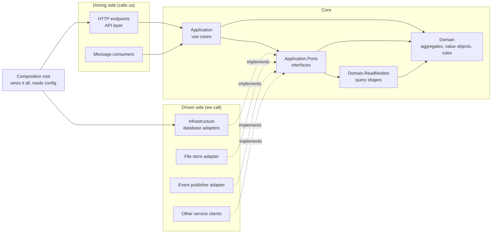
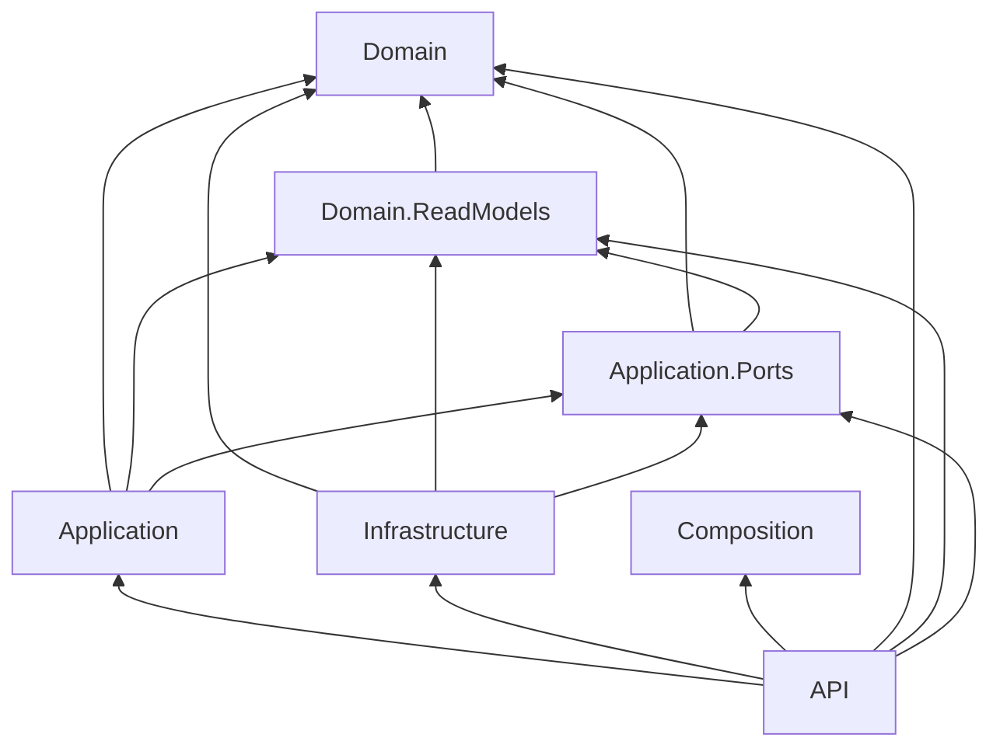
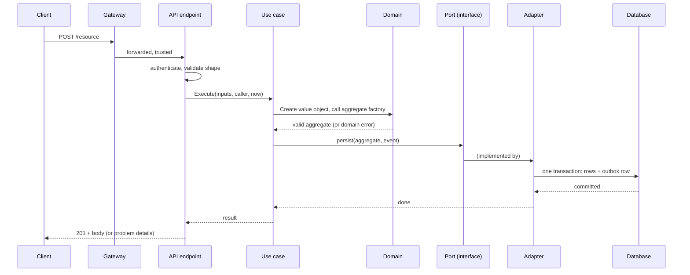

# 03. Hexagonal service architecture

- **Part of:** the Microservice Migration Playbook ([README](README.md))
- **Read this if:** you are creating a service's project structure, or reviewing whether code is in the
  right layer.
- **Rule prefix:** `ARC-`

## 1. The idea in one picture

The **domain** is the center. It knows nothing about HTTP, databases, files, queues, or frameworks.
Everything it needs from the outside world, it asks for through an **interface it defines** (a *port*).
Everything the outside world offers (a web request, a message, a database) is plugged in through an
**adapter** at the edge. The dependency arrows always point **inward**.



**Why this shape.** It makes the part that is hardest to change (business rules) the part that depends on
the least, and the part that changes most often (frameworks, storage, transport) replaceable at the edge.
You pay in indirection; you get testability, portability, and a boundary you can enforce.

## 2. Modules and what lives in each

A service is several build modules (projects/packages/crates), not folders in one. A real module boundary
is what lets the build *refuse* a bad dependency (ARC-10).

| Module | Contains | May depend on | Must not depend on |
|---|---|---|---|
| **Domain** | Aggregates, entities, value objects, domain rules (pure functions), domain exceptions | the language's standard library only | any other module of this service, any framework, any I/O |
| **Domain.ReadModels** | Query-side shapes (flat records) and rules that operate only on them | Domain | everything else |
| **Application.Ports** | Interfaces the use cases need (repositories, publishers, clocks, allocators), result types | Domain, Domain.ReadModels | Application, Infrastructure, API |
| **Application** | Use cases: one class per use case; orchestration only | Domain, ReadModels, Ports | Infrastructure, API |
| **Infrastructure** | Adapters: database access, file store, publisher, outbound clients | Domain, ReadModels, Ports | Application, API |
| **Composition** | Configuration objects, validation of configuration, wiring helpers | the config library | the API layer, the web framework |
| **API** | Endpoints, request/response contracts, authentication handlers, middleware, API description | everything above | n/a (outermost) |
| **Client** *(optional)* | A generated client library for the API, in its own module | nothing of ours | the API module |



Notice what is **absent**: Application never references Infrastructure; Infrastructure never references
Application. They meet only through the ports, and are joined at the composition root.

## 3. Rules

**ARC-1 — Dependencies point inward only.**
*Why:* any outward arrow lets a rule depend on a technology, and the first one makes the second one
acceptable. *Check:* ARC-10.

**ARC-2 — The domain depends on nothing.** No framework, no ORM annotations, no serialization
attributes, no clock, no random source, no file or network.
*Why:* a domain that needs a database to be tested will not be tested; a domain that imports the framework
inherits its release cycle. Time and randomness are **inputs** (ARC-2a): the domain accepts an instant or
an allocator, so tests are deterministic.
*How:* mapping is described **outside** the domain (adapter-side configuration), using private
constructors and field access where the mapper needs them.

**ARC-3 — Ports speak the domain's language, not the storage's.**
A port says "register this patient and record this event atomically", not "insert into table X and table Y".
*Why:* the use case must not know *how* atomicity is achieved. It also lets you replace the mechanism (a
local transaction today, something else tomorrow) without touching business code.

**ARC-4 — A use case is a class with one job.**
It validates by constructing domain objects, calls ports, returns a result. It contains **no** business
rule (those live in the domain) and **no** technology detail (those live in adapters). Name it for the
business action: `RegisterPatient`, `SwapInsuranceLevel`.
*Why:* a use-case layer that grows rules becomes a second, untested domain; one that grows I/O becomes a
second infrastructure.

**ARC-5 — Adapters implement ports and never reach back.**
An adapter MUST NOT reference the application layer. An interface used only between two adapters (for
example a file-store interface used by the repository adapter) is **not a port**: keep it inside
Infrastructure.
*Why:* a "port" nothing in the core uses is just indirection wearing the port naming convention.

**ARC-6 — The transaction boundary belongs to the adapter, expressed through the port.**
The port method states the *unit of work* ("persist this decision and its event together"); the adapter
opens and commits the transaction.
*Why:* transactions are a storage concern, but "these two changes must be atomic" is a business
requirement. The port carries the requirement; the adapter provides the mechanism.

**ARC-7 — Wire contracts live in the API layer and are never domain types.**
Requests and responses are explicit, versioned, named types. Serialized names are pinned by a test.
*Why:* domain types change for business reasons; wire types are a promise to outsiders. Coupling them
freezes the domain or breaks clients.

**ARC-8 — One composition root; configuration is read in exactly one place.**
It binds configuration to typed options, validates them at startup (OPS-3), and registers adapters against
ports. It is **host-neutral** (no web framework), so the same wiring can run in a web host, a worker, or a
test host.
*Why:* scattered configuration reads cause "works here, fails there"; a framework-free composition module
makes in-process tests cheap.

**ARC-9 — Read models are separate from aggregates, and separately enforced.**
Query results are flat records, not aggregates. They live in their own module that the write-side domain
**cannot** reference.
*Why:* reads and writes have different shapes and different consistency needs. A compile-time boundary
beats a folder name: it proves nothing an aggregate does can accidentally depend on a query shape.

**ARC-10 — Every structural rule is a test.**
See section 6.
*Why:* P-4.

**ARC-11 — Validate at the edge for shape; validate in the domain for truth; keep the messages equal.**
The edge rejects malformed input cheaply (required, length, range, format) using declarative validation, and
**also** publishes those constraints in the API description. The domain factory re-checks everything, because
the domain cannot assume who called it. Where both check the same rule, use the **same message text**.
*Why:* edge validation is a convenience and an early exit; the domain is the authority. Equal messages mean
callers see the same answer regardless of which layer caught the problem.

**ARC-12 — Do not layer a thin adapter; do not copy a collapsed scaffold as a template.**
A component that merely translates one protocol to another (a login bridge, a proxy) has no domain. Giving it
five modules adds ceremony and no protection; the source project built five layers for such a bridge and
later deleted three of them. Conversely, a real domain service gets the full layering on its own merits.
*Why:* layering earns its cost where there is a domain to protect.

**ARC-13 — Endpoints are thin.**
An endpoint maps request → use-case input, calls the use case, maps the result or the known domain errors
to a response. It contains no rules and no storage calls.
*Why:* endpoints are the easiest place for rules to leak, and the hardest to test in isolation.

**ARC-14 — Cross-cutting concerns live at the edge, as middleware or filters.**
Authentication, authorization gates, error shaping, correlation, rate limiting, request logging. The domain
never logs credentials or reads the request.
*Why:* it keeps the core free of transport concepts and gives one place to enforce them uniformly.

**ARC-15 — Organize by role inside each module; mirror it in tests.**
Within Domain: `ValueObjects/`, `Rules/`, and the aggregate files, grouped by sub-area. Test folders mirror
the same structure.
*Why:* the structure tells a reader which role each type plays before they open it.

## 4. A request, end to end



## 5. Pseudo-code of the pattern

```text
// ---- Domain (no dependencies) ----
final class Registration {                     // value object
    private Registration(...) {}               // no public constructor
    static Registration create(first, last, dob, ...) {
        errors = []
        if (first empty or length > 255) errors += "First name must be 1-255 characters."
        ...
        if (errors not empty) throw new RegistrationInvalid(errors)   // collects ALL errors
        return new Registration(...)
    }
}
final class Patient {                          // aggregate root
    private Patient(...) {}
    static Patient register(Registration r, Identity id, UserId by, Instant at) { ... }
}

// ---- Ports (depend on Domain only) ----
interface PatientRegistry {
    void register(Patient p, PatientRegistered event);    // atomic by contract
}

// ---- Application (depends on Domain + Ports) ----
class RegisterPatient {
    RegisterPatient(PatientRegistry registry, IdAllocator ids, Clock clock) {...}
    Patient execute(RegistrationInput in, UserId by) {
        r  = Registration.create(in.first, in.last, in.dob, ...);
        p  = Patient.register(r, ids.next(), by, clock.now());
        registry.register(p, PatientRegistered.from(p));
        return p;
    }
}

// ---- Infrastructure (depends on Domain + Ports; NOT Application) ----
class SqlPatientRegistry implements PatientRegistry {
    void register(Patient p, PatientRegistered e) {
        tx = db.begin()
        db.insert(patientRow(p))                // translation to the legacy shape lives here
        db.insert(outboxRow(e))
        tx.commit()
    }
}

// ---- API (depends on everything; the only place HTTP exists) ----
POST /patients:
    body = validate(request)                     // shape only
    try   { p = registerPatient.execute(body, caller.userId); return 201(location) }
    catch (RegistrationInvalid e) { return 400(problem(e.errors)) }
```

## 6. Enforcement: the architecture tests

Implement these with whatever reflection or dependency-analysis facility your platform has. They read the
**compiled** module references, so a forbidden reference fails the build even if no code calls it.

| Test | Asserts |
|---|---|
| Domain references no other module of ours | Domain is a leaf |
| ReadModels references only Domain | The read side cannot pull in aggregates |
| Ports reference only Domain and ReadModels | Ports are pure interfaces |
| Application does not reference Infrastructure or API | Use cases see only ports |
| Infrastructure does not reference Application or API | Adapters never reach back |
| Composition does not reference API or the web framework | The root is host-neutral |
| **Invariant enforcement** | Each aggregate and value object has **no public constructor** and **no publicly settable property** |

The last one is the most valuable and least obvious: it stops someone adding a public setter "to make
testing easier", and, for languages with copy-with syntax on records, it closes the escape hatch that
lets a caller clone an object with an invalid field. See [04](04-tactical-domain-modeling.md) DOM-2.

**Maintain the type list deliberately.** The invariant test iterates an explicit list of types. A new
aggregate MUST be added to it in the same change (QLT-5).

## 7. Anti-patterns

| Anti-pattern | Symptom | Fix |
|---|---|---|
| **Anemic domain** | Aggregates are bags of getters; use cases hold the rules | Move rules into aggregates and domain rules (ARC-4) |
| **Repository returns ORM entities** | Domain types carry storage attributes | Keep mapping in the adapter (ARC-2) |
| **Use case reaches into storage** | `if (db.query(...))` in a use case | Add a port in domain language (ARC-3) |
| **Endpoint runs rules** | Rule logic in handlers | Move to domain; endpoint maps only (ARC-13) |
| **Port named after a table** | `IPatientDataTable` | Name by business need (ARC-3) |
| **Shared "common" module** | Everything depends on it | Keep the kernel tiny (DSC-8) |
| **Domain types serialized as responses** | Renaming a field breaks clients | Separate contracts (ARC-7) |
| **Config read in many places** | Different defaults per layer | One composition root (ARC-8) |
| **Framework base class in the domain** | Domain cannot compile without it | Remove (ARC-2) |
| **A "port" used only by adapters** | Pointless indirection | Move into Infrastructure (ARC-5) |
| **Five layers for a protocol translator** | Ceremony, no domain | Collapse (ARC-12) |
| **A use case that bypasses the aggregate** | One code path skips an invariant | Route every write through the aggregate and test each path (QLT-6) |

## 8. When the structure is too heavy

Layering has a cost. Collapse deliberately (never accidentally) when:

- There is **no domain**: the component is a translator, proxy, or session holder (ARC-12).
- It is a **throwaway** with a stated removal date.
- The "service" has **one use case and no rules**, and will not grow. (Then ask whether it needs to exist.)

When you collapse, record the decision and keep the dependency direction. A collapsed component is still
not allowed to depend on a framework *inside* the code that holds the rules.

## 9. Checklist: new service skeleton

- [ ] Modules exist for Domain, ReadModels, Ports, Application, Infrastructure, Composition, API.
- [ ] The dependency tests (section 6) exist and run in CI before any feature code.
- [ ] The invariant test exists with an empty-or-seed type list.
- [ ] A composition root binds, validates, and registers; nothing else reads configuration.
- [ ] A "hello" use case flows from endpoint to adapter to database and is covered by an integration test.
- [ ] The service has a container definition and a gateway route (MIG-6).
- [ ] API contracts are separate from domain types, and serialized names are pinned by a test.
- [ ] A global error shaper and an authentication gate exist before any real endpoint (SEC-1, OPS-8).
