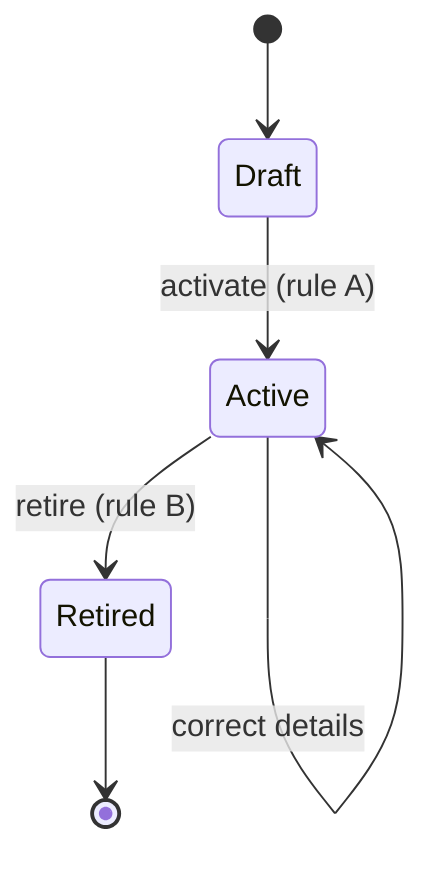

# 04. Tactical domain modeling

- **Part of:** the Microservice Migration Playbook ([README](README.md))
- **Read this if:** you are writing or reviewing aggregates, value objects, and business rules.
- **Rule prefix:** `DOM-`

## 1. What "tactical" means here

Strategic design ([02](02-discovery-and-strategic-design.md)) says *where* the boundary is. Tactical design
says *how the inside is built* so that **invalid states cannot be constructed** and **rules can be tested
without any infrastructure**. The goal is a model whose compile-time shape makes the wrong thing hard to
write.

## 2. Building blocks

| Block | Identity | Mutability | Use for |
|---|---|---|---|
| **Aggregate root** | Yes | Through its own methods only | The consistency boundary; the only thing outside code holds |
| **Entity (inside an aggregate)** | Yes, within the aggregate | Through the root | Things with a lifecycle that the root governs |
| **Value object** | No, equality by value | Immutable | A concept defined by its values and rules (a name, a date range, a coded value) |
| **Domain rule** | None | None | A pure function: inputs in, decision out |
| **Domain service** | None | Stateless | A rule that needs several aggregates and belongs to none |
| **Domain event** | Yes (event id) | Immutable | A fact that happened |
| **Read model** | No | Immutable | A query result shape; not an aggregate |

## 3. Rules

### Invariants and construction

**DOM-1 — Draw aggregate boundaries around consistency requirements.**
Ask: *what must be true together, atomically?* That set is one aggregate. Everything else references it by
identity and is consistent *eventually*. Keep aggregates small.
*Why:* big aggregates cause lock contention and slow loads; boundaries drawn around "data I load together"
reproduce table-shaped thinking (DSC-2).

**DOM-2 — An aggregate or value object is valid from the moment it exists, and cannot be made invalid.**
- No public constructor; the only entry points are named factory methods (`register`, `add`, `create`).
- No publicly settable property; state changes only through methods that enforce rules.
- Validate **inside** the factory; do not trust that a caller already validated.
*Why:* if invalid states are constructible, every use of the type must defend against them. Make the
invalid state unrepresentable and the rest of the code can stop checking. Enforced by test (ARC-10).

**DOM-3 — Collect every error, then fail once.**
A factory gathers all rule violations into a list and throws a single domain exception per concept area
carrying that list.
*Why:* a user who fixes one field and meets the next error, five times, has been mistreated. A list also
maps cleanly to a 400 response with per-field messages.

**DOM-4 — Replace primitives with value objects where mix-ups are plausible.**
Typed identifiers (`PatientNumber`, `StaffUserId`, `PayerId`) rather than three interchangeable integers;
`EmailAddress`, `DateRange`, `CodedValue` rather than strings and dates with rules scattered around.
*Why:* two same-typed arguments can be swapped silently. (A review of the source project found every id was
a plain integer; fixing it is on the plan, not done.)

**DOM-5 — Narrow, named mutation; widen nothing for convenience.**
If one legitimate post-construction change exists (a policy changing level in a swap), give it one method
with the **narrowest visibility the build allows** (module-internal, with the cluster aggregate as the only
caller). Never add a public setter.
*Why:* each exception to immutability is a place an invariant can break. Keep them countable.

### Identity

**DOM-6 — Separate public identity from storage keys, and never rely on a legacy key you cannot prove unique.**
Use a stable, opaque identifier (a UUID) as the identity other services and APIs reference. Treat the
legacy numeric id as a **correlation key**, not the identity, unless the schema enforces uniqueness
*and* it is allocated safely.
*Why:* legacy "ids" are frequently non-unique, reused, or allocated by a read-then-write race. An opaque
identity you control survives a future database move.

**DOM-7 — Identity allocation is a port, not a line in the aggregate.**
If a human-visible number is needed (a chart number, an invoice number), obtain it from an injected
allocator with a defined concurrency strategy ([05](05-legacy-integration-and-data.md) LEG-9). The aggregate
receives it; it does not invent it.
*Why:* allocation inside the aggregate makes collisions untestable and hides the concurrency design in a
constructor. (The source project generated a random 63-bit number inside the aggregate. It was unique
enough to pass tests, but it broke legacy's own "max plus one" allocator and made collisions a raw 500. See
[12](12-lessons-learned.md).)

**DOM-8 — Time and randomness are inputs.**
Pass an instant or a clock; pass an allocator or random source. Never read the system clock or a global
random generator in the domain.
*Why:* deterministic tests; and a place to assert, at startup, that every clock agrees on a time zone
([05](05-legacy-integration-and-data.md) LEG-11).

### Reading and writing legacy data

**DOM-9 — Be strict when writing, tolerant when reading (the legacy asymmetry).**
Creation goes through the strict factory. **Loading** an existing legacy row uses a separate
*reconstitution* path that restores state **without** re-running creation validation, and read queries
tolerate zero, partial, or malformed values rather than throwing.
*Why:* a legacy row already exists; it passed whatever validation legacy had, which may be looser than
yours. Throwing on it makes one bad row break every operation on that patient. Skipping or defaulting a
malformed value loses nothing a caller could observe in most read paths. Decide per path and test it.
*How:* the reconstitution constructor is module-internal and called only by the repository adapter.

**DOM-10 — Reference data and enumerations: closed legacy sets become value objects with a parser.**
Fail on unknown values when **writing**; tolerate and surface (or skip) unknown values when **reading**.
*Why:* the legacy system may hold historical values your enumeration lacks. Rejecting them on read makes the
past unreadable.

**DOM-11 — Limits are invariants and belong in the domain.**
Maximum payload sizes, string lengths, numeric ranges. Cite the legacy source of the number in a comment.
*Why:* a limit enforced only at the edge is bypassed by the next caller. A limit in the domain cannot be.
(The source project found an upload-size invariant missing from the domain after the edge check existed.)

### Rules

**DOM-12 — Business rules are pure functions with cited sources.**
A scoring formula, an effective-date picker, a mapping table: write them as stateless functions of their
inputs; put thresholds as named constants with a comment pointing to the legacy source or decision.
*Why:* they become trivially testable, can be reused by several use cases, and the citation answers "why 12
and not 10?" years later.

**DOM-13 — When an invariant spans several entities, model the cluster as one aggregate and keep persistence workarounds out of it.**
Example: a patient's insurance policies, where "no two at the same level and start date" and "swap levels"
involve more than one policy. Make a *Coverage* aggregate that owns the swap decision and returns a result
object describing the outcome. The adapter persists that decision, including any storage workaround (such
as a temporary sentinel date to dodge a unique constraint).
*Why:* the business question ("who ends up at which level?") is independent of the storage trick. Separated,
the decision is unit-testable without a database, and the trick stays where it belongs. A model with only
single-entity aggregates has never exercised the harder half of what an aggregate is for.

**DOM-14 — Do not echo the wire vocabulary (or the storage vocabulary) in the domain.**
If the domain has a coded-value type, its members are `CodeSystem`/`CodeValue`/`DisplayText`, not the
standard's field names; the API adapter translates. Same for storage names.
*Why:* when the standard (or the schema) changes, the domain should not. One adapter file translating is
cheaper than renaming across the model.

**DOM-15 — Parity first; mark new rules "(new)".**
Port legacy behavior as found. When you add a rule legacy lacks, mark it *(new)* in the rule catalogue and
get an explicit decision (KD-7). When you decline to copy a legacy behavior, record that too.
*Why:* undiscovered dependence on legacy behavior is the main source of silent regressions.

### Events and errors

**DOM-16 — Events are plain, immutable facts with curated payloads.**
Named in the past tense (`PatientRegistered`), carrying only what a consumer needs (and nothing that is
sensitive without a reason). The aggregate or use case builds them; they carry no behavior.
*Why:* an event is a public contract. A payload that mirrors the whole row couples every consumer to your
schema and leaks data ([06](06-apis-gateway-and-events.md) EVT-5).

**DOM-17 — Domain errors are typed, and endpoints map known ones; nothing swallows the unknown.**
Validation failure → validation exception with errors. Missing entity → not-found exception. State
conflict → conflict exception. Endpoints map each to its status code; a global handler shapes everything
else (OPS-8).
*Why:* string-matching errors is fragile; swallowing exceptions hides faults. A "conflict" returned as
"bad request" tells the client to fix input that is fine.

### Completeness

**DOM-18 — Every path that changes an aggregate goes through the aggregate.**
If both "add policy" and "swap policy" must respect the cluster invariant, **both** route through the
cluster aggregate. A use case that constructs an entity directly bypasses the invariant.
*Why:* this exact bug shipped in the source project: the cluster rule existed but was reachable from one
path only, and the database constraint masked it until a caller received a raw database error. Test each
path (QLT-6).

**DOM-19 — The domain is testable with no infrastructure, and tested that way.**
Domain tests construct, call, and assert. If a domain test needs a database or a framework, the model has
a dependency it should not.

## 4. Aggregate design heuristics

| Question | Guidance |
|---|---|
| What goes in one aggregate? | Only what must be consistent in one transaction |
| How do aggregates refer to each other? | By identity, never by object reference |
| How many aggregates per transaction? | One. Cross-aggregate effects go through events or are validated at command time |
| Large collections inside an aggregate? | Probably a separate aggregate that references the owner |
| Rule needs data from another aggregate? | Validate at command time (a read), accept eventual drift, and warn rather than block where the business allows |
| Soft-delete or retire? | Prefer an explicit lifecycle state to deletion when records are legally retained |

## 5. Lifecycle and state

Model a lifecycle explicitly when it has rules.

- Each transition is a method; illegal transitions throw a conflict error (DOM-17).
- Document each transition's guard with its rule id.
- Do not model "status" as a free-text field with rules scattered around; either it is a lifecycle (model
  it) or it is a flag (keep it simple).

## 6. Handling legacy quirks inside the model

| Quirk | Handling |
|---|---|
| Column is `NOT NULL DEFAULT ''` where the domain means "absent" | Domain uses an optional value; the adapter maps absent ↔ empty string (backing-field mapping, because some mappers skip converters on null) |
| A column named for one concept holds another ("date" is "last updated") | Name the domain member for the real concept; comment the trap; record it in the glossary |
| Identifier that looks unique and is not | Do not use it as identity (DOM-6) |
| Free-text field that is really a code | Keep parity; add a controlled value later as a *(new)* decision |
| Directive type inferred from a document name | Keep for parity, comment it, do not extend |
| Dates stored as zero/partial | Tolerant read as text, parse or skip (DOM-9) |

## 7. Worked example (generic)

> **Requirement.** A customer may hold up to three *plans*, at levels 1, 2, 3. Two plans may not share a
> level and start date. An operator may *swap* a plan to a different level; if another plan occupies that
> level, the two trade places.

1. The invariant spans plans, so **`PlanPortfolio`** is the aggregate (DOM-13), loaded from existing plans.
2. `addPlan(level, ...)` checks the cross-plan rule, then calls the entity factory `Plan.add(...)`, which
   validates the plan's own fields (DOM-2).
3. `swap(planId, targetLevel)` decides who ends up where and returns `SwapResult(moved, displaced?)`. It
   changes levels only through `plan.changeLevel(...)`, which is module-internal (DOM-5).
4. The use case loads the portfolio, calls `swap`, then calls `port.persistSwap(result)` (ARC-3).
5. The adapter persists the result, applying the unique-key workaround if needed. The aggregate knows
   nothing of the unique key.
6. Tests: decision logic with in-memory objects (no database); persistence with a real database.

## 8. Review rubric for a domain change

Score each 0-2 and record findings, not just a number.

| Question | Evidence |
|---|---|
| Can an invalid instance be constructed? | Invariant test passes; no public ctor/setter |
| Is each rule a function with a cited source? | Comments, rule ids |
| Are all write paths through the aggregate? | Path-per-test (QLT-6) |
| Does anything depend on technology? | Layer test passes |
| Are legacy quirks translated at the boundary? | Mapping lives in the adapter |
| Are new rules marked and decided? | *(new)* in the catalogue, decision linked |
| Are errors typed and mapped? | Endpoint tests per error |

## 9. Checklist

- [ ] Each aggregate states its invariants and rule ids.
- [ ] Factories validate and collect all errors; no public constructors or setters (test in the list).
- [ ] Identifiers that could be confused are typed.
- [ ] Identity allocation sits behind a port with a concurrency strategy.
- [ ] Time and randomness are inputs.
- [ ] Reconstitution is separate from creation; reads are tolerant, writes are strict.
- [ ] Cluster invariants have one aggregate and every path uses it.
- [ ] Domain vocabulary does not mirror wire or storage vocabulary.
- [ ] Events are curated, past-tense, immutable.
- [ ] New behavior is marked *(new)* with a decision; declined legacy behavior is recorded.
