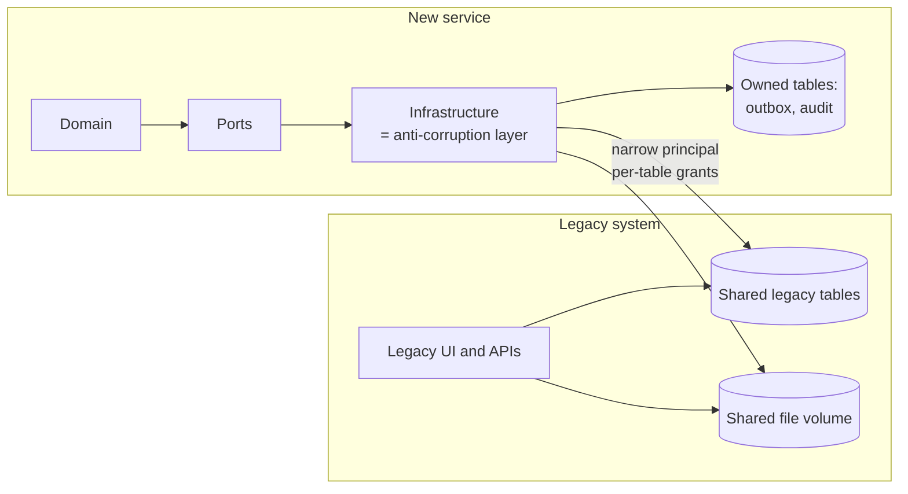
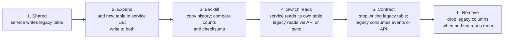

# 05. Legacy integration and data

- **Part of:** the Microservice Migration Playbook ([README](README.md))
- **Read this if:** your service will read or write data the legacy system also uses, or you plan to
  take ownership of that data over time.
- **Rule prefix:** `LEG-`

## 1. The integration model

[KD-2](01-principles-and-decision-framework.md#kd-2--where-does-the-data-live) chooses *where the data
lives*. This document is about doing the recommended option well: **the service works inside the legacy
database, as a narrow principal, behind an anti-corruption layer (ACL), on the way to owning its data.**



**Central fact:** the service owns **rows it creates** and **tables it adds**; it does **not** own the
schema. Everything in this document follows from that.

## 2. Ownership matrix

Build one for every table (and file location) the service touches.

| Table / resource | This service | Source of truth today | Other writers | Target owner |
|---|---|---|---|---|
| `entity_main` | insert, limited update | shared | legacy UI, legacy API, imports | this service, once update ships and legacy paths close |
| `entity_policy` | insert, update | shared | legacy screens | this service |
| `shared_counter` | update (draw an id) | **legacy** | every legacy allocator | legacy; we only borrow ids |
| `service_outbox` | insert, update, purge | **this service** | none | this service |
| `reference_list`, `staff` | read only | legacy / another context | legacy | another context |
| documents volume | write, read | shared | legacy document manager | this service for our category |

Columns: *who decides the value*, *who can change it*, *who should own it*. A cell that says "shared" is a
risk; a plan to make it "ours" or "theirs" is what the matrix is for.

## 3. Schema inventory (do this first)

For each table in scope, record:

| Item | Why it matters |
|---|---|
| Columns, types, nullability, defaults | Mapping and tolerant-read rules |
| Primary key (is there one?) | Missing keys mean duplicate rows are possible |
| Unique constraints | Collisions must be handled, not assumed away |
| Foreign keys | Their **absence** means you must check existence yourself |
| Triggers, generated columns, stored routines | Hidden behavior on write |
| Character set and collation | Comparison and search behavior |
| Row counts and representative data | Real-data survey (DSC-3) |
| Which code paths write it | LEG-8 |

Automate the inventory as a script that emits a document, so it can be re-run when legacy changes.
**Typical findings:** no primary key on a central table; no foreign keys anywhere; ids that are not unique;
a "date" column that is really a modification time; booleans stored as strings; the same fact stored in two
places.

## 4. Rules: mapping and the ACL

**LEG-1 — Do not own the legacy schema.**
Mark every mapped legacy table as *excluded from your migrations* in the ORM or migration tool. You create
and migrate only tables **you** introduced (outbox, audit, idempotency).
*Why:* a tool that "helpfully" alters a legacy table in production will eventually break the legacy system.
You are a guest.

**LEG-2 — All translation lives in one place: Infrastructure.**
Names, encodings, null conventions, enumerations, date handling. The domain sees domain concepts only
(ARC-2). Document each mapped column: domain member, normalization, notes.
*Why:* if translation leaks, the legacy schema becomes your model.

**LEG-3 — Test the mapping's fidelity at the byte level where encodings differ.**
Examples: a UUID stored as 16 bytes in a **different byte order** than your platform's native GUID layout
will store a *different* UUID than the legacy system reads back, and silently breaks every legacy feature
that uses it; empty-string-versus-null; integer widths; time zones. Each gets a test that round-trips
through the **real** column type.
*Why:* these bugs are invisible until the legacy system reads your data.

**LEG-4 — Read tolerantly.**
Read ambiguous columns (dates especially) as text and parse defensively; skip or default an unparseable
value rather than throwing; never let one malformed legacy row break an operation on its owner.
*Why:* legacy data has decades of history. Throwing on it makes your service as fragile as your worst row.
Add a test that plants a malformed unrelated row and proves the operation still succeeds.

**LEG-5 — Parameterize every statement; choose ORM or raw SQL per case, not by dogma.**
Use the ORM for simple inserts and reads. Use **raw, parameterized SQL** where legacy-specific functions,
tolerant reads, or odd idioms are needed. Audit every call site for injection: build SQL only from
constants and bound parameters.
*Why:* the tolerance and idioms you need often have no clean ORM equivalent; a "full ORM" rewrite became a
hybrid with more risk, not less.

**LEG-17 — Bulk-load bounded reference data; never N+1.**
A view that resolves several lookup lists should load each list once per request (they are bounded
configuration data) and resolve in memory.
*Why:* one search that issues hundreds of tiny queries is a latent outage.

## 5. Rules: least privilege

**LEG-6 — The service has its own database principal, granted per table and per verb.**
Never reuse the legacy application's account. Never grant on the whole schema. Write each grant with a
comment saying *why* that verb on that table:

```sql
-- inserts and updates the rows it owns
GRANT SELECT, INSERT, UPDATE ON legacy_db.entity_main TO 'svc_user'@'%';
-- only ever inserts a new document row and reads rows back
GRANT SELECT, INSERT ON legacy_db.documents TO 'svc_user'@'%';
-- read-only lookups
GRANT SELECT ON legacy_db.staff TO 'svc_user'@'%';
GRANT SELECT ON legacy_db.reference_list TO 'svc_user'@'%';
-- the shared counter: "SET id = LAST_INSERT_ID(id + 1)" needs SELECT as well as UPDATE,
-- because the engine requires read privilege on any column referenced on the right-hand side
GRANT SELECT, UPDATE ON legacy_db.shared_counter TO 'svc_user'@'%';
-- "replace into" is insert-or-delete+insert, so both privileges are needed
GRANT SELECT, INSERT, DELETE ON legacy_db.link_table TO 'svc_user'@'%';
-- its own table: only what it uses (NOT "ALL PRIVILEGES")
GRANT SELECT, INSERT, UPDATE, DELETE ON legacy_db.service_outbox TO 'svc_user'@'%';
```

*Why:* the grant list is a statement of exactly what the service can damage. It is also documentation of
what it touches, and it is the single best defense if the service is ever compromised.
**Non-obvious privileges are the point of the comments**: each grant above came from a real failure
("SELECT command denied for column" on a counter table).

**LEG-7 — Test as that principal.**
The integration fixture connects as a user with **exactly** the production grants (QLT-8).
*Why:* the source project's integration tests used a more permissive account. A missing `SELECT` on a
counter table was not caught until the real stack ran. A test that passes under a stronger principal than
production proves little about permissions.

**LEG-18 — Provision the principal and owned tables with an idempotent one-shot job.**
It creates the user (if absent), sets the password from configuration, applies the grants, creates owned
tables (if absent), and is safe to rerun. Make dependent services wait for it to complete successfully
(OPS-6).
*Why:* "run this SQL by hand" is how environments drift. A one-shot job reruns when its configuration
changes, so a rotated password takes effect without manual steps.

**Beware:** "create table if not exists" cannot **evolve** a table. Introduce a real migration mechanism
for owned tables before the first schema change (OPS-5).

## 6. Rules: concurrent writers

**LEG-8 — Inventory every writer of the data, not just the one you plan to retire.**
UI screens, REST and other APIs, batch jobs, imports, triggers, other modules, and **anything reachable
through your own proxy**. For each: keep, close, or accommodate (with a concurrency rule).
*Why:* the source project retired the legacy registration *screen*, declared "single writer", and later
found the legacy REST API, enabled in the stack and reachable through the browser proxy, still inserted rows.
The claim was false.

**LEG-10 — Use optimistic concurrency before any update command.**
Shared rows can change under you. Use a conditional update keyed on a last-modified value (or a version
column if you may add one), and return a conflict (409) when it does not match.
*Why:* a read-modify-write on a row legacy also edits will overwrite the other writer silently.

**LEG-12 — Use shared counters exactly as legacy does, and pin the idiom with a test.**
If legacy hands out ids from a global counter table, take ids with the same atomic statement the legacy
code uses. A test that fails if the idiom changes protects you from "improving" it into a race.

## 7. Identity allocation

**LEG-9 — Allocation has a written concurrency strategy, behind a port.**
Options for a human-visible number when legacy used "max plus one":

| Option | Behavior | Verdict |
|---|---|---|
| **A. Random within a range, retry on duplicate** | Fast; unique-ish | Breaks any legacy "max plus one"; unbounded size; collisions are a runtime error. **Avoid** for numbers legacy also allocates |
| **B. "Max plus one" inside a locking transaction** | Dense, sequential, compatible | Needs a lock or retry on duplicate key; **recommended** where legacy shares the number space |
| **C. A dedicated counter row** | Safe; may leave gaps | Good if you own the number space |
| **D. A database sequence** | Native | Not possible if legacy allocates its own way into the same column |

*Why:* the number space is shared with legacy if legacy still allocates into it; the choice must be
compatible with legacy's allocator. Whatever you choose, put it behind a port (DOM-7) and add a retry on
duplicate-key as a backstop.

## 8. Rules: time, files, audit

**LEG-11 — Decide, per column, which clock is stored, and assert it at startup.**
Many legacy systems mix UTC and server-local timestamps. Write the rule (which columns are which), and add
a startup assertion that the database server and your service agree on the offset you assumed.
*Why:* a two-hour error in a "registered at" time is a legal and clinical problem, not a cosmetic one.

**LEG-14 — Shared files need a path discipline, an atomicity story, and a reconciliation plan.**
- **Same volume, same identity:** if legacy owns the directory with a specific user id and restrictive
  mode, run your container as that same user rather than loosening the directory's permissions.
- **Path containment:** resolve the full path and reject anything outside the repository root, for both
  reads and deletes (traversal defense).
- **Atomicity:** a file and a row cannot commit together. Write the file first, then the row; on any row
  failure, **best-effort delete** the file and rethrow the *original* exception (a cleanup failure must
  never replace the real error).
- **Residual risk:** a crash between file write and row commit leaves an orphan. Plan a periodic
  **reconciliation report** (orphan files, rows without files).
- **Size caps** are domain invariants (DOM-11).

**LEG-16 — Decide the audit story explicitly: yours, legacy's, or both.**
Legacy may have its own audit log your writes bypass. Decide whether to write it too (needed while legacy
screens remain in use), and keep your own append-only audit ([07](07-security-and-compliance.md) SEC-9).
*Why:* an audit gap is a compliance gap, and it is invisible until someone asks.

**LEG-13 — Owned tables (outbox, audit, idempotency) live in the same database, are created by a real
migration step, and are never purged by being the only record.**
Same database because their purpose is atomicity with the business write (KD-2). Purging published outbox
rows is fine; the outbox is **not** the audit trail.

## 9. Rules: proving compatibility and retiring paths

**LEG-15 — Prove that rows you create open cleanly in the legacy UI.**
Do a **manual check first** (create via the service, open and edit in the legacy screens), then automate
what you can. Legacy code often assumes columns you left at defaults (a "last modified by" never written, a
subscriber record absent on a policy).
*Why:* the first complaint will be "the old screen crashes on records the new service made", and you will
not have a test for it.

**LEG-19 — Make each step reversible, and keep the legacy path available until parity is shown.**
Before cutting a capability over: write the **rollback** (disable the new route, re-enable the legacy
path, reconcile rows written meanwhile), and compare outputs side by side on real workflows. Retire the
legacy write path (LEG-8) only when the new path has proven parity and the rollback has been rehearsed.

## 10. From shared database to owned data (expand / contract)

The recommended stage-A integration is a **waypoint**. When a trigger fires (a second service needs the
data, the schema blocks a rule, legacy writers are gone), move ownership table by table:



**LEG-20 — Every step in the sequence is deployable and reversible.**
Dual-write needs an idempotent writer and a reconciliation report. Validate the backfill with counts,
checksums, and a sample of full-record comparisons. Keep the previous step's read path live behind a flag
until the next step is verified.
*Why:* big-bang data moves are the one place a migration cannot be undone.

## 11. Cutover and rollback template

| Step | Action | Verify | Rollback |
|---|---|---|---|
| 1 | Route a small share (or internal users) to the new path | Records created are visible and editable in legacy | Route back |
| 2 | Compare side by side for a defined period | Differences explained | Keep legacy active |
| 3 | Close the legacy write path (flag or permission) | No writes from legacy in the log | Re-enable the flag |
| 4 | Remove legacy code | Nothing references it | Restore from version control |

## 12. Checklist: legacy integration

- [ ] Schema inventory exists for every table and file location, including *missing* constraints.
- [ ] Ownership matrix written; every "shared" has a plan.
- [ ] Mapped legacy tables are excluded from your migrations (LEG-1).
- [ ] One ACL; mapping documented per column; encoding round-trip tests exist (LEG-2, LEG-3).
- [ ] Tolerant-read tests plant malformed unrelated rows (LEG-4).
- [ ] All SQL is parameterized and reviewed (LEG-5).
- [ ] A dedicated principal, per-table per-verb grants, each commented (LEG-6).
- [ ] Integration tests run as that principal (LEG-7).
- [ ] The provisioning job is idempotent and gates dependents (LEG-18, OPS-6).
- [ ] Every writer of the data is listed and dispositioned (LEG-8).
- [ ] Concurrency token on every updatable shared row (LEG-10).
- [ ] Shared-counter idiom pinned by a test (LEG-12).
- [ ] Identity allocation strategy chosen and behind a port (LEG-9).
- [ ] Clock rule written and asserted at startup (LEG-11).
- [ ] File handling: same identity, containment, compensation, reconciliation plan (LEG-14).
- [ ] Audit story decided (LEG-16).
- [ ] Legacy-UI compatibility checked manually (LEG-15).
- [ ] Rollback written and rehearsed before cutover (LEG-19).
- [ ] The expand/contract plan exists, even if it is not yet scheduled (LEG-20).
