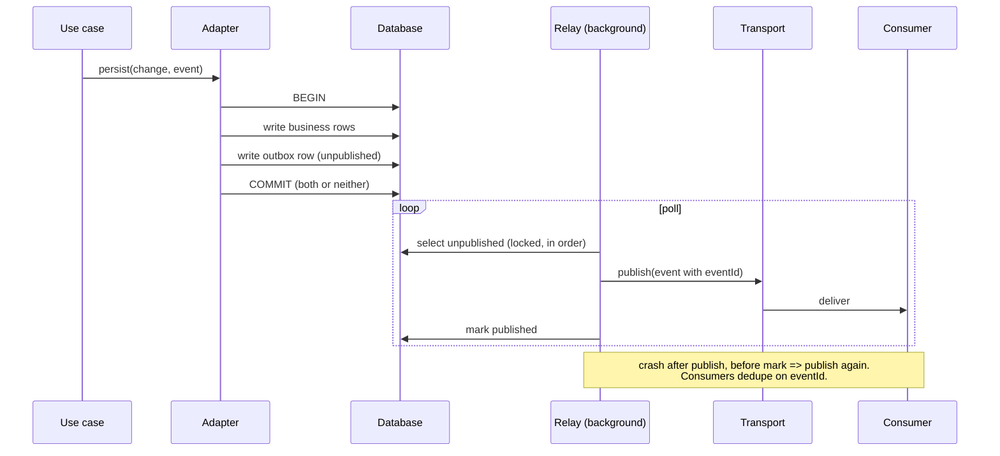

# 06. APIs, gateway, and events

- **Part of:** the Microservice Migration Playbook ([README](README.md))
- **Read this if:** you are defining what a service exposes, how browsers and other services reach it, or
  how it announces changes.
- **Rule prefixes:** `API-` (requests, contracts, gateway) and `EVT-` (events)

## 1. Three kinds of boundary

| Boundary | Style | Failure model |
|---|---|---|
| **Browser or app → edge** | HTTP through a gateway (and a BFF if there is a browser session) | Visible to the user; must degrade gracefully |
| **Service → service (query/command)** | Synchronous HTTP, ideally through the gateway or a known address, with a circuit breaker | The caller must handle the callee being down |
| **Service → anyone (fact)** | Asynchronous events through an outbox | Consumers are decoupled; delivery is at-least-once |

## 2. Rules: HTTP APIs

**API-1 — Version the path from the first release.** `/api/v1/...`. Within a version, change **only
additively**; a breaking change is a new version and a superseding decision.
*Why:* clients cannot all upgrade at once. A versioned path is the cheapest way to let old and new coexist.

**API-2 — Contract types are explicit, separate from the domain, and pinned by tests.**
One named request type and one named response type per operation. A serialization test asserts the exact
field names.
*Why:* the contract is a promise (ARC-7); a silent rename should fail a test.

**API-3 — Use the full status vocabulary correctly.**

| Situation | Status |
|---|---|
| Created | 201 with a `Location` header |
| Malformed or invalid input | 400 with per-field errors |
| Not authenticated | 401 |
| Not permitted | 403 |
| Does not exist | 404 |
| State conflict (stale version, illegal transition, duplicate) | **409**, not 400 |
| Unexpected failure | 500 with a generic problem body |

*Why:* a conflict reported as "bad request" tells the client to fix input that is fine, and breaks retry
logic. (The source project returned conflicts as 400; it is on the fix list.)

**API-4 — One error body shape for every failure.** Use a standard problem-details format
(type, title, status, detail, per-field `errors`). A **global handler** shapes anything the endpoint did not
anticipate and **logs it**; it never returns stack traces or internal messages.
*Why:* clients write one error parser. Leaking internals is a security finding (SEC-12).

**API-5 — Make creating commands idempotent.**
Accept an `Idempotency-Key` header; store key → result for a defined window (for example 24 hours) in an
owned table; return the original result on a repeat.
*Why:* networks retry. Without it a timeout followed by a retry registers the same person twice. Pair with
"never report failure after a commit" (EVT-15).

**API-6 — Paginate, sort, and filter on the server from the first list endpoint.**
Define a default page size and a maximum. Never ship a whole-collection endpoint "for now".
*Why:* it is a contract change to add later, and a list that works at 50 rows fails at 500,000. (The source
project shipped a whole-list endpoint and recorded it as a finding.)

**API-7 — Routes use your opaque public identity, not legacy keys.**
`/patients/{uuid}`, not `/patients/{legacyNumber}`.
*Why:* legacy numbers are guessable, non-unique, and leak ordering (DOM-6).

**API-8 — Never accept the acting user's identity from the request.**
The acting user comes from the **verified caller context** supplied by the edge (SEC-4). Remove any
"createdBy" field from bodies once the context exists.
*Why:* a client-supplied actor is a forgery vector and makes the audit trail worthless.

**API-9 — The API description is generated, accurate, and tested.**
- Declare the **security scheme** on every operation that needs it (an undocumented gate is invisible to
  clients and to "try it" tools).
- Surface **validation constraints** (min/max length, ranges, formats) from your declarative validation
  into the schema. Test it against the **real generated document**.
- Be aware of lossy numeric attributes (a range bound declared as a floating-point maximum loses precision;
  omit a bound that is only a "must be positive" idiom rather than publish a wrong one).
- **Commit a snapshot** of the document and have CI **regenerate and diff** it, failing on drift (OPS-12).
*Why:* the description is the contract clients generate code from. An untested one rots.

**API-10 — Generate typed clients from the committed snapshot, into their own module.**
The client module has no reference to the API module, takes its base address from the caller, and each
dependency gets its **own** `HttpClient` and **own** circuit breaker.
*Why:* one dependency's outage must not trip another's breaker. Two generated clients may emit classes with
the same name (an `ApiException`); alias or namespace-qualify at the call site.

**API-11 — Standards-based APIs live in an adapter, built on a real library, with vendored profiles.**
For an interchange standard (for example a health data standard):
- Use the standard's reference library for the **model** and **validation**; do not hand-roll the resource
  shape. (The source project hand-rolled it, shipped a wrong coded-value type, and later replaced it.)
- Choose library versions **empirically**: confirm that model and validator generations are compatible by
  running them; do not trust release notes.
- **Vendor** the standard's profile packages into the repository and load them at startup, so the service is
  deterministic and offline, with no runtime registry dependency.
- Content-address any extracted cache by the package's hash, so a changed package invalidates it.
- Translate between the standard's wire vocabulary and the domain at **one** mapper (DOM-14).
- Expect the generated API description for polymorphic resources to be untyped; clients deserialize
  themselves.
*Why:* a standard is a moving, detailed target. The library already encodes thousands of rules.

**API-12 — Responses are allow-lists.** A response type includes exactly the fields intended; sensitive
fields (national ids, secrets) are excluded by construction, not by hope.
*Why:* serializing the domain or storage object leaks every field, including ones added later.

**API-13 — Uploads: limit twice, prefer multipart for large files.**
Cap size at the edge (cheap rejection) **and** in the domain (invariant, DOM-11). Base64 inflates size by
about a third and holds the whole payload in memory; use streaming multipart beyond small files, and
reconcile the edge and domain limits so they agree.

## 3. Rules: gateway and edge

**API-14 — One external origin; the gateway routes by specific path prefixes.**
Browser, session cookie, and static frontend share one origin so cookies work without loosening same-site
rules or adding cross-origin configuration. Make routes **more specific than catch-alls** so precedence
resolves them regardless of registration order, rather than excluding paths by pattern.

**API-15 — The gateway is the only caller of backend services; backends publish no host port.**
*Why:* a published port lets the gate be bypassed entirely.

**API-16 — The gateway's trust header is per-cluster, removed from inbound traffic, then set.**
For each backend that requires a shared secret, the gateway **first deletes** any inbound copy of that
header, **then** sets its own, **only on requests routed to that cluster**.
*Why:* otherwise a client can send the header, or the secret reaches services that must not hold it.
*And remember:* a shared secret proves the call came through the gateway; it does **not** prove a user is
signed in. The gateway MUST also enforce authentication for protected routes (SEC-2).

**API-17 — Preserve what downstreams need.**
Forward the original `Host` where a downstream compares it to a registered redirect address; forward the
client address and scheme; terminate TLS at the gateway and have trusted downstreams read forwarded headers
from **only** the gateway's network.
*Why:* a downstream that sees the gateway's internal host or scheme builds wrong redirects, flags, and
rate-limit keys.

**API-18 — A browser-session proxy has at most two upstreams: the legacy system and the gateway.**
Do not grow the BFF's route table per service.
*Why:* it turns the BFF into a gateway by accretion and pre-empts the real gateway's design.

## 4. Rules: events

### The outbox pattern



**EVT-1 — Any event that must not be lost goes through a transactional outbox.**
The event row commits **in the same local transaction** as the business change.
*Why:* writing the change and then publishing is two operations that can half-succeed. The outbox turns
"publish" into "record in the same transaction, deliver later". This is also why [KD-2](01-principles-and-decision-framework.md#kd-2--where-does-the-data-live)
keeps the outbox in the same database as the business data.

**EVT-2 — Every event has a standard envelope.**

```json
{
  "eventId": "uuid",              // unique; consumers dedupe on this
  "eventType": "PatientRegistered",
  "schemaVersion": 1,
  "occurredAt": "2026-11-16T09:30:00Z",
  "subject": "uuid of the aggregate",
  "actor": "verified user id or 'system'",
  "correlationId": "uuid, ties the whole workflow",
  "causationId": "uuid of the command or event that caused this",
  "payload": { }
}
```
*Why:* without an id and a version, consumers cannot dedupe or evolve. (The source project's only event had
neither, and so could not be consumed safely.)

**EVT-3 — Delivery is at-least-once; consumers MUST be idempotent on `eventId`.**
Record processed ids (or make handlers naturally idempotent).
*Why:* exactly-once delivery is not available across a network; idempotent handling gives the *effect* of
exactly-once.

**EVT-4 — Preserve order per subject, not globally.**
The relay processes in id order and never lets a later event for the same subject overtake a failing
earlier one; it may continue with other subjects.
*Why:* global ordering is expensive and unnecessary; per-aggregate ordering is what consumers need.

**EVT-5 — Payloads are curated and minimal.**
Include what consumers need and no sensitive data without a reason; prefer an identifier plus a few stable
fields to a copy of the row. Document the privacy classification of each field.
*Why:* an event is a public contract and a data-copy.

**EVT-6 — Version events additively.**
Add fields; never repurpose them. A breaking change publishes both versions during a transition window.

**EVT-7 — The relay is a real component with a defined failure model.**
- Select a batch of unpublished rows in order, **locked** so two instances never take the same row
  (skip-locked semantics).
- Publish; on success set `publishedAt`. On failure, increment attempts, record the error, schedule the next
  attempt with **exponential back-off**.
- After a maximum number of attempts, mark the row **dead** and alert; never silently drop it.
- A retention job purges old published rows.
*Why:* an outbox with no relay is a table. (The source project's exit criterion said "the event is
published exactly once", while nothing read the table. **Built means it works end to end**, P-10.)

**EVT-8 — Put the transport behind a port.**
`EventPublisher.publish(envelope)`. Choose a broker when a second consumer exists; use a direct HTTP call
only as a stopgap for one consumer; **never** let consumers read the outbox table directly (that shares the
database and defeats service ownership).
*Why:* the relay, envelope, and idempotency rules are identical regardless of transport, so build them now
and decide the transport later.

**EVT-9 — Every state-changing command emits its event in the same transaction.**
Not just the first slice's command.
*Why:* a consumer that sees "created" but never "changed" holds stale data. (In the source project only
registration emitted; insurance and directive changes opened their own transactions and wrote nothing.)

**EVT-10 — Contract-test events consumer-first.** The consumer's expectations become a test the producer
runs.
*Why:* it catches the breaking change at the producer's build, not in production.

**EVT-11 — Distinguish internal reactions from integration events.**
Some follow-up work (recomputing a score) is an *internal handler* of an event, run by the relay in the
same service; other events go to other services.

**EVT-12 — The outbox is not the audit trail.** Outbox rows are purged and carry curated payloads; keep a
separate append-only audit (SEC-9).

**EVT-13 — Events identify subjects by opaque identity** (DOM-6), never by legacy numeric keys alone;
include the correlation key where consumers need to join to legacy.

**EVT-14 — Cross-service multi-step changes use a saga, and wait for their participants.**
Do not reach into another service's tables. A bulk operation that legacy does non-transactionally across
many tables (a merge) is **deferred** until the owning services exist and a compensation strategy is
designed (KD-8).

**EVT-15 — Never report failure after a commit.**
Anything done **after** the transaction commits in the request path (scoring, notifications) must not be
able to change the response. Either make it an event handler (EVT-11) or contain and log its failure.
*Why:* the source project's registration committed, then ran scoring inline; a scoring error returned 500
for a created patient, and the retry created a duplicate.

## 5. Sync or async? A decision table

| Question | If yes |
|---|---|
| Does the caller need the answer to proceed? | Synchronous |
| Is it "this happened" and more than one party may care? | Event |
| Must the producer keep working while the consumer is down? | Event |
| Is it a multi-step change across services? | Saga over events |
| Is latency under a tight budget and the data small and stable? | Synchronous query, with caching |

## 6. Checklist: new endpoint

- [ ] Versioned path; opaque identity in the route.
- [ ] Request and response types named and pinned by a serialization test.
- [ ] Shape validation at the edge; domain validation with the same messages.
- [ ] Status codes per API-3; conflicts are 409.
- [ ] Error body is the standard shape; unknown errors hit the global handler.
- [ ] Creating commands accept an idempotency key.
- [ ] List endpoints are paginated.
- [ ] No actor field in the body (SEC-4).
- [ ] Security scheme and constraints appear in the generated description; snapshot regenerated.
- [ ] Authentication required by default on the route group.
- [ ] If it changes state: its event is written in the same transaction (EVT-9).
- [ ] No post-commit work can change the response (EVT-15).

## 7. Checklist: new event

- [ ] Past-tense name; envelope fields present; schema version set.
- [ ] Curated payload; privacy reviewed.
- [ ] Written in the same transaction as the change.
- [ ] Relay delivers, retries with back-off, dead-letters, purges.
- [ ] Consumer is idempotent on `eventId`.
- [ ] A contract test exists on the consumer's expectations.
