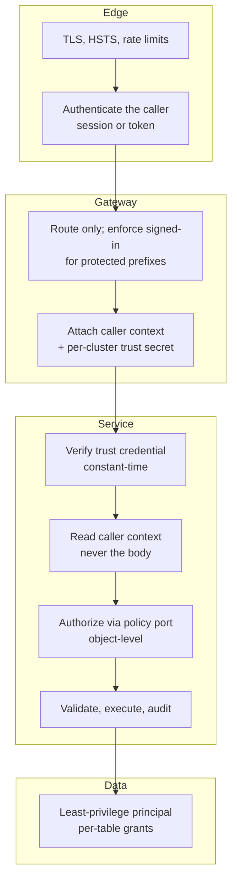
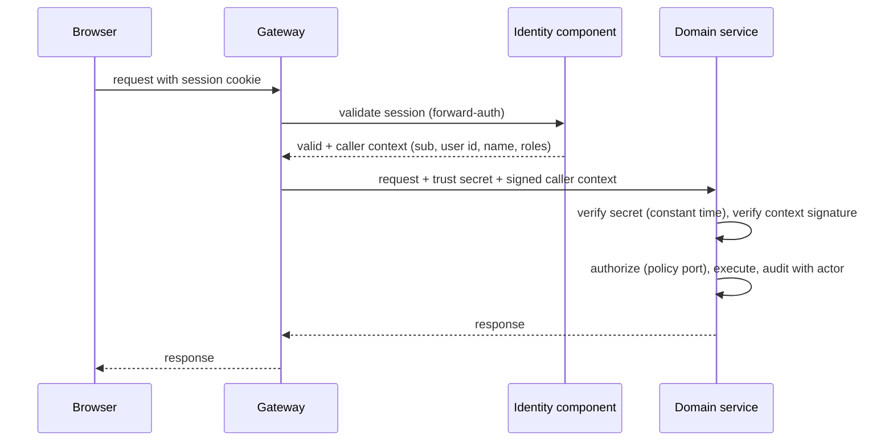

# 07. Security and compliance

- **Part of:** the Microservice Migration Playbook ([README](README.md))
- **Read this if:** you are about to expose a service to any caller, or you are reviewing one that is.
- **Rule prefix:** `SEC-`
- **Scope:** how a *domain service* is secured and how it consumes an identity. Migrating the login system
  itself is a separate problem (see `docs/legacy-auth-migration-handbook.md`).

## 1. The security posture in one paragraph

Every request is **authenticated** at the edge, **attributed** to a verified person or system, **authorized**
against a policy, **validated**, **executed with the least database privilege that works**, **recorded** in
an append-only audit, and **never logged** in a way that leaks the data it handled. Anything not explicitly
allowed is denied. Configuration that would weaken any of this stops the service from starting.

> **The honest headline from the source project.** The service's gate checked only *"did this call come
> through the gateway?"* The gateway attached the shared secret to **every** request, so the patient API was
> reachable by anyone, **signed in or not**. The acting user was whatever the client typed into the body.
> There was no authorization and no audit. A user interface was built on top before this was closed. The
> rules below exist so that sequence cannot repeat. ([12](12-lessons-learned.md), L-1 to L-4)

## 2. The layers

Each layer assumes the one before it **might have failed**. The service does not trust the gateway to have
done authorization; the database user does not trust the service to be bug-free.

## 3. Rules: authentication and trust

**SEC-1 — Deny by default.**
Authentication is required on the **route group**, not on each handler; an endpoint must *opt out*
explicitly and visibly. A new endpoint added next year is protected without anyone remembering.
*Why:* the cheapest security bug is a forgotten attribute on one endpoint.

**SEC-2 — The edge MUST verify that a real user is signed in before routing to protected services.**
A shared secret between gateway and service proves provenance, **not identity**. The gateway (or a
forward-authentication step it calls) MUST reject unauthenticated requests to protected prefixes.
*Why:* this was the critical finding. Attaching the trust secret unconditionally converts a gateway into an
**open door with a credential on it**.
*Options (decide and record, KD-3):*

| Mechanism | How | Cost |
|---|---|---|
| **Forward-auth** | Gateway asks the identity component "is this session valid?" per request and routes on yes | Small; no shared keys; an extra hop (cache briefly) |
| **Shared session keys** | Gateway validates the session cookie itself | Couples gateway to the session format and keys |
| **Token validation** | Callers present a signed token the gateway validates | Needs a token on this path; best long-term |
| **Wait** | Leave as is | **Not acceptable** once any user can reach the gateway |

**SEC-3 — Service-to-service trust is explicit, scoped, and tested.**
- Backends publish **no host port** (API-15).
- Each backend requires a credential from its gateway: a shared secret in a header (constant-time
  comparison), later mutual TLS or a signed token.
- The secret is **scoped to its cluster**; the gateway deletes inbound copies before setting its own
  (API-16).
- "No credential presented" and "wrong credential presented" are distinguished in the result, and both
  deny.
*Why:* constant-time comparison stops a network-adjacent attacker learning the secret from response timing.

**SEC-4 — Identity comes from a verified caller context, never from the request body.**
Define a **caller context** (subject id, internal numeric user id where columns need one, display name,
roles/scopes) produced by the identity component, forwarded by the gateway, and read by the service. Remove
every "acting user" field from request bodies once it exists (API-8).
*Why:* a client-supplied actor is forgeable, and an audit trail built on it is fiction.
*Design early:* the source project found its session carried only an external UUID subject while the legacy
columns it had to fill were **integer foreign keys**. No lookup existed. The resolution of "external id →
internal id" is a real design question; make it an explicit decision (who owns the mapping, how it is
cached) **before** the first service writes an actor.

**SEC-5 — Authorization is a separate, injectable policy, enforced at the object level.**
A port such as `AccessPolicy.canView(caller, record)` / `canModify(...)`. Policy ownership belongs to an
authorization/identity context, not to each service. Default **deny**. Check at the **object** level
(this caller, this record, this facility), not only "is a clinician".
*Why:* authentication answers "who"; most data breaches in multi-user systems are authorization failures
("any signed-in user can open any record").

**SEC-19 — Session and token mechanics are not the service's job.**
Cookies, refresh, revocation, and logout belong to the identity component. The service validates what it is
handed and never stores a user's credentials or tokens.

## 4. Rules: data and input

**SEC-6 — Least privilege at the data layer** (LEG-6). Each service has its own principal, per-table per-verb
grants, and tests run as that principal.

**SEC-7 — Treat every input as hostile.**
- Parameterize every SQL statement; build queries only from constants and bound values (LEG-5).
- Bound everything: lengths, counts, ranges, payload sizes, page sizes (DOM-11, API-6).
- File operations: resolve the full path and reject anything outside the repository root (traversal);
  generate stored names yourself; never trust a client's file name or content type; consider malware
  scanning for uploads in regulated settings.
- Extracting archives or caches: key the destination on a **content hash**, not on a fixed predictable path
  with an "already done" marker file.
*Why:* a fixed, writable, marker-gated temp path is a stale-cache and plant-a-marker risk even when low
severity in a container.

**SEC-17 — Classify data and minimize its spread.** Mark fields by sensitivity. Exclude the most sensitive
(national identifiers, secrets) from list/summary responses, events, and logs unless a requirement exists.
*Why:* data you do not copy cannot leak from the copy.

**SEC-12 — Errors never leak internals.** The global handler returns a generic body and logs details
server-side. Validation errors name the field and rule, not the storage.

**SEC-10 — Never log credentials, tokens, request bodies, or sensitive fields.** Enforce with a test that
runs the pipeline and inspects captured log output. Log identifiers and outcomes, not content.
*Why:* logs are copied everywhere and retained long; they are the usual accidental data store.

## 5. Rules: audit and accountability

**SEC-9 — Audit is append-only, written in the same transaction, and separate from logs and events.**

| Field | Content |
|---|---|
| `at` | Instant (UTC) |
| `actor` | Verified caller subject and internal id (SEC-4) |
| `action` | Business verb (`patient.register`, `insurance.swap`) |
| `subject` | Opaque identity of the record |
| `outcome` | Success, denied, failed |
| `from` | Client address, correlation id |
| `details` | Minimal, non-sensitive: field names changed, not values (unless required) |

- Written **inside** the business transaction so a change cannot commit without its record.
- **Reads of sensitive records are audited too** (a "who looked at this record" log), where regulation or
  policy requires it.
- Not the outbox (purged, curated), not the application log (rotated, unstructured).
- Decide about the **legacy system's own audit log** (LEG-16): while legacy screens are in use, you may need
  to write it as well.
*Why:* "who changed this and when" is the first question after any incident, and for regulated data a legal
requirement. The source project recorded **nothing** for 0 of 5 commands.

## 6. Rules: transport, abuse, and configuration

**SEC-11 — TLS terminates at the gateway; HSTS on; secure cookies; trusted proxies are explicit.**
Downstreams read forwarded scheme and address only from the gateway's network (API-17).

**SEC-13 — Rate-limit unauthenticated and expensive entry points per client address**, using the *real* address
from trusted forwarded headers (otherwise every client appears as the gateway).

**SEC-14 — Fail closed on configuration.**
Required secrets and connection settings validate at startup (OPS-3). Any development convenience (a
certificate-validation bypass, a debug UI, an API explorer) **refuses to run outside Development** and is
verified by a test.

**SEC-15 — Containers are minimal and non-root.**
No published ports for backends. Run as a non-root user; if a shared volume is owned by a specific user id
with a restrictive mode, run **as that id** rather than loosening the directory.

**SEC-8 — Secrets are generated, scoped, never committed, never logged.**
- Provide an `.env.example` with names only; generate real values with a script; keep `.env` ignored.
- One secret per purpose (database principal, gateway trust, signing keys); rotate by changing config and
  re-running the idempotent provisioner (LEG-18).
- CI uses repository secrets, with throwaway fallbacks for pull-request builds only.
- Print variable **names**, never values, in CI output.

**SEC-16 — Control the supply chain.**
Pin dependency versions; fail the build on known critical vulnerabilities; scan containers; scan the
repository for secrets; verify vendored packages by hash; require two reviewers for changes to
authentication, authorization, secrets, public contracts, and migrations.

## 7. Rules: process

**SEC-18 — Test the gate itself.**
Tests prove: no credential → 401; wrong credential → 401; correct credential but no signed-in user →
rejected (once SEC-2 exists); every operation in the generated description declares the scheme; a request
body actor field is ignored or rejected; direct access to a backend port is impossible in the compose
topology.

**SEC-20 — Threat-model each service before exposing it, and again each phase.**
A one-page STRIDE pass:

| Threat | Question | Typical control |
|---|---|---|
| **S**poofing | Can a caller pretend to be a user or the gateway? | SEC-2, SEC-3, SEC-4 |
| **T**ampering | Can data change without authority or trace? | SEC-5, SEC-9, optimistic concurrency |
| **R**epudiation | Can an actor deny an action? | SEC-9 with verified actors |
| **I**nformation disclosure | What leaks via responses, logs, events, errors? | SEC-10, SEC-12, SEC-17 |
| **D**enial of service | What can one client exhaust? | SEC-13, pagination, size caps, circuit breakers |
| **E**levation of privilege | Can a low-privilege caller reach more? | SEC-5, SEC-6 |

**SEC-22 — The security gate precedes exposure.**
No user interface, public route, or external client is built against a service until SEC-1 through SEC-5
and SEC-9 are satisfied for that service, or the service is demonstrably unreachable (no route, no port).
*Why:* the cheapest time to add the gate is before a screen depends on its absence. Closing it later means
re-testing every screen.

**SEC-21 — Regulated and personal data adds duties.**
Whatever your regime (health, finance, general privacy), plan: access logging (SEC-9), minimum necessary
disclosure (SEC-17), retention and deletion rules for each store (including outbox, audit, files, and
backups), encryption in transit and at rest, a break-glass procedure that is itself audited, and a breach
response runbook. Use only **synthetic or sanitized** data in development, test, and CI.

## 8. Identity forwarding: a minimum design

**Caller-context transport:** a signed, short-lived token in a header (so the service can verify it was
produced by the gateway/identity component, not merely forwarded by anyone); or mutual TLS plus a trusted
header. Never an unsigned header on a network others can reach.

## 9. Security gates

| Gate | Before | Evidence |
|---|---|---|
| **G-A** | Any exposure of the service | SEC-1, SEC-2, SEC-3, SEC-18 tests pass |
| **G-B** | The first write endpoint | SEC-4 context, SEC-6 least privilege, SEC-9 audit |
| **G-C** | The first user interface | G-A, G-B, SEC-5 policy |
| **G-D** | Production | SEC-8 secrets, SEC-16 scans, SEC-20 threat model, SEC-21 data duties, rollback tested |

## 10. Checklist: security review

- [ ] Every route group requires authentication; opt-outs are explicit and listed.
- [ ] The edge rejects unauthenticated callers for protected prefixes; the secret alone is not the gate.
- [ ] Backends publish no host port; the trust header is deleted-then-set per cluster.
- [ ] Constant-time secret comparison; absent vs wrong credential both deny.
- [ ] No actor field in any request body; caller context is verified.
- [ ] An authorization policy port exists; default deny; object-level checks.
- [ ] Database principal is per-service, per-table, per-verb; tests run as it.
- [ ] All SQL parameterized; all sizes bounded; file paths contained.
- [ ] Responses are allow-lists; sensitive fields excluded.
- [ ] Global error handler; no internals in responses.
- [ ] Logs hold no credentials, bodies, or sensitive fields (tested).
- [ ] Audit is append-only, transactional, includes verified actor; sensitive reads audited.
- [ ] Rate limits on unauthenticated and expensive routes; real client address used.
- [ ] Startup refuses missing secrets and dev bypasses outside Development (tested).
- [ ] Container non-root; volume ids matched; no published backend port.
- [ ] Dependencies pinned and scanned; secrets scanned; vendored packages hashed.
- [ ] Threat model exists and is dated; data-duty plan exists for regulated data.
