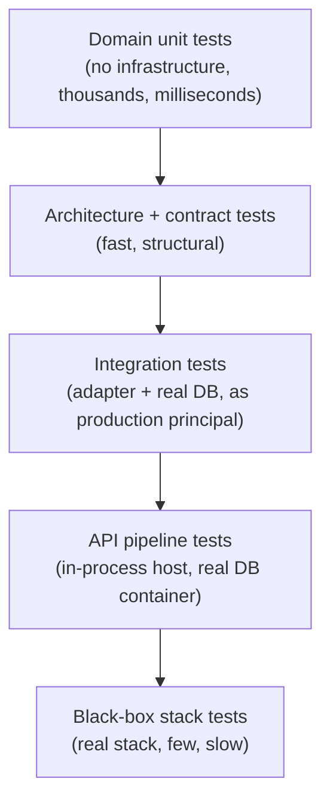

# 08. Quality and testing

- **Part of:** the Microservice Migration Playbook ([README](README.md))
- **Read this if:** you are deciding what to test and how, defining "done", or reviewing a change.
- **Rule prefix:** `QLT-`

## 1. Quality means five things here

| Attribute | Meaning | Primary mechanism |
|---|---|---|
| **Correctness** | Rules behave as the business expects | Domain tests, characterization tests |
| **Structure** | Architecture stays as designed | Architecture tests (ARC-10) |
| **Safety** | Cannot be misused or leak | Security tests, least privilege (SEC-18) |
| **Resilience** | Fails predictably, recovers | Fault tests, retry, breakers (OPS-9) |
| **Maintainability** | A stranger can change it safely | Documentation, naming, small changes, review |

## 2. The test levels

| Level | Scope | Needs | Typical size | Runs |
|---|---|---|---|---|
| **Domain unit** | One aggregate, value object, or rule | Nothing | Hundreds to thousands | Every build, first |
| **Architecture** | Module references, invariant enforcement | Compiled assemblies | Dozens | Every build, first |
| **Contract** | Serialized names, API snapshot, event shapes | The host (for the API document) | Dozens | Every build |
| **Integration (adapter)** | Repository against a real database | Disposable DB container | Dozens to hundreds | Every build |
| **API pipeline** | Real HTTP pipeline in-process | Container DB, test host | Dozens | Every build |
| **Black-box stack** | Gateway routing, login flows, smoke | The running stack | A handful | CI after stack-up |

**The shape:** most tests at the bottom, a few at the top. If your top level grows to cover business rules,
the rules are in the wrong layer.

## 3. Rules

### Structure and domain

**QLT-1 — Business rules are tested at the domain level, with no infrastructure.**
Construct, call, assert. No mocks of your own domain.
*Why:* speed and honesty. A rule that needs a database to test has a dependency it should not.

**QLT-2 — Architecture tests run in CI and fail the build.**
Layer references (ARC-10), no public constructors or setters on invariant types, serialized-name pins.
*Why:* they are the only thing that makes the architecture survive turnover.

**QLT-3 — Rule ids appear in test names.**
`PT_6_registration_requires_a_first_name`, or an attribute carrying the id.
*Why:* it answers "which legacy behavior has a test?" with a search instead of an archaeology project. (The
source project's 51 rules had no such trace.)

**QLT-5 — The invariant test's type list is maintained as part of every aggregate change.**
A new aggregate or value object is added to it in the same change.
*Why:* the test only protects the types it lists.

**QLT-6 — Test every write path to an invariant, not just one.**
If "add" and "swap" both must respect a cluster rule, each has a test that violates it. Include a test that
the *use case* uses the aggregate (not just that the aggregate works).
*Why:* the source project had a cluster rule reachable from one path only; nothing exercised the other, and a
database constraint hid the bug until a caller saw a raw error.

### Integration

**QLT-7 — Integration tests use a real engine, in a disposable container, with the legacy schema.**
- The same **engine and version** as production.
- A schema **copied from the real legacy schema, anti-patterns included** (no primary key, odd defaults).
  A "nicer" test schema proves nothing about the real mapping.
- Fresh container per test run; data isolated per test (below).
*Why:* in-memory substitutes behave differently exactly where legacy is strange.

**QLT-8 — Integration tests connect as the production principal, with exactly its grants.**
Create the principal in the fixture with the same grant script production uses (or the same statements), not
a root or owner account.
*Why:* a test that passes under a stronger account proves nothing about permissions. The source project's
fixture used a permissive account; a missing `SELECT` on a counter table was invisible until the real stack
ran ([12](12-lessons-learned.md) L-10).

**QLT-4 — Tests are deterministic and isolated; "unique" data must be unique *under the matching logic*.**
If a rule matches on a phonetic code, a prefix, or a normalization, a random suffix does not make two
values distinct under it. Randomize the leading characters (or whatever the matcher reads), or isolate each
test's data (separate patient, separate tenant, cleanup).
*Why:* a shared-state test that passes alone and fails in a crowd is a flake; the source project's
duplicate-scoring test collided through a phonetic function that read only a short prefix.

**QLT-22 — A flaky test is a bug with an owner and a date.**
Re-running to green is not a fix. Quarantine with an issue, find the shared state, fix or delete.
*Why:* a suite that cries wolf stops being read.

### API and stack

**QLT-9 — Test the real HTTP pipeline in-process.**
Boot the real host, replace only the **ports** you must (to force a failure), and assert: statuses, bodies,
the authentication gate, the global error handler, and the generated API description.
*Why:* many defects live in wiring, middleware order, binding, and serialization, which unit tests cannot
see.

**QLT-10 — A few black-box tests against the running stack prove routing and the golden path.**
Gateway routes reach the right service (not a fallback), a signed-in user can complete the main workflow,
a backend port is unreachable directly.
*Why:* these catch composition and deployment errors nothing else will.

**QLT-11 — Contracts are tests.**
- Serialized field names pinned (API-2).
- The API description snapshot regenerated and diffed in CI (OPS-12).
- Event shapes tested; consumer expectations run as the producer's tests (EVT-10).

**QLT-12 — Resilience is tested by forcing failure.**
Swap in a failing repository and assert a structured 500; make a transaction retry and assert the unit of
work replays correctly (OPS-9); trip a breaker and assert the fallback.
*Why:* retry and error paths only run under failure. Code that "works" in normal tests can throw the first
time a retry fires.

**QLT-13 — Security behaviors are tests** (SEC-18): no/wrong credential → 401, the scheme appears on every
operation, actor fields in bodies are ignored, logs contain no secrets.

### Legacy

**QLT-14 — Characterize legacy behavior with real data before you replace it.**
For each ported rule, feed the legacy system and your implementation the same inputs (from a sanitized
snapshot) and compare. Store the cases as golden tests.
*Why:* it is the only evidence of parity (KD-7), and it catches the rule you misread.

### Discipline

**QLT-15 — Say exactly what you verified.**
Distinguish *compiled*, *unit tests run*, *integration tests run*, *run against the real stack*, *checked in
a browser/device*. A note like "build-verified only; integration suite not yet run" is honest and useful;
silence is not.
*Why:* downstream decisions assume the strongest reading of "verified".

**QLT-16 — Gate on critical behavior, not on a coverage percentage.**
Measure coverage; require tests for every rule, every write path, every error mapping, and every security
behavior. A percentage target is gamed; a checklist of behaviors is not.

**QLT-17 — Static analysis and formatting are automatic.**
Formatting check, warnings-as-errors for production code, nullable/strictness enabled, no warning
suppression without a comment, an issue, and approval. Verify "unused import" cleanups by **removing and
rebuilding**, not by inspection alone.

**QLT-18 — Every change is reviewed against a checklist; sensitive areas need two approvers** (§6).
*Why:* review is where design intent, security, and data ownership get a second pair of eyes; a checklist
keeps it from degenerating into a style pass.

**QLT-19 — Run the layered six-dimension review at each slice or milestone** (§4), with grounded evidence,
and record the findings.
*Why:* it found real defects in this project that tests had not (a bypassed aggregate, a lossy numeric
bound, a predictable cache path).

**QLT-20 — A slice has a written definition of done, and "done" means all of it** (§5).
*Why:* "done except docs and deployment" is how gaps become permanent.

**QLT-21 — Performance has sanity checks, not just feelings.**
Watch for N+1 query patterns (count queries per request in a test), unbounded lists, and per-row lookups.
Record a baseline for any endpoint the business cares about.

**QLT-23 — For rule-dense domain code, consider property-based or mutation testing.**
Properties ("a swap twice returns the original levels", "a score is never negative") and mutation checks
find the cases example-based tests miss. Optional, but cheap where the domain is pure.

**QLT-24 — Test data is synthetic or sanitized, always.**

## 4. The layered review: six dimensions

At the end of each slice or milestone, review each layer against six dimensions with **grounded evidence**
(read the code, run the tests), record findings, and either fix or track each. A score is a conversation
starter; the findings are the product.

| Dimension | Ask | Evidence |
|---|---|---|
| **Clean architecture** | Does anything depend outward? Does the model echo wire or storage vocabulary? Is a "port" really a port? | Layer tests; read imports; read names |
| **Documentation** | Does every public type say *why*, citing the legacy source where a rule is ported? Are caveats applied consistently? | Read comments; grep for repeated caveats |
| **Security** | Is every SQL call parameterized? Are limits enforced in the domain? Any predictable paths or caches? | Read every call site, not just risky ones |
| **DDD** | Are aggregates real (invariants, clusters)? Are read models separate? Do all paths use the aggregate? | Model review; path-per-test |
| **SOLID / design** | Duplicated orchestration? Dead code? Open-closed pain that actually bites? | Grep; cost-benefit before refactoring |
| **Resilience / fail-fast** | Retries correct inside transactions? Global error shaping? Startup validation? | Fault tests; start with a missing secret |

**Discipline for the review itself:**
- Decide *with the owner* whether to fix, track, or accept a finding. Do not silently "fix" a theoretical
  violation that never bites (for example an enumeration that needs a `switch` edit per new value but is a
  legacy-fixed closed set). Record "reviewed, left as is, because".
- Fixing one finding often exposes a latent one (routing a path through the aggregate revealed an
  unforgiving date read). Re-run the relevant dimension after a fix.
- Record the review (date, findings, outcome) in a notes file; link it from the decision records.

## 5. Definition of Done: a slice

A slice is done only when **all** are true.

- [ ] Rules ported and listed with ids and legacy citations; new rules marked *(new)* with a decision.
- [ ] Domain unit tests for every rule and every path (QLT-1, QLT-3, QLT-6).
- [ ] Architecture tests pass; invariant list updated (QLT-2, QLT-5).
- [ ] Adapter integration tests against a real DB as the production principal (QLT-7, QLT-8).
- [ ] API pipeline tests: statuses, validation, auth gate, error shape (QLT-9, QLT-13).
- [ ] Contract artifacts updated: serialized names, API snapshot, event shape (QLT-11).
- [ ] Failure behavior tested: a forced failure and, if transactional, the retry path (QLT-12).
- [ ] Security checklist ([07](07-security-and-compliance.md) §10) satisfied for the new surface.
- [ ] Event written in the same transaction for every state change (EVT-9).
- [ ] Container, provisioning, configuration, and gateway route updated; stack boots (OPS-1, OPS-2).
- [ ] Decision record(s), glossary, ownership matrix, findings register, roadmap, and changelog updated in
      the same change (P-13).
- [ ] The verification level is stated (QLT-15).

## 6. Code review checklist

**Correctness**
- [ ] Do all paths go through the aggregate? Is every error mapped?
- [ ] Are time and randomness injected? Are new rules cited?

**Architecture**
- [ ] Right layer for each type? New dependency allowed by the layer test?
- [ ] Does the domain echo wire or storage terms?

**Security and privacy**
- [ ] Authentication on by default? Actor from the verified context? Responses allow-listed?
- [ ] SQL parameterized? Sizes bounded? Logs clean? Audit written?

**Data**
- [ ] Mapping tested at the encoding level? Tolerant reads? Concurrency token on updates?
- [ ] Grants updated and commented? Tests run as that principal?

**Operations**
- [ ] Config validated at start? Health and logs adequate? Rollback described in the PR?

**Maintainability**
- [ ] Names from the glossary? Comments explain *why*? Small enough to review as one thing?

Two approvals for: authentication, authorization, secrets, public contracts, database migrations, patient or
financial data paths, production procedures.

## 7. Test fixtures that earn their keep

| Fixture | Contents | Pitfall to avoid |
|---|---|---|
| **Database container** | Real engine/version, legacy-shaped schema, production principal, seed data | Using the root account; a cleaned-up schema |
| **API host** | Real pipeline with the service's configuration set to test values | Faking the gate; skipping the error handler |
| **Failing port** | An implementation of a port that throws | Mocking the wrong layer |
| **Captured log provider** | Collects log lines for assertion | Forgetting to assert absence of secrets |
| **Fake legacy/other service** | An HTTP stub for outbound calls | Fake that is more forgiving than the real one |

## 8. Anti-patterns

| Anti-pattern | Why it hurts |
|---|---|
| Tests that need the whole stack to check a rule | Slow, flaky, and the rule is in the wrong layer |
| "Nicer" test schema than production | Mapping bugs survive |
| Test principal stronger than production | Permission bugs survive |
| Re-running a flaky test until green | The suite loses authority |
| Asserting on implementation (call counts) | Refactors break tests that guard no behavior |
| One mega-fixture shared across unrelated suites | Hidden coupling and ordering bugs |
| Testing only the happy path | Failure behavior is where the incidents are |

## 9. Success measures (track them)

Baseline early, remeasure each phase (DSC §8).

| Measure | Target |
|---|---|
| Legacy names inside Domain | 0, enforced |
| Rules with a test naming the rule id | all |
| Invariant types covered by the enforcement test | every aggregate and value object |
| State-changing commands that write their event in their own transaction | all |
| Commands whose actor is verified | all |
| Commands that write an audit entry | all |
| Integration tests run as the production principal | yes |
| Records creatable without sign-in through the edge | none |
| Open critical/high findings | 0 before production |
| Flaky tests quarantined with an owner | 0 unowned |
