# 09. Delivery and operations

- **Part of:** the Microservice Migration Playbook ([README](README.md))
- **Read this if:** you are packaging, configuring, deploying, or operating a service.
- **Rule prefix:** `OPS-`

## 1. The operating model

A service is **built reproducibly, configured from the environment, provisioned idempotently, started in a
defined order, observed continuously, and deployable and reversible in small steps.** Anything that needs a
person to remember a step is a defect waiting to happen.

## 2. Repository and build

**OPS-20 — Builds are reproducible.**
Pin the toolchain version in a checked-in file; commit dependency lock files; restore fails on error; the
legacy database for CI comes from a **versioned snapshot** (a release asset) rather than from whatever a
developer has.
*Why:* a build that depends on the machine cannot be debugged.

A suggested layout (names adapt to your stack):

```text
repo/
├── src/
│   ├── Services/<ServiceName>/        # one folder per service, with its layer modules (03)
│   ├── Gateway/                       # the edge
│   └── <Shared>/                      # legacy data mapping shared by services, if any (keep minimal)
├── tests/Services/<ServiceName>/      # mirrors src: unit, architecture, integration
├── scripts/
│   ├── setup/                         # generate env, certificates
│   ├── seeds/                         # idempotent provisioning (users, grants, tables)
│   ├── stack/                         # bring the stack up, apply credentials
│   └── dev/                           # regenerate artifacts (API snapshots)
├── docs/                              # decisions, design set, guides, changelogs
├── <stack-definition file>            # the one definition of the whole local stack
├── .env.example                       # names only
└── .github/workflows/ci.yml
```

**OPS-17 — Every repeated manual step is a script, and the scripts are documented.**
Generating an environment file, creating certificates, applying credentials to a restored legacy stack,
regenerating API snapshots, bringing the stack up. A `scripts/README` lists each with its purpose and when
to run it.
*Why:* a step that lives in someone's head is the step that is skipped on the day it matters.

## 3. Packaging

**OPS-1 — Each service has a multi-stage container build that restores before it copies.**

```text
FROM sdk-image AS build
COPY <each module's project file>  ...        # project files only, preserving folder layout
RUN restore                                   # cached until a dependency changes
COPY . ./                                     # then the sources
RUN publish --no-restore -o /out

FROM runtime-image
COPY --from=build /out .
USER <non-root>
ENTRYPOINT [...]
```

**Per-service build context needs its own ignore file.**
When a service builds with its **own folder** as the build context, a repository-root ignore file does not
apply. Without a local ignore file the build copies the host's `bin/` and `obj/` folders over the freshly
restored ones; their dependency-asset files point at the *host's* package cache, and publish fails with a
confusing "asset not found" error even though the restore genuinely succeeded.
*Why:* this cost real time in the source project; it is invisible in the container build file itself.

**Non-root, and matching volume identity.** Run as a non-root user. If a shared volume belongs to a specific
user id with a restrictive mode, run the container **as that id** rather than loosening the volume
(SEC-15).

## 4. Configuration

**OPS-3 — Configuration is typed, validated at startup, and fails fast.**
Bind each configuration section to a typed options object with required-field and range validation, and
**validate on start** so the process refuses to run with a missing database host, empty secret, or invalid
path. Never default a secret to an empty string.

```text
options Gateway:
    required Secret          // missing => startup fails
    required BaseUrl         // missing => startup fails
bind(config.section("InternalGateway")) -> options; validateOnStart()
```
*Why:* a service that starts misconfigured fails later, at a request, in production, in the middle of
someone's workflow. Failing at start surfaces it in the deploy.

**OPS-4 — Configuration comes from the environment; secrets are generated and never committed.**
Compose or the platform sets environment variables; code reads typed options only (ARC-8). Keep a
documented `.env.example` (names, defaults, meanings) and scripts that generate real values and
certificates. A single page ("configuration reference") lists every setting, its default, whether it is
secret, and which service reads it.

**OPS-13 — Defaults are conservative.**
Default environment = Production-like; ports bind to loopback; containers non-root; development UIs and
explorers only in Development; development certificate-validation bypasses refuse to run elsewhere (SEC-14).

## 5. Provisioning and data setup

**OPS-5 — Owned tables evolve through a real migration mechanism; legacy tables are never migrated by you.**
`create table if not exists` creates a table once and can never change it. Before the first change to an
owned table (outbox, audit, idempotency), adopt versioned migrations applied by the provisioning job.
Mapped legacy tables are excluded (LEG-1).

**OPS-6 — Provisioning is a one-shot, idempotent job that dependents wait for.**
It creates the principal, sets the password, applies grants, creates owned tables, seeds data. It is safe to
rerun. Dependent services declare they need it to have **completed successfully**.
*Why:* an unprovisioned database at service start is a race; a one-shot rerun on config change applies
rotated credentials without human steps.

**OPS-2 — One definition of the whole stack.**
A single compose-style file defines every service, the legacy system, the database, the provisioning jobs,
and the gateway. Rules:
- Backends publish **no host port**; only the gateway does (API-15).
- Services depend on their dependencies' **health** (not just "started") and on provisioning jobs'
  **completion**.
- Shared volumes are declared once and mounted where needed, with matching identity.
- One command brings it up from a clean checkout.

```text
service <svc>:
    build: context = service folder
    user: <id matching the shared volume>
    depends_on: database(healthy), provisioning(completed_successfully)
    environment: typed-options settings only
    # NO published ports
service gateway:
    ports: loopback only
    depends_on: <svc> ...
```

## 6. Startup, health, and ordering

**OPS-7 — Health and readiness are explicit, and startup waits for what it needs.**
- A **liveness** endpoint (process is up) and a **readiness** endpoint (dependencies reachable).
- If the service cannot be useful until the legacy system is ready, **poll the legacy readiness probe at
  startup** (bounded, with a timeout), in addition to the orchestrator's dependency ordering, so a bare
  local run and a race are both covered.
- If a service has no health endpoint, add one; do not poll something that is not the thing you want.
*Why:* orchestrators know that a container *started*, not that the system behind it is *ready*.

**OPS-19 — Audit and remove per-process state before running two instances.**
Anything held only in memory (sessions, signing keys, caches that affect correctness, generated
certificates) breaks the moment a second instance or a restart appears. Persist keys and certificates
as files/secrets, keep sessions server-side, and **actually run two instances** and a rolling deploy mid-flow
before you claim readiness.

## 7. Resilience

**OPS-8 — A global error handler shapes every unexpected failure into a structured body and logs it** (API-4).

**OPS-9 — Retrying transient faults must replay the whole unit of work, and nothing inside may depend on state that changed.**
Most data-access libraries can retry transient failures. Two traps:
1. A retrying strategy **refuses to run inside a transaction it did not open**, and fails *only when a retry
   actually fires*, not at startup, so it passes ordinary tests and breaks in production.
2. If the retried block assigns an externally visible value (a generated id) to an aggregate, a retry
   re-executes it and **throws on the second assignment**.

The pattern:

```text
result = strategy.execute(() => {          // the WHOLE unit of work is the retried block
    tx = db.begin()
    ... statements ...
    id = generatedId()
    tx.commit()
    return id                              // return data; do not mutate outside objects here
})
aggregate.assignGeneratedIdentity(result)  // exactly once, after the strategy succeeds
```
Every explicit transaction follows this shape. Read-only and implicit single-statement paths are covered
automatically. Test it by forcing a transient fault (QLT-12).

**OPS-10 — Wrap every remote dependency in a timeout and a circuit breaker, one instance per dependency.**
A breaker stops calling a dependency known to be down; a shared breaker means one dependency's outage opens
the circuit for another. Retries multiply load on a struggling dependency: use limited, back-off retries,
and only for idempotent calls.

**Graceful degradation.** Decide for each dependency: fail the request, serve stale data, or skip a
non-essential step. Write it down.

## 8. Observability

**OPS-11 — You can answer "what happened to this request?" without attaching a debugger.**

| Signal | Minimum |
|---|---|
| **Structured logs** | One line per request with method, route template, status, duration, correlation id; errors with exception type; **never** bodies or credentials (SEC-10) |
| **Correlation** | Generate or propagate a correlation id at the gateway; log it everywhere; put it in event envelopes and audit rows |
| **Health** | Liveness and readiness (OPS-7) |
| **Metrics** | Request rate/latency/error rate by route, dependency latency, relay backlog, dead-letter count, breaker state (add when there is a place to send them) |
| **Tracing** | Later; correlation ids come first |
| **Audit** | Separate (SEC-9) |

**Alert on:** error-rate and latency regressions, relay backlog growth, **any** dead-lettered event, breaker
open, startup validation failures, authentication-failure spikes.

## 9. CI/CD

**OPS-12 — CI builds the real stack and proves the contracts have not drifted.**

```mermaid
flowchart LR
    A[Checkout] --> B[Create env file<br/>from secrets or fallbacks]
    B --> C[Download legacy snapshot]
    C --> D[Start DB, restore snapshot,<br/>apply credentials]
    D --> E[Bring up the stack<br/>build + wait healthy]
    E --> F[Probe endpoints]
    F --> G[Regenerate API snapshots,<br/>git diff must be empty]
    G --> H[Restore, build<br/>warnings as errors]
    H --> I[Run all tests<br/>unit, arch, integration, black-box]
    I --> J[Always: logs on failure,<br/>tear down, upload results]
```



Rules:
- Runs on every pull request and every push to the main branch; **no direct pushes** to main.
- Uses a pinned toolchain, a clean checkout, least-privilege tokens, **no production credentials**, and
  synthetic data only.
- **Drift check:** regenerate each API description snapshot and fail on any diff (API-9). It runs *after*
  the stack is up if the generator needs the legacy system reachable.
- Prints configuration **names**, never values.
- Always dumps container logs on failure and always tears down.
- Add: formatting check, dependency vulnerability scan, container scan, secret scan, coverage publish
  ([08](08-quality-and-testing.md) QLT-16, SEC-16).
- Make **each check required** in branch protection. Do not lower a requirement because a check is
  inconvenient; record an exception instead (README: Exceptions).

## 10. Release, rollout, rollback

**OPS-14 — Every release step is small, observable, and reversible.**

| Technique | Use |
|---|---|
| **Route-level switch** | Send a path to the new service or back to legacy without redeploying code |
| **Feature flag** | Enable a behavior for a subset; disable on trouble |
| **Expand/contract** | Add new, dual-write, switch reads, remove old (LEG-20) |
| **Versioned contracts** | Old and new clients coexist (API-1, EVT-6) |
| **Small PRs, squash-merged** | One meaningful commit per change; easy to revert |
| **Backward-compatible data changes first** | Deploy the schema change that old code tolerates, then the code |

**Rollback is written before the release**, includes data written since, and is **rehearsed** at least once
for any release that changes a write path.

## 11. Data protection and continuity

**OPS-15 — Backups exist, are restorable, and are tested.**
Back up the shared database and the file volume together (they are one logical store). Test a restore on a
schedule. Define retention for every store (outbox, audit, idempotency, files, backups) and apply it.
Encrypt backups. Note the recovery objectives you can actually meet.

## 12. Operational readiness review (before production)

**OPS-16 — A short review gate, with evidence, before any production exposure.**

- [ ] Starts from a clean checkout with one command; no manual steps.
- [ ] Refuses to start with a missing/invalid configuration (tested).
- [ ] Provisioning is idempotent and gates the service.
- [ ] Health and readiness endpoints exist and are used.
- [ ] Runs as non-root; no published backend port; volumes' identities match.
- [ ] Two instances run correctly; a rolling deploy mid-flow works (OPS-19).
- [ ] Dependency failure behavior documented and tested (breaker, retry, degrade).
- [ ] Logs are structured, correlated, and clean of secrets (tested).
- [ ] Alerts exist for the signals in OPS-11.
- [ ] Backups restored successfully within the last N days.
- [ ] Rollback written and rehearsed.
- [ ] Security gate D passed ([07](07-security-and-compliance.md) §9).
- [ ] Runbook covers: restart, rotate a secret, replay the dead-letter queue, disable the new route.
- [ ] On-call knows the service and the legacy fallback.

## 13. Configuration reference template

**OPS-18 — One configuration reference lists every setting.** Setting, owning service(s), required, default,
whether it is secret, and what it means. It is updated in the same change that adds a setting (P-13).
*Why:* configuration is an API between the code and the operator, and the one that is least often
documented.

| Setting | Service | Required | Default | Secret | Meaning |
|---|---|---|---|---|---|
| `Db:Host` | service | yes | — | no | Database host |
| `Db:Password` | service | yes | — | **yes** | Principal's password |
| `Gateway:Secret` | service, gateway | yes | — | **yes** | Shared trust credential |
| `Files:Root` | service | yes | — | no | Shared volume path |

Keep it in the repository and update it in the same change that adds a setting (P-13).
