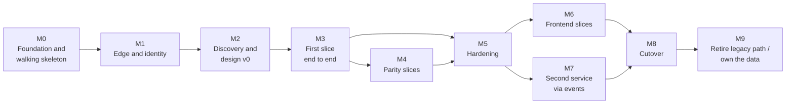
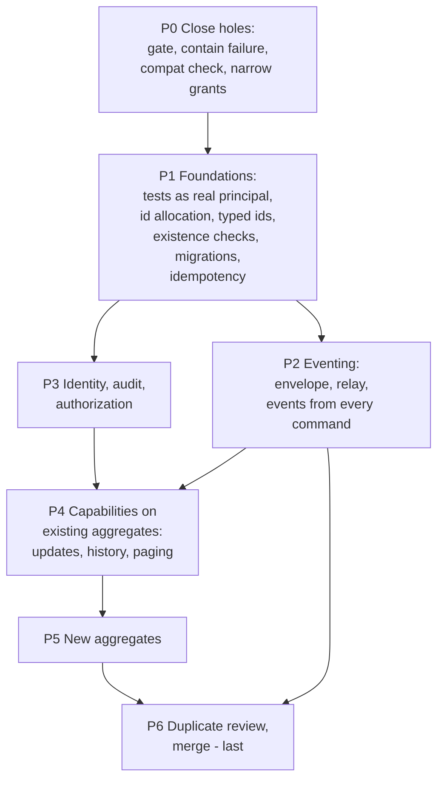

# 10. Roadmap and milestones

- **Part of:** the Microservice Migration Playbook ([README](README.md))
- **Read this if:** you are planning the order of work, defining "done" for a phase, or deciding when to
  stop.
- **Rule prefix:** `MIG-`

## 1. The shape of the journey

M4 and M5 interleave in practice: **harden before you widen** (MIG-8). M6 and M7 can overlap once M5's
security gate holds.

## 2. Rules

**MIG-1 — Build a walking skeleton before any feature.**
Repository, CI, the whole stack (including the legacy system) starting from one command, conventions, the
decision-record folder, and an empty-but-deployed service reachable through the gateway.
*Why:* the first slice should find *domain* problems, not "we cannot deploy".

**MIG-2 — Run the legacy system locally from a resettable snapshot.**
A versioned database snapshot plus its file volume, restorable in minutes; synthetic or sanitized data
only. CI uses the same snapshot.
*Why:* everything in discovery, testing, and parity depends on being able to run the real thing.

**MIG-3 — Discovery and a thin design set precede the first slice** (DSC-1).

**MIG-4 — Identity and the edge come before domain exposure.**
Authentication of users, the gateway, TLS, and the signed-in check exist before any domain endpoint is
reachable by a user (SEC-22).

**MIG-5 — Every milestone has entry criteria, exit criteria, and a decision gate.**
A gate is a point at which work may be paused or reversed: security inadequate, critical workflows not
equivalent, consistency not demonstrable, reliability regressed, operations burden exceeds the benefit,
coupling excessive, or rollback impractical.

**MIG-6 — The first slice is small, self-contained, and exercises every layer and every path.**
It must include: a domain rule with a factory, a use case, a driven adapter against the real legacy
schema, a least-privilege principal, an outbox event, an API endpoint, authentication, tests at every
level, a container, a gateway route, and the documentation updates. *Registration* (creating one thing)
is the classic choice: it touches identity allocation, validation, persistence, and events.
*Why:* a slice that skips the event path or the gateway defers the hardest integration to later and larger
work.

**MIG-7 — Every slice follows the same cycle** (section 4).

**MIG-8 — Harden before you widen.**
After the first slice and before adding more features or a user interface, close the **P0 items**: the
security gate (SEC-2), caller context (SEC-4), failure-after-commit (EVT-15), identity allocation (LEG-9),
tests as the production principal (QLT-8), and the manual legacy-compatibility check (LEG-15).
*Why:* each new slice and screen builds on the foundation; defects found later cost multiples. The source
project built a full frontend on a service whose gate was open, then wrote the finding down.

**MIG-9 — Re-estimate after discovery and again after the first slice.**
The initial estimate is a guess; the first slice's actual time per layer is the best predictor you will ever
get. Publish the new estimate.

**MIG-10 — Order slices by risk and independence, not by table size.**
Prefer: self-contained rules first (little coupling, clear parity test), then rich-rule slices, then
document/file handling, then standards APIs, then anything that changes *other* contexts' data. **Defer**
cross-service bulk operations until the participants exist (EVT-14, KD-8).

**MIG-11 — Name every stand-in's removal criterion when you build it, and delete it when met.**
A temporary token broker, a feature-flagged route, a shim: each has a written condition ("remove when no
caller uses it") and an owner. When the condition is true, remove it and everything that existed only for
it, and record the coverage you lost.
*Why:* scaffolding that outlives its purpose becomes architecture by accident.

**MIG-12 — Each milestone ends with a layered review and an updated findings register.**
Run the six-dimension review ([08](08-quality-and-testing.md) §4) on what you built, fix or track every
finding, re-baseline the success measures, and re-read the decision register for items that have become
urgent.

**MIG-13 — Frontend slices follow the backend gate.**
Pages for a capability are built after its endpoints pass security gate C ([07](07-security-and-compliance.md)
§9). Keep frontends thin: they call a **typed generated client** (API-10), hold no business rules, and show
server-provided errors faithfully.

**MIG-14 — A second service integrates by contract first.**
Agree the event and query contracts, write the consumer's expectations as tests the producer runs (EVT-10),
build the relay and envelope (EVT-2, EVT-7), then build the consumer. Do not read the producer's tables.

**MIG-15 — Cutover is staged, observable, and reversible; rollback is rehearsed before step one.**
Use the cutover template ([05](05-legacy-integration-and-data.md) §11).

**MIG-16 — Decommission only when nothing depends on the legacy path.**
Evidence: no traffic for a defined period, no other writer (LEG-8), data ownership transferred or archived,
rollback window closed. Then remove the legacy code and the compatibility shims.

**MIG-17 — Know your stop conditions.**
Decide in advance what would make you pause (the gates in MIG-5). The migration succeeds if it produces a
safer, more maintainable platform **and an honest account of what the approach does and does not deliver**.

**MIG-18 — Estimate in slices, with ranges, and say what is uncertain.**
A realistic pace for one person part-time on a first service is **months, not weeks**, and the long pole is
rarely the domain code: it is security, data integrity, eventing, and documentation.

## 3. Milestones in detail

### M0: Foundation and walking skeleton

| | |
|---|---|
| **Goal** | Anyone can clone, run everything, change something, and see CI prove it. |
| **Entry** | A decision to proceed; KD-1 and KD-2 drafted. |
| **Deliverables** | Repo with conventions, branch rules, PR template; decision-record folder and template; legacy snapshot and restore script; one-command stack; CI that builds, tests, and brings the stack up; a trivial deployed service behind the gateway; documentation index. |
| **Exit** | A trivial change goes PR → CI green → stack boots from a clean checkout. The legacy system answers a health probe in CI. |
| **Gate** | If the legacy system cannot be run reproducibly, stop and fix that. |
| **Risks** | Skipping this "to get to the real work". |

### M1: Edge and identity

| | |
|---|---|
| **Goal** | A real user can sign in through one origin; the gateway knows who they are. |
| **Entry** | M0. |
| **Deliverables** | The identity bridge or provider integration; the gateway with TLS and one external origin; session handling; rate limits; audit of login outcomes; documented identity decision. See the authentication docs in this repository. |
| **Exit** | Sign-in, silent refresh, logout, and revocation work through the gateway; no backend port is published. |
| **Gate** | Record the identity architecture decision before domain slices depend on it (KD-3). |
| **Risks** | Over-building a bridge as if it were a domain service (ARC-12); leaving a stand-in forever (MIG-11). |

### M2: Discovery and design v0

| | |
|---|---|
| **Goal** | A defensible boundary and a thin design set. |
| **Entry** | M0 (M1 may run in parallel). |
| **Deliverables** | Schema inventory; legacy behavior notes with evidence; one-pager, glossary seed, context sketch, ownership matrix, decision list (DSC-1); findings and not-verified lists started; slice order chosen (MIG-10). |
| **Exit** | The boundary is confirmed by a domain stakeholder; the first slice is chosen and described. |
| **Gate** | If the boundary is unclear (heavy two-way coupling), stay a module and revisit (KD-1). |
| **Risks** | Table-shaped boundaries (DSC-2); assuming single writer (LEG-8). |

### M3: First slice, end to end

| | |
|---|---|
| **Goal** | One real capability through every layer and into the running stack. |
| **Entry** | M2; the security gate A design exists. |
| **Deliverables** | MIG-6 in full. Service skeleton with architecture tests (03 §9); provisioning job and principal; outbox; endpoint with gate; container; route; tests at all levels; ADRs; ownership matrix updated; changelog. |
| **Exit** | Create through the gateway, see it in the legacy UI (LEG-15), the event row exists and (once built) delivers; all tests pass **as the production principal**. |
| **Gate** | If rows created here break legacy screens, stop and fix the mapping. |
| **Risks** | Reporting success after commit (EVT-15); random identifiers (LEG-9); permissive test principal (QLT-8). |

### M4: Parity slices

| | |
|---|---|
| **Goal** | The rest of the in-scope capability, one slice at a time. |
| **Entry** | M3 exit. |
| **Deliverables** | Per slice: the cycle in section 4. Order per MIG-10. |
| **Exit** | Every in-scope capability is Built, Deferred with a precondition, or Excluded, with evidence. |
| **Gate** | After each slice: the layered review (MIG-12). |
| **Risks** | A path that bypasses the aggregate (DOM-18); tolerant-read regressions (LEG-4); unbounded lists (API-6). |

### M5: Hardening

| | |
|---|---|
| **Goal** | Make what exists safe, correct, and operable. |
| **Entry** | Slices exist worth hardening; do the P0 items **before** M6. |
| **Deliverables** | **P0:** signed-in check at the edge (SEC-2); manual legacy compatibility (LEG-15); contain post-commit failure (EVT-15); narrow grants (LEG-6); decide legacy writers (LEG-8). **P1:** tests as the real principal; identity allocation; typed ids; existence checks; migration mechanism; idempotency and 409; clock rule; rule ids in test names. **P2:** envelope, relay, events from every command. **P3:** caller context, audit, access policy. |
| **Exit** | Security gates A and B pass; success measures ([08](08-quality-and-testing.md) §9) at target; no open critical or high findings. |
| **Gate** | Any critical finding blocks M6, M7, and M8. |
| **Risks** | Treating hardening as optional polish. |

### M6: Frontend slices

| | |
|---|---|
| **Goal** | People can use it. |
| **Entry** | Gate C. |
| **Deliverables** | Pages built on a typed generated client; accessibility and responsive checks; frontend tests; each page gated on sign-in as defense in depth (never the only gate). |
| **Exit** | Core workflows complete end to end by a real user through the gateway. |
| **Risks** | Placeholder identities left in forms; business rules creeping into pages. |

### M7: Second service via events

| | |
|---|---|
| **Goal** | Prove the integration model with a real consumer. |
| **Entry** | M5 events and relay built. |
| **Deliverables** | The consumer service skeleton; contract tests; idempotent consumption; a chosen transport behind the port; cross-service correlation. |
| **Exit** | A change in the first service produces the right effect in the second, exactly once in effect, under replay. |
| **Gate** | If a consumer needs to read the producer's tables, the contract is wrong. |

### M8: Cutover

| | |
|---|---|
| **Goal** | The new service is the system of record for its capability. |
| **Entry** | M5 exit; parity evidence (QLT-14); rollback rehearsed. |
| **Deliverables** | Staged routing; side-by-side comparison; legacy write path closed; monitoring and runbooks. |
| **Exit** | No writes from the legacy path for the defined period; support has no open parity defects. |

### M9: Retire the legacy path / own the data

| | |
|---|---|
| **Goal** | Finish the strangler: remove or isolate the legacy capability and, where chosen, move data ownership. |
| **Deliverables** | Expand/contract execution (LEG-20); legacy code removed; documentation retired or archived; final review and case study. |
| **Exit** | MIG-16 evidence. |

## 4. The slice cycle

Repeat for every capability. Each step has an artifact.

```mermaid
flowchart LR
    S1[1. Research<br/>legacy source, data,<br/>writers] --> S2[2. Specify<br/>rules with ids,<br/>marked new vs parity]
    S2 --> S3[3. Domain<br/>aggregate/rule +<br/>unit tests]
    S3 --> S4[4. Ports and<br/>use case]
    S4 --> S5[5. Adapter +<br/>integration tests<br/>as prod principal]
    S5 --> S6[6. API + contract<br/>+ pipeline tests]
    S6 --> S7[7. Deploy<br/>grants, config,<br/>route, container]
    S7 --> S8[8. Docs<br/>ADR, glossary,<br/>matrix, changelog]
    S8 --> S9[9. Review<br/>six dimensions]
    S9 --> S10[10. Register<br/>update findings,<br/>decisions, measures]
```

| Step | Output | Done when |
|---|---|---|
| 1. Research | Notes with evidence; writers listed | Every claim cites a file or query |
| 2. Specify | Rule catalogue rows; *(new)* items decided | Rules have ids and sources |
| 3. Domain | Aggregates, factories, rules, tests | Invariant test covers new types; all rules tested |
| 4. Ports and use case | Interfaces in domain terms; one use case per action | No technology in ports (ARC-3) |
| 5. Adapter | Repository, mapping, tolerant reads, transaction shape | Integration tests pass as the production principal |
| 6. API | Endpoints, DTOs, validation, errors, snapshot | Pipeline tests pass; snapshot diff reviewed |
| 7. Deploy | Grants, configuration, container, route | Stack boots; black-box smoke passes |
| 8. Docs | ADR(s), glossary, ownership matrix, changelog | In the same change (P-13) |
| 9. Review | Findings recorded; fixes or tracked | Dimensions reviewed with evidence |
| 10. Register | Findings, decisions, measures updated | Nothing known lives only in someone's head |

A slice that skips step 7 is not shipped; a slice that skips 8 is not understood.

## 5. Evolution phases (the hardening order)

After the first slices, a typical dependency-ordered plan (from the findings register):

**Rule of thumb:** P0 has no prerequisites and should not wait for anything. Updates (P4) need concurrency
tokens (LEG-10), idempotency (API-5), and audit (SEC-9) first; merge needs other services to exist.

## 6. Planning a timeline

| Activity | Typical share of a first service's effort |
|---|---|
| Foundation, CI, stack, identity edge | 15-20% |
| Discovery and design | 10-15% |
| Slices (domain, adapters, API, tests) | 30-35% |
| Hardening (security, integrity, events, audit) | 20-25% |
| Frontend | 10-15% |
| Documentation (in-flow, not extra) | included above; budget review time |

**These shares are planning heuristics, not measurements.** They were not tracked in the source project
(its roadmap estimated four to six months part-time for the whole vertical slice and has not yet been
re-baselined). Track your own hours per activity from the first slice; **your first slice's actual
breakdown** is the number to plan with (MIG-9).

## 7. Checklist: ready to leave a milestone

- [ ] Exit criteria are met with evidence, not assertion.
- [ ] The layered review is done; findings are fixed or tracked (MIG-12).
- [ ] The findings and decision registers are current.
- [ ] Success measures are re-baselined.
- [ ] The roadmap and changelog are updated in the same change.
- [ ] The next milestone's entry criteria are checked.
- [ ] Any decision gate has been consciously passed, not skipped.
