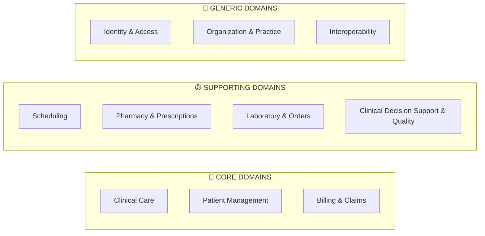

# OpenEMR → C# Microservices: Domain-Driven Design Blueprint

> [!IMPORTANT]
> This document defines the strategic DDD design for modernizing OpenEMR from a PHP monolith into a C# microservices architecture. It establishes bounded contexts, ubiquitous language, domain classifications, and inter-context relationships.

---

## 1. Strategic Domain Overview

OpenEMR is a full-featured Electronic Health Records (EHR) system. Through analysis of the legacy codebase — its 90+ services, 35+ clinical forms, FHIR R4 integration, X12 EDI billing, clinical decision support, and patient portal — we identify **10 bounded contexts** organized across three domain classifications.



---

## 2. Domain Classification Rationale

| Classification | Bounded Context | Rationale |
|---|---|---|
| 🔴 **Core** | **Clinical Care** | The heart of the EHR — encounters, clinical documentation, vitals, assessments. This is the primary differentiator and highest business value. |
| 🔴 **Core** | **Patient Management** | Patient identity, demographics, insurance enrollment, and longitudinal health record. Foundational to every clinical workflow. |
| 🔴 **Core** | **Billing & Claims** | Revenue cycle management — claim generation, EDI submission, ERA processing, payment posting. Direct revenue impact. |
| 🟡 **Supporting** | **Scheduling** | Appointment booking, calendar management, patient flow. Enables clinical workflows but not the core differentiator. |
| 🟡 **Supporting** | **Pharmacy & Prescriptions** | Medication management, e-prescribing, drug inventory. Clinically critical but can leverage external systems (e.g., Surescripts). |
| 🟡 **Supporting** | **Laboratory & Orders** | Lab/procedure ordering, result tracking, specimen management. Often integrates with external lab systems. |
| 🟡 **Supporting** | **Clinical Decision Support & Quality** | CDS rules, CQM/eCQM reporting, AMC tracking. Regulatory compliance layer. |
| 🔵 **Generic** | **Identity & Access Management** | Authentication, authorization, OAuth2/OIDC, user management. Standard infrastructure, buy-or-build. |
| 🔵 **Generic** | **Organization & Practice** | Facility management, practice settings, global configuration. Shared reference data. |
| 🔵 **Generic** | **Interoperability** | FHIR R4, CCDA, Direct Messaging, SMART on FHIR. Standards-based integration gateway. |

---

## 3. Bounded Contexts — Deep Dive

### 3.1 🔴 Clinical Care Context (`ClinicalCare.Service`)

> **Microservice**: `OpenEMR.ClinicalCare.Api`

The Clinical Care context owns the clinical encounter lifecycle — from creation through documentation to closure. It is the richest domain in the system.

#### Ubiquitous Language

| Term | Definition |
|---|---|
| **Encounter** | A discrete clinical interaction between a patient and provider at a facility. Has a class (AMB, IMP, EMER), status, and date range. Identified by encounter number. |
| **Clinical Note** | Structured or free-text documentation within an encounter (SOAP notes, progress notes). |
| **Vitals** | A set of physiological measurements (BP, heart rate, temperature, BMI, O2 sat, pain level) recorded during an encounter. |
| **Assessment** | A clinical evaluation form (PHQ-9, GAD-7, functional/cognitive status). |
| **Care Plan** | A documented plan of treatment goals and interventions for a patient. |
| **Condition** | A diagnosed medical problem, tracked as active/inactive/resolved. Maps to ICD-10. |
| **Allergy/Intolerance** | A recorded adverse reaction to a substance (drug, food, environmental). |
| **Immunization** | A vaccine administration record with lot, site, manufacturer, and VIS date. |
| **Procedure** | A clinical procedure performed during an encounter, coded with CPT/HCPCS. |
| **Clinical Form** | A data-capture template for structured encounter documentation (35+ types: SOAP, vitals, eye exam, etc.). |
| **Social History** | Lifestyle and social factors (smoking, alcohol, occupation, education). |
| **Observation** | A discrete clinical data point (lab value, social assessment, survey response). |
| **Care Team** | The group of providers responsible for a patient's care. |
| **Rendering Provider** | The clinician who directly provides care during an encounter. |

#### Aggregate Roots
- **Encounter** (root): Contains Clinical Notes, Vitals, Assessments, Procedures performed
- **Condition** (root): Patient problem list entry
- **AllergyIntolerance** (root): Allergy record
- **CarePlan** (root): Treatment plan

#### Legacy PHP Mapping

| C# Concept | Legacy PHP Source |
|---|---|
| `Encounter` aggregate | [`EncounterService`](file:///c:/Users/Mo/projects/openemr/src/Services/EncounterService.php), `form_encounter` table |
| `ClinicalNote` entity | [`ClinicalNotesService`](file:///c:/Users/Mo/projects/openemr/src/Services/ClinicalNotesService.php), SOAP forms |
| `Vitals` entity | [`VitalsService`](file:///c:/Users/Mo/projects/openemr/src/Services/VitalsService.php) |
| `Condition` aggregate | [`ConditionService`](file:///c:/Users/Mo/projects/openemr/src/Services/ConditionService.php) |
| `AllergyIntolerance` aggregate | [`AllergyIntoleranceService`](file:///c:/Users/Mo/projects/openemr/src/Services/AllergyIntoleranceService.php) |
| `Immunization` entity | [`ImmunizationService`](file:///c:/Users/Mo/projects/openemr/src/Services/ImmunizationService.php) |
| `CarePlan` aggregate | [`CarePlanService`](file:///c:/Users/Mo/projects/openemr/src/Services/CarePlanService.php) |
| `CareTeam` entity | [`CareTeamService`](file:///c:/Users/Mo/projects/openemr/src/Services/CareTeamService.php) |
| Clinical Forms | [interface/forms/*](file:///c:/Users/Mo/projects/openemr/interface/forms) (35+ form types) |

#### Domain Events Published
- `EncounterCreated`, `EncounterUpdated`, `EncounterClosed`
- `VitalsRecorded`, `ConditionDiagnosed`, `ConditionResolved`
- `AllergyRecorded`, `ImmunizationAdministered`
- `ClinicalNoteDocumented`, `ProcedurePerformed`

---

### 3.2 🔴 Patient Management Context (`PatientManagement.Service`)

> **Microservice**: `OpenEMR.PatientManagement.Api`

Owns the patient's identity, demographics, contacts, insurance enrollment, and document management. This is the "patient master data" context.

#### Ubiquitous Language

| Term | Definition |
|---|---|
| **Patient** | An individual receiving healthcare services. Identified by PID (internal) and pubpid (public/MRN). Has demographics, contacts, and insurance policies. |
| **Demographics** | Core identifying information: name, DOB, sex, SSN, race, ethnicity, language, marital status. |
| **Contact** | An address, phone number, or email associated with a patient or related person. |
| **Related Person** | A person with a relationship to the patient (emergency contact, guardian, next of kin). |
| **Insurance Policy** | A patient's coverage under an insurance plan, classified as primary, secondary, or tertiary. |
| **Patient Issue** | A medical problem, allergy, medication, or surgery recorded on the patient's issue list. |
| **Patient Document** | A stored file (scanned document, lab report, image) in the patient's chart. |
| **Patient Portal Credentials** | The patient's login credentials for the online patient portal. |
| **Advance Directive** | A patient's documented healthcare wishes (DNR, healthcare proxy, etc.). |
| **Patient History** | A versioned audit trail of demographic changes. |
| **Employer** | The patient's employer information, often required for workers' comp or insurance. |

#### Aggregate Roots
- **Patient** (root): Demographics, Contacts, Related Persons, Employer
- **InsurancePolicy** (root): Coverage details, subscriber info, copay/deductible
- **PatientDocument** (root): Document metadata, categories, storage

#### Legacy PHP Mapping

| C# Concept | Legacy PHP Source |
|---|---|
| `Patient` aggregate | [`PatientService`](file:///c:/Users/Mo/projects/openemr/src/Services/PatientService.php), `patient_data` table |
| `InsurancePolicy` entity | [`InsuranceService`](file:///c:/Users/Mo/projects/openemr/src/Services/InsuranceService.php) |
| `PatientDocument` aggregate | [`DocumentService`](file:///c:/Users/Mo/projects/openemr/src/Services/DocumentService.php) |
| `RelatedPerson` entity | [`DemographicsRelatedPersonsService`](file:///c:/Users/Mo/projects/openemr/src/Services/DemographicsRelatedPersonsService.php) |
| `PatientHistory` | [`PatientNameHistoryService`](file:///c:/Users/Mo/projects/openemr/src/Services/PatientNameHistoryService.php) |
| `Employer` | [`EmployerService`](file:///c:/Users/Mo/projects/openemr/src/Services/EmployerService.php) |
| `AdvanceDirective` | [`PatientAdvanceDirectiveService`](file:///c:/Users/Mo/projects/openemr/src/Services/PatientAdvanceDirectiveService.php) |
| Portal credentials | [`PatientPortalService`](file:///c:/Users/Mo/projects/openemr/src/Services/PatientPortalService.php), [`PatientAccessOnsiteService`](file:///c:/Users/Mo/projects/openemr/src/Services/PatientAccessOnsiteService.php) |

#### Domain Events Published
- `PatientRegistered`, `PatientDemographicsUpdated`
- `InsurancePolicyEnrolled`, `InsurancePolicyTerminated`
- `DocumentUploaded`, `PortalCredentialsIssued`

---

### 3.3 🔴 Billing & Claims Context (`BillingClaims.Service`)

> **Microservice**: `OpenEMR.BillingClaims.Api`

The revenue cycle management context — transforms clinical encounters into billable claims, processes EDI transactions, and manages payments.

#### Ubiquitous Language

| Term | Definition |
|---|---|
| **Claim** | A formal request for payment submitted to an insurance payer for services rendered. Contains procedures, diagnoses, and provider/facility information. |
| **Fee Sheet** | The encounter-level billing worksheet where CPT/HCPCS codes and ICD-10 diagnoses are captured. |
| **Billing Encounter** | The billing view of a clinical encounter — includes billing status, payer assignment, and line items. |
| **Line Item** | A single billable service on a claim, coded with CPT/HCPCS, modifiers, units, and fee. |
| **Payer** | An insurance company or entity responsible for claim adjudication. Classified as primary, secondary, or tertiary. |
| **X12 Partner** | A clearinghouse or direct payer connection for EDI submission. |
| **EDI Transaction** | An electronic data interchange file (837P professional, 837I institutional, 270/271 eligibility, 835 ERA). |
| **ERA (Electronic Remittance Advice)** | An 835 transaction from a payer detailing payment, adjustments, and denials per claim line. |
| **Payment** | Money received from a payer or patient, posted against claim line items. |
| **Adjustment** | A modification to a charge — contractual write-off, denial, patient responsibility. Has a group code and reason code. |
| **HCFA 1500** | The standard paper claim form for professional services. |
| **UB-04** | The standard paper claim form for institutional/facility services. |
| **Copay** | The patient's fixed out-of-pocket cost per visit, collected at time of service. |
| **Prepayment Balance** | Patient credit balance from advance payments. |
| **Day Sheet** | A daily financial summary of charges, payments, and adjustments. |
| **Superbill** | A pre-populated encounter form listing common CPT codes for a practice. |
| **Billing Batch** | A group of claims submitted together in a single EDI transmission. |

#### Aggregate Roots
- **Claim** (root): Line Items, Diagnoses, Adjustments, Payer assignments
- **Payment** (root): Payment allocations to claim line items
- **BillingBatch** (root): Batch of claims for EDI submission

#### Legacy PHP Mapping

| C# Concept | Legacy PHP Source |
|---|---|
| `Claim` aggregate | [`Claim`](file:///c:/Users/Mo/projects/openemr/src/Billing/Claim.php) (2440 lines!) |
| `BillingProcessor` | [`BillingProcessor`](file:///c:/Users/Mo/projects/openemr/src/Billing/BillingProcessor/BillingProcessor.php) |
| EDI 837 generators | [`GeneratorX12`](file:///c:/Users/Mo/projects/openemr/src/Billing/BillingProcessor/Tasks/GeneratorX12.php), [`X125010837P`](file:///c:/Users/Mo/projects/openemr/src/Billing/X125010837P.php) |
| ERA processing | [`ParseERA`](file:///c:/Users/Mo/projects/openemr/src/Billing/ParseERA.php) |
| Payment gateway | [`PaymentGateway`](file:///c:/Users/Mo/projects/openemr/src/Billing/PaymentGateway.php), [`PaymentProcessing`](file:///c:/Users/Mo/projects/openemr/src/PaymentProcessing/PaymentProcessing.php) |
| HCFA 1500 | [`Hcfa1500`](file:///c:/Users/Mo/projects/openemr/src/Billing/Hcfa1500.php), [`HCFAInfo`](file:///c:/Users/Mo/projects/openemr/src/Billing/HCFAInfo.php) |
| Day Sheet | [`DaySheetAggregator`](file:///c:/Users/Mo/projects/openemr/src/Billing/DaySheet/DaySheetAggregator.php) |
| Prepayment | [`PrepaymentBalanceService`](file:///c:/Users/Mo/projects/openemr/src/Billing/PrepaymentBalanceService.php) |
| Invoice | [`InvoiceSummary`](file:///c:/Users/Mo/projects/openemr/src/Billing/InvoiceSummary.php) |
| EDI History | [`EdiHistory/*`](file:///c:/Users/Mo/projects/openemr/src/Billing/EdiHistory) |

#### Domain Events Published
- `ClaimCreated`, `ClaimSubmitted`, `ClaimAdjudicated`
- `PaymentPosted`, `AdjustmentApplied`
- `ERAReceived`, `ERAProcessed`
- `BatchSubmitted`, `BatchAcknowledged`

---

### 3.4 🟡 Scheduling Context (`Scheduling.Service`)

> **Microservice**: `OpenEMR.Scheduling.Api`

Manages appointment booking, provider availability, calendar events, patient flow tracking, and appointment reminders.

#### Ubiquitous Language

| Term | Definition |
|---|---|
| **Appointment** | A scheduled time slot for a patient visit with a provider at a facility. Has a category, status, and duration. |
| **Calendar Event** | A time-based entry on a provider's calendar (appointment, block, meeting). Stored in `openemr_postcalendar_events`. |
| **Appointment Category** | A classification of appointments (office visit, new patient, telehealth, group therapy). |
| **Appointment Status** | The lifecycle state: scheduled → checked-in → in-exam → checked-out → complete. Also: no-show, cancelled, rescheduled. |
| **Provider Schedule** | A provider's recurring availability template (office hours, blocked times). |
| **Patient Tracker** | Real-time tracking of patient flow through the clinic (waiting room → exam room → checkout). |
| **Recurring Appointment** | An appointment pattern that repeats on a schedule (weekly, monthly). |
| **Reminder** | An automated notification sent to a patient about an upcoming appointment (SMS, email, phone). |
| **No-Show** | When a patient fails to appear for a scheduled appointment. |

#### Aggregate Roots
- **Appointment** (root): Status history, recurrence rules, reminders
- **ProviderSchedule** (root): Availability slots, blocked times

#### Legacy PHP Mapping

| C# Concept | Legacy PHP Source |
|---|---|
| `Appointment` aggregate | [`AppointmentService`](file:///c:/Users/Mo/projects/openemr/src/Services/AppointmentService.php), `openemr_postcalendar_events` table |
| Calendar events | [`PostCalendar`](file:///c:/Users/Mo/projects/openemr/src/PostCalendar) |
| Patient tracker | [`PatientTrackerService`](file:///c:/Users/Mo/projects/openemr/src/Services/PatientTrackerService.php) |
| Reminders | [`Reminder`](file:///c:/Users/Mo/projects/openemr/src/Reminder) |
| MedEx messaging | [`MedEx`](file:///c:/Users/Mo/projects/openemr/library/MedEx) |
| Appointment events | [`AppointmentSetEvent`](file:///c:/Users/Mo/projects/openemr/src/Events/Appointments/AppointmentSetEvent.php), [`CalendarFilterEvent`](file:///c:/Users/Mo/projects/openemr/src/Events/Appointments/CalendarFilterEvent.php) |

#### Domain Events Published
- `AppointmentBooked`, `AppointmentCancelled`, `AppointmentRescheduled`
- `PatientCheckedIn`, `PatientNoShow`
- `ReminderSent`, `PatientFlowUpdated`

---

### 3.5 🟡 Pharmacy & Prescriptions Context (`Pharmacy.Service`)

> **Microservice**: `OpenEMR.Pharmacy.Api`

Manages medication prescriptions, e-prescribing workflows, drug inventory, and pharmacy directory.

#### Ubiquitous Language

| Term | Definition |
|---|---|
| **Prescription** | A provider's order for a medication, with drug, dosage, route, frequency, quantity, and refills. |
| **Medication** | A pharmaceutical product identified by NDC code, with name, form, strength, and route. |
| **Drug** | A cataloged medication in the formulary, with pricing and inventory tracking. |
| **Dispensation** | The act of fulfilling a prescription — quantity dispensed, date, pharmacy. |
| **Pharmacy** | A licensed dispensing location where prescriptions are filled. |
| **E-Prescribe** | Electronic transmission of a prescription to a pharmacy (via Weno/Surescripts). |
| **Drug Interaction** | A clinically significant interaction between two medications. |
| **Formulary** | The list of approved/preferred medications for an insurance plan or health system. |
| **Medication Reconciliation** | The process of verifying a patient's current medication list across care transitions. |
| **Drug Sales** | Inventory dispensing records for in-office drug sales. |

#### Aggregate Roots
- **Prescription** (root): Drug, dosage instructions, refill history, dispensation records
- **DrugInventory** (root): Stock levels, lot tracking, expiration dates

#### Legacy PHP Mapping

| C# Concept | Legacy PHP Source |
|---|---|
| `Prescription` aggregate | [`PrescriptionService`](file:///c:/Users/Mo/projects/openemr/src/Services/PrescriptionService.php) |
| `Drug` entity | [`DrugService`](file:///c:/Users/Mo/projects/openemr/src/Services/DrugService.php), [`DrugSalesService`](file:///c:/Users/Mo/projects/openemr/src/Services/DrugSalesService.php) |
| Pharmacy directory | [`ImportPharmacies`](file:///c:/Users/Mo/projects/openemr/src/Pharmacy/Services/ImportPharmacies.php) |
| Rx integration | [`RxList`](file:///c:/Users/Mo/projects/openemr/src/Rx/RxList.php), [Ensora/*](file:///c:/Users/Mo/projects/openemr/src/Rx/Ensora) |
| E-prescribe module | [`oe-module-weno`](file:///c:/Users/Mo/projects/openemr/interface/modules/custom_modules/oe-module-weno) |
| Drug management UI | [interface/drugs/*](file:///c:/Users/Mo/projects/openemr/interface/drugs) |

#### Domain Events Published
- `PrescriptionCreated`, `PrescriptionSigned`, `PrescriptionTransmitted`
- `MedicationDispensed`, `DrugInteractionDetected`
- `InventoryAdjusted`, `DrugExpiring`

---

### 3.6 🟡 Laboratory & Orders Context (`LabOrders.Service`)

> **Microservice**: `OpenEMR.LabOrders.Api`

Manages clinical orders (lab tests, radiology, procedures), result tracking, specimen management, and lab integrations.

#### Ubiquitous Language

| Term | Definition |
|---|---|
| **Procedure Order** | A clinician's request for a laboratory test, imaging study, or other diagnostic procedure. |
| **Order Item** | A specific test within a procedure order (e.g., CBC, BMP, TSH). |
| **Lab Result** | The outcome data from a completed procedure order, with reference ranges and abnormal flags. |
| **Specimen** | A biological sample collected for laboratory analysis (blood, urine, tissue). |
| **Procedure Provider** | An external laboratory or imaging center that performs ordered procedures. |
| **Compendium** | A lab's catalog of available tests with ordering codes and specimen requirements. |
| **Requisition** | A printed or electronic form sent to a lab with the procedure order details. |
| **Result Status** | The lifecycle state of a result: pending → preliminary → final → corrected → cancelled. |

#### Aggregate Roots
- **ProcedureOrder** (root): Order items, specimen records, results
- **ProcedureProvider** (root): Lab/imaging center configuration, compendium

#### Legacy PHP Mapping

| C# Concept | Legacy PHP Source |
|---|---|
| `ProcedureOrder` aggregate | [`ProcedureService`](file:///c:/Users/Mo/projects/openemr/src/Services/ProcedureService.php) |
| `ProcedureProvider` | [`ProcedureProviderService`](file:///c:/Users/Mo/projects/openemr/src/Services/ProcedureProviderService.php) |
| Order relationships | [`ProcedureOrderRelationshipService`](file:///c:/Users/Mo/projects/openemr/src/Services/ProcedureOrderRelationshipService.php) |
| Lab observations | [`ObservationLabService`](file:///c:/Users/Mo/projects/openemr/src/Services/ObservationLabService.php) |
| Order forms | [interface/orders/*](file:///c:/Users/Mo/projects/openemr/interface/orders), [interface/procedure_tools/*](file:///c:/Users/Mo/projects/openemr/interface/procedure_tools) |
| Lab integrations | [`DornLabEvent`](file:///c:/Users/Mo/projects/openemr/src/Events/Services/DornLabEvent.php), [`QuestLabTransmitEvent`](file:///c:/Users/Mo/projects/openemr/src/Events/Services/QuestLabTransmitEvent.php) |

#### Domain Events Published
- `OrderPlaced`, `OrderTransmitted`, `OrderCancelled`
- `ResultReceived`, `AbnormalResultFlagged`
- `SpecimenCollected`, `SpecimenRejected`

---

### 3.7 🟡 Clinical Decision Support & Quality Context (`CdsQuality.Service`)

> **Microservice**: `OpenEMR.CdsQuality.Api`

Manages clinical decision support rules, clinical quality measures (CQM/eCQM), automated measure counting (AMC), and regulatory compliance reporting.

#### Ubiquitous Language

| Term | Definition |
|---|---|
| **Clinical Rule** | A configurable decision support rule with filter criteria, target population, and triggered actions/reminders. |
| **Rule Criteria** | Conditions that determine when a rule applies (age, sex, diagnosis, medication, allergy). |
| **Rule Action** | What happens when a rule fires (alert, reminder, intervention suggestion). |
| **CDS Alert** | A notification displayed to a clinician when a rule condition is met. |
| **Clinical Quality Measure (CQM)** | A standardized measure of healthcare quality (e.g., diabetes HbA1c control). |
| **eCQM** | An electronic CQM using the QDM (Quality Data Model) for automated calculation. |
| **Automated Measure Calculation (AMC)** | Tracking of Meaningful Use / Promoting Interoperability measures. |
| **QRDA** | Quality Reporting Document Architecture — the XML format for CQM submission. |
| **Measure Denominator** | The eligible population for a quality measure. |
| **Measure Numerator** | The subset that meets the measure criteria. |

#### Aggregate Roots
- **ClinicalRule** (root): Criteria, filters, actions, reminder intervals
- **QualityMeasure** (root): Numerator/denominator definitions, reporting periods

#### Legacy PHP Mapping

| C# Concept | Legacy PHP Source |
|---|---|
| `ClinicalRule` aggregate | [`ClinicalDecisionRules/*`](file:///c:/Users/Mo/projects/openemr/src/ClinicalDecisionRules) — Rule, RuleAction, RuleCriteria, RuleManager |
| CDS Alerts | [`CdrAlertManager`](file:///c:/Users/Mo/projects/openemr/src/ClinicalDecisionRules/Interface/RuleLibrary/CdrAlertManager.php) |
| CQM/QDM | [`Cqm/Qdm/*`](file:///c:/Users/Mo/projects/openemr/src/Cqm/Qdm) (80+ QDM data types) |
| QRDA Reporting | [`QrdaReportController`](file:///c:/Users/Mo/projects/openemr/src/Cqm/QrdaControllers/QrdaReportController.php) |
| AMC Tracking | [`AMCItemTracker`](file:///c:/Users/Mo/projects/openemr/src/Reports/AMC/Trackers/AMCItemTracker.php) |
| Real-world testing | [`RealWorldTesting`](file:///c:/Users/Mo/projects/openemr/src/Reports/RealWorldTesting.php) |

#### Domain Events Consumed
- Subscribes to `EncounterCreated`, `ConditionDiagnosed`, `PrescriptionCreated`, etc. from other contexts to evaluate rules and calculate measures.

---

### 3.8 🔵 Identity & Access Management Context (`Identity.Service`)

> **Microservice**: `OpenEMR.Identity.Api`

Handles authentication, authorization, OAuth2/OIDC, multi-factor authentication, user management, and API security.

#### Ubiquitous Language

| Term | Definition |
|---|---|
| **User** | A system user (physician, nurse, admin, billing staff) with credentials and role assignments. |
| **Practitioner** | A clinical user with professional identifiers (NPI, taxonomy code, DEA number). |
| **Role** | A named set of permissions (physician, nurse, front desk, billing, admin). |
| **ACL (Access Control List)** | Fine-grained permission assignments controlling access to features and data. |
| **OAuth2 Client** | A registered application authorized to access OpenEMR APIs. |
| **Access Token** | A time-limited JWT granting API access with specific scopes. |
| **Scope** | A permission boundary on an API token (e.g., `patient/*.read`, `user/Encounter.write`). |
| **MFA** | Multi-factor authentication (TOTP, U2F) for enhanced login security. |
| **Patient Portal User** | A patient with portal credentials for self-service access. |
| **Audit Log** | An immutable record of user actions for compliance and forensics. |
| **Trusted User** | A pre-approved user with elevated API access (e.g., for system integrations). |

#### Aggregate Roots
- **User** (root): Credentials, role assignments, MFA configuration
- **OAuthClient** (root): Client registration, scopes, grant types

#### Legacy PHP Mapping

| C# Concept | Legacy PHP Source |
|---|---|
| `User` aggregate | [`UserService`](file:///c:/Users/Mo/projects/openemr/src/Services/UserService.php) |
| `Practitioner` | [`PractitionerService`](file:///c:/Users/Mo/projects/openemr/src/Services/PractitionerService.php) |
| OAuth2/OIDC | [`OpenIDConnect/*`](file:///c:/Users/Mo/projects/openemr/src/Common/Auth/OpenIDConnect) — full OIDC server |
| ACL | [`AclMain`](file:///c:/Users/Mo/projects/openemr/src/Common/Acl), [`Gacl`](file:///c:/Users/Mo/projects/openemr/src/Gacl) |
| MFA | [`MfaUtils`](file:///c:/Users/Mo/projects/openemr/src/Common/Auth/MfaUtils.php) |
| Auth utilities | [`AuthUtils`](file:///c:/Users/Mo/projects/openemr/src/Common/Auth/AuthUtils.php), [`AuthHash`](file:///c:/Users/Mo/projects/openemr/src/Common/Auth/AuthHash.php) |
| Trusted users | [`TrustedUserService`](file:///c:/Users/Mo/projects/openemr/src/Services/TrustedUserService.php) |

#### Domain Events Published
- `UserCreated`, `UserUpdated`, `UserDeactivated`
- `LoginSucceeded`, `LoginFailed`, `MFAChallengePassed`
- `TokenIssued`, `TokenRevoked`

---

### 3.9 🔵 Organization & Practice Context (`Organization.Service`)

> **Microservice**: `OpenEMR.Organization.Api`

Manages facilities, practice configuration, insurance companies, code systems, and shared reference data.

#### Ubiquitous Language

| Term | Definition |
|---|---|
| **Facility** | A physical or virtual location where care is delivered. Has NPI, address, tax ID, and service types. |
| **Billing Facility** | The facility identity used on insurance claims (may differ from service facility). |
| **Insurance Company** | A payer entity with EDI identifiers, claims addresses, and eligibility rules. |
| **Code System** | A medical terminology system (ICD-10, CPT, HCPCS, SNOMED, LOINC, CVX, RxNorm). |
| **List Option** | A configurable dropdown value used throughout the system (ethnicities, languages, states, etc.). |
| **Global Setting** | A system-wide configuration parameter affecting behavior across all contexts. |
| **Practice** | A medical practice organization, potentially with multiple facilities. |
| **Location** | A specific room, wing, or area within a facility for patient tracking. |
| **Holiday** | A non-working day affecting scheduling and billing. |

#### Aggregate Roots
- **Facility** (root): Address, identifiers, service configuration
- **InsuranceCompany** (root): Payer details, EDI configuration
- **CodeSystem** (root): Code catalogs, crosswalks

#### Legacy PHP Mapping

| C# Concept | Legacy PHP Source |
|---|---|
| `Facility` aggregate | [`FacilityService`](file:///c:/Users/Mo/projects/openemr/src/Services/FacilityService.php) |
| `InsuranceCompany` | [`InsuranceCompanyService`](file:///c:/Users/Mo/projects/openemr/src/Services/InsuranceCompanyService.php) |
| `ListOption` | [`ListService`](file:///c:/Users/Mo/projects/openemr/src/Services/ListService.php) |
| Code types | [`CodeTypesService`](file:///c:/Users/Mo/projects/openemr/src/Services/CodeTypesService.php) |
| Locations | [`LocationService`](file:///c:/Users/Mo/projects/openemr/src/Services/LocationService.php) |
| Holidays | [`HolidayService`](file:///c:/Users/Mo/projects/openemr/src/Services/HolidayService.php) |
| Globals | [`Globals`](file:///c:/Users/Mo/projects/openemr/src/Services/Globals) |

#### Domain Events Published
- `FacilityCreated`, `FacilityUpdated`
- `InsuranceCompanyRegistered`
- `CodeSystemImported`

---

### 3.10 🔵 Interoperability Context (`Interop.Service`)

> **Microservice**: `OpenEMR.Interop.Api`

The standards-based integration gateway — FHIR R4 API, CCDA document generation/parsing, Direct Messaging, SMART on FHIR app launch, and bulk data export.

#### Ubiquitous Language

| Term | Definition |
|---|---|
| **FHIR Resource** | A standardized healthcare data object (Patient, Encounter, Observation, etc.) conforming to HL7 FHIR R4. |
| **FHIR Bundle** | A collection of FHIR resources returned from a search or transaction. |
| **US Core Profile** | A US-specific FHIR implementation guide mandating required elements for interoperability. |
| **CCDA Document** | A Consolidated CDA (Clinical Document Architecture) XML document for clinical data exchange. |
| **SMART App Launch** | An OAuth2-based protocol for launching third-party apps within the EHR context. |
| **Bulk Data Export** | An asynchronous FHIR operation for exporting large datasets (patient-level, group-level, system-level). |
| **Direct Message** | A secure, standards-based clinical email for provider-to-provider communication. |
| **Provenance** | A FHIR resource tracking the origin and authorship of clinical data. |
| **EHI Export** | Electronic Health Information export for patient data portability compliance. |

#### Aggregate Roots
- **FhirResourceMapping** (root): Mapping configurations between internal and FHIR representations
- **ExportJob** (root): Bulk export job state, progress tracking

#### Legacy PHP Mapping

| C# Concept | Legacy PHP Source |
|---|---|
| FHIR Services | [`Services/FHIR/*`](file:///c:/Users/Mo/projects/openemr/src/Services/FHIR) (55+ FHIR service classes) |
| FHIR Resources | [`FHIR/R4/*`](file:///c:/Users/Mo/projects/openemr/src/FHIR/R4) |
| SMART on FHIR | [`FHIR/SMART/*`](file:///c:/Users/Mo/projects/openemr/src/FHIR/SMART) |
| CCDA service | [`ccdaservice/serveccda.js`](file:///c:/Users/Mo/projects/openemr/ccdaservice/serveccda.js) (Node.js) |
| CDA services | [`CDADocumentService`](file:///c:/Users/Mo/projects/openemr/src/Services/CDADocumentService.php), [`Cda/*`](file:///c:/Users/Mo/projects/openemr/src/Services/Cda) |
| Direct Messaging | [`DirectMessaging`](file:///c:/Users/Mo/projects/openemr/src/Common/DirectMessaging) |
| EHI Export | [`oe-module-ehi-exporter`](file:///c:/Users/Mo/projects/openemr/interface/modules/custom_modules/oe-module-ehi-exporter) |
| Bulk export | [`FhirExportJobService`](file:///c:/Users/Mo/projects/openemr/src/Services/FHIR/FhirExportJobService.php) |

#### Domain Events Consumed
- Subscribes to events from all contexts to maintain FHIR projections and trigger real-time notifications.

---

## 4. Context Relationships Map

The following describes how bounded contexts interact using DDD relationship patterns:

| Upstream Context | Downstream Context | Relationship | Integration Pattern |
|---|---|---|---|
| **Patient Management** | Clinical Care | **Customer-Supplier** | Clinical Care depends on patient identity. Patient context publishes `PatientRegistered` events. Async messaging + API query. |
| **Patient Management** | Billing & Claims | **Customer-Supplier** | Billing needs patient demographics and insurance policies for claims. Async events + API. |
| **Patient Management** | Scheduling | **Customer-Supplier** | Scheduling needs patient identity for booking. Lightweight API query. |
| **Clinical Care** | Billing & Claims | **Customer-Supplier** | Encounters generate billable services. `EncounterClosed` event triggers claim creation. |
| **Clinical Care** | Lab & Orders | **Partnership** | Encounters contain procedure orders; results flow back into encounter documentation. Bidirectional async messaging. |
| **Clinical Care** | Pharmacy & Prescriptions | **Partnership** | Encounters produce prescriptions; medication data informs clinical decisions. Bidirectional events. |
| **Clinical Care** | CDS & Quality | **Customer-Supplier** | Clinical data feeds rules evaluation and quality measure calculation. Event-driven (publish-subscribe). |
| **Scheduling** | Clinical Care | **Customer-Supplier** | Checked-in appointment can trigger encounter creation. `PatientCheckedIn` event. |
| **Organization & Practice** | *All Contexts* | **Published Language (Shared Kernel)** | Facility, code systems, and list options are shared reference data consumed by all contexts via a lightweight API. |
| **Identity & Access** | *All Contexts* | **Published Language (Shared Kernel)** | Authentication tokens and user identity are shared infrastructure. API Gateway pattern. |
| **Interoperability** | *All Contexts* | **Anti-Corruption Layer** | Translates between internal domain models and external standards (FHIR R4, CCDA, X12). Facade/adapter pattern. |
| **Billing & Claims** | Organization & Practice | **Conformist** | Billing conforms to insurance company and facility data from Organization context. |

---

## 5. Cross-Cutting Concerns

### 5.1 Shared Kernel (Minimal)
The following value objects are shared across contexts via a `OpenEMR.SharedKernel` NuGet package:

- `PatientId` (strongly-typed ID, wrapping UUID)
- `EncounterId` (strongly-typed ID)
- `ProviderId` / `PractitionerId`
- `FacilityId`
- `CodedValue` (code + system + display, e.g., ICD-10, CPT, SNOMED)
- `DateRange` (start/end for periods)
- `Address`, `ContactPoint` (value objects)
- `Money` (amount + currency)

### 5.2 Integration Patterns

| Pattern | Usage |
|---|---|
| **Domain Events via Message Bus** | Async integration between contexts. Use RabbitMQ / Azure Service Bus / AWS SNS+SQS. |
| **API Gateway** | Unified entry point (Ocelot or YARP) routing to individual microservices. |
| **Anti-Corruption Layer** | Interoperability context translates between FHIR/CCDA and internal models. |
| **Saga / Process Manager** | Orchestrate multi-step workflows (e.g., encounter → claim → submission → ERA processing). |
| **CQRS** | Separate read/write models for report-heavy contexts (Billing, CDS/Quality). |
| **Event Sourcing** | Consider for Clinical Care (encounter audit trail) and Billing (claim lifecycle). |

### 5.3 Recommended C# Technology Stack

| Layer | Technology |
|---|---|
| API Framework | ASP.NET Core 8+ Minimal APIs |
| Domain Modeling | Rich domain models with MediatR for CQRS |
| Persistence | Entity Framework Core 8+ (per-service database) |
| Messaging | MassTransit + RabbitMQ (or Azure Service Bus) |
| API Gateway | YARP (Yet Another Reverse Proxy) |
| Auth | Duende IdentityServer or Keycloak |
| FHIR | Firely .NET SDK (Hl7.Fhir.R4) |
| Containers | Docker + Kubernetes |
| Observability | OpenTelemetry + Seq/ELK |
| Testing | xUnit + ArchUnitNET (architecture tests) |

---

## 6. Migration Strategy

> [!TIP]
> Follow the **Strangler Fig** pattern: build new microservices alongside the legacy PHP system, gradually routing traffic from old to new.

### Phase 1: Foundation (Months 1-3)
1. Deploy **Identity & Access** service (OAuth2/OIDC) — all other services authenticate through it
2. Deploy **Organization & Practice** service — shared reference data
3. Establish API Gateway, message bus, and CI/CD pipeline

### Phase 2: Core Domains (Months 4-9)
4. **Patient Management** — migrate `patient_data`, demographics, insurance enrollment
5. **Clinical Care** — migrate encounters, conditions, allergies, vitals, clinical notes
6. **Scheduling** — migrate calendar, appointments, patient tracker

### Phase 3: Revenue & Orders (Months 10-15)
7. **Billing & Claims** — migrate claim generation, EDI, payment processing
8. **Pharmacy & Prescriptions** — migrate prescriptions, drug inventory, e-prescribing
9. **Laboratory & Orders** — migrate procedure orders, result management

### Phase 4: Compliance & Integration (Months 16-18)
10. **CDS & Quality** — migrate clinical rules, CQM reporting
11. **Interoperability** — migrate FHIR API, CCDA, Direct Messaging
12. Decommission legacy PHP monolith

---

## 7. Solution Structure

```
OpenEMR.Microservices/
├── src/
│   ├── SharedKernel/
│   │   └── OpenEMR.SharedKernel/          # Shared value objects, base classes
│   ├── Services/
│   │   ├── ClinicalCare/
│   │   │   ├── OpenEMR.ClinicalCare.Domain/       # Entities, aggregates, domain events
│   │   │   ├── OpenEMR.ClinicalCare.Application/  # Use cases, CQRS handlers
│   │   │   ├── OpenEMR.ClinicalCare.Infrastructure/ # EF Core, messaging
│   │   │   └── OpenEMR.ClinicalCare.Api/           # ASP.NET Core host
│   │   ├── PatientManagement/
│   │   │   ├── OpenEMR.PatientManagement.Domain/
│   │   │   ├── OpenEMR.PatientManagement.Application/
│   │   │   ├── OpenEMR.PatientManagement.Infrastructure/
│   │   │   └── OpenEMR.PatientManagement.Api/
│   │   ├── BillingClaims/
│   │   │   ├── OpenEMR.BillingClaims.Domain/
│   │   │   ├── OpenEMR.BillingClaims.Application/
│   │   │   ├── OpenEMR.BillingClaims.Infrastructure/
│   │   │   └── OpenEMR.BillingClaims.Api/
│   │   ├── Scheduling/
│   │   ├── Pharmacy/
│   │   ├── LabOrders/
│   │   ├── CdsQuality/
│   │   ├── Identity/
│   │   ├── Organization/
│   │   └── Interop/
│   ├── Gateway/
│   │   └── OpenEMR.ApiGateway/            # YARP reverse proxy
│   └── PatientPortal/
│       └── OpenEMR.PatientPortal.Api/     # BFF for patient-facing app
├── tests/
│   ├── UnitTests/
│   ├── IntegrationTests/
│   └── ArchitectureTests/
├── docker/
│   └── docker-compose.yml
└── docs/
```
