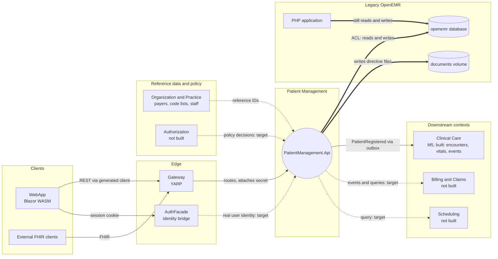

# Patient Management: context map

- **Status:** Draft for review
- **Perspective:** Target design; built relationships and gaps are marked.
- **Part of:** the Patient Management design set (`README.md` in this folder)
- **Depends on:** doc 01 (what the context owns), doc 02 (terms)

This document says who Patient Management talks to, which side leads, what crosses each boundary, and
what it costs. Relationship names follow the standard DDD patterns (customer-supplier, conformist,
anti-corruption layer, open host service, published language, shared kernel, separate ways).

## 1. Map

Solid lines exist today. Dotted lines are target. Thick lines are shared-storage coupling.

## 2. Relationships

| # | Counterpart | Direction | Pattern | State |
|---|---|---|---|---|
| R1 | **Legacy OpenEMR** (database and PHP) | Both | **Anti-corruption layer** on our side, over a **shared database**. We are **conformist** to the schema. | Built |
| R2 | **Legacy documents volume** | We write | Shared filesystem (`sitesvolume`) | Built |
| R3 | **Gateway** | Gateway calls us | Gateway fronts us as **open host**; we trust it by shared secret | Built, with a gap (section 5) |
| R4 | **AuthFacade / Identity** | Upstream of us | **Customer-supplier** (we need the caller's identity from it) | **Target.** Nothing is forwarded today. |
| R5 | **WebApp** | Downstream of us | **Customer-supplier**; we publish **OpenAPI**, it consumes a generated client | Built |
| R6 | **External FHIR clients** | Downstream of us | **Open host service** with **published language** (HL7 FHIR R4, US Core 8.0.0) | Built (read, search, create, `$validate`) |
| R7 | **Clinical Care** | Downstream of us | **Customer-supplier**; asynchronous | Event exists; consumer not built |
| R8 | **Billing and Claims** | Downstream of us | **Customer-supplier**; events plus a coverage query | Target |
| R9 | **Scheduling** | Downstream of us | **Customer-supplier**; lightweight query | Target |
| R10 | **Organization and Practice** | Upstream of us | We are **conformist** to its reference data (payers, code lists, staff) | Built by direct read of legacy tables |
| R11 | **Authorization** | Upstream of us | **Customer-supplier**; we ask, it decides | **Target** |
| R12 | **Interoperability** | Overlaps us | See section 4, decision D3 | Open |
| R13 | **Patient portal** | None | **Separate ways**: excluded by decision | n/a |

## 3. Relationship detail

### R1. Legacy OpenEMR: ACL over a shared database

This is the relationship that most shapes the design.

- **Why shared.** ADR 0049: registration writes straight into `patient_data`; there is no Patient
  Management database. The outbox lives in the same database so the event and the registration commit
  together.
- **What the anti-corruption layer does.** It lives in `Infrastructure` and is the only code that knows
  legacy names. It translates `date` to *last updated*, `provider` to *payer*, `completed_ad` text to a
  three-state status, `sex` null-versus-empty, zero and partial dates to tolerant reads, `list_options`
  codes to resolved codes, and the `sequences` counter to a document id. Doc 06 lists each.
- **Who else writes.** ADR 0049 retires the legacy **registration** screen. It does not retire legacy's
  **REST API** (`POST /api/patient`, which runs the same `PatientService::insert`); this stack's compose
  file enables it (`rest_api`, `rest_fhir_api`) and AuthFacade's BFF proxy exposes it to the browser, so
  patients can still be created by legacy code (doc 06, section 2). Nothing in the repository
  retires legacy's other screens for the same data: demographics edit, insurance, and directives. Until
  demographics update (C2) is built here, legacy PHP remains the only way to *change* a patient. So the
  single-writer claim holds for **inserting** a patient, not for **changing** one. Both of the following
  are therefore live coupling, not hypothetical:
  - legacy edits can change any `patient_data` column at any time, so a future `Patient.Update` must
    treat the row as shared and detect concurrent change (for example with a version or last-updated
    check) rather than assume it holds the latest state;
  - `dupscore` has two writers: this service, and legacy's duplicate report, which still offers
    "Mark Unique" and "Recompute" actions (`DuplicatePatientService.php`). The reserved values `-1`
    (declared unique) and `-9` (pending rescore) are legacy's, and this service must respect them.
- **Inbound legacy readers.** Legacy PHP reads the rows we write. Hence the discipline already in the
  code: a directive document's stored name embeds its type keyword so legacy classifies it correctly.
- **Policy.** New domain code never sees a legacy name. A change to a legacy table is a change to the
  adapter only. This service never migrates legacy tables (`ExcludeFromMigrations`); the only table it
  creates is the outbox.
- **Exit.** The relationship ends when patient data is migrated to a service-owned store and legacy is
  switched off for these tables. That is a later phase; the ACL is what makes it possible.

### R2. Legacy documents volume

Directive files go to `{repository}/{pid}/{driveUuid}` on the volume legacy's own PHP also uses. The
container runs as uid 1000 because that volume's `documents` directory is mode 700 for legacy's worker
(ADR 0061 changelog finding). Coupling to note: a file and its database row are not atomic (doc 06), and
legacy reads and may delete the same files.

### R3. Gateway

The Gateway is the single external origin (ADR 0033), routes `/api/v1/patients/{**}` and `/fhir/{**}` to
us, and attaches `X-Internal-Gateway-Secret` itself (ADR 0055, 0060). We reject any request without the
secret. See section 5 for the problem with this.

### R4. AuthFacade (identity): target

The one thing we need from identity is **who is acting**, as the number that fills `created_by`,
`documents.owner`, and the directive authenticator. AuthFacade's session carries only OpenEMR's user
**UUID** (`sub`). No lookup from that UUID to the numeric `users.id` exists (ADR 0055). Two ways to close
it are on the table (`patient-view-pending-decisions.md` item 1):

- AuthFacade resolves the number and exposes it, and the Gateway forwards it as a signed internal
  header or token; or
- this context resolves the caller itself from a forwarded subject.

**Recommendation for the target map:** AuthFacade owns identity resolution and publishes a **caller
context** (subject, numeric user id, display name, roles) as its published language; this context is a
**conformist** to that shape and never calls AuthFacade directly. Reason: identity resolution is not a
patient concern, and putting the lookup here would couple this context to OpenEMR's user model.

### R5. WebApp

WebApp calls `IPatientManagementClient`, generated from the committed OpenAPI snapshot (ADR 0059). The
contract is the OpenAPI document; the snapshot is the guard against silent drift. WebApp has its own
circuit breaker. Contract debts, from `patient-view-pending-decisions.md`: summary-only patient detail,
whole-list endpoint with browser paging, one parameter typed non-nullable, a 20 MB upload cap versus the
domain's 30 MB.

### R6. External FHIR clients

FHIR is a **published language** we speak, not our own model. The mapping lives in `Api`
(`FhirPatientMapper`) so the domain never takes on FHIR names. Build and validate against US Core 8.0.0
using Firely (ADR 0052). Scope limits are deliberate and recorded in `m4-domain-notes.md`.

### R7. Clinical Care (M5)

> **Status 2026-11-16:** built. Clinical Care keeps a **reference** (uuid, pid) in its own `clinical_care_patient_ref`, filled by
> `PatientRegistered` delivered by an outbox relay over HTTP ([ADR 0066](../architecture/0066-patient-registered-reaches-clinical-care-through-an-outbox-relay-over-http.md),
> [slice 3](../clinical-care/03-patient-registered-consumption.md)). It reads no `patient_data`. The analysis below is kept as written.

The first real downstream. ROADMAP M5: *consumes `PatientRegistered` through the outbox*. Clinical Care
keeps its own model and holds only a **patient reference**. It must not call back synchronously to
create an encounter. The boundary is verified: `patient_data` here, `form_encounter` there, coupled only
by a read-only reference (`m2-schema-inventory.md`).

### R8 to R9. Billing and Scheduling: target

- **Billing** needs demographics and the coverage in force on a date of service. Give it the **coverage
  query** (synchronous, effective policy for a date) plus events when coverage changes, so its cache
  can be invalidated. Billing owns money; we never hold copay or deductible.
- **Scheduling** needs only identity and name to book. A lightweight search and read; no events at first.

### R10. Organization and Practice: reference data

We read payers (`insurance_companies`), code lists (`list_options`), and staff (`users`) directly from
legacy tables, so today we are conformist **and** coupled at the table level. Target: reach these through
**ports** (`IPayerDirectory`, `ICodeLists`, `IStaffDirectory`) so the table coupling stays inside the
adapter and a real Organization service can later replace it. We hold payer **IDs** only. One real gap:
nothing validates that `CompanyId` exists, so a typo is stored silently.

### R11. Authorization: target

We will ask, not decide: *may this caller read, register, or change this patient, in this facility?* A
port (`IPatientAccessPolicy`) is the target seam; the policy and consent rules belong to Authorization.
Today there is none, and every authenticated caller can do everything.

### R12 and R13

R12 is decision D3 below. R13: portal credentials and portal login are a separate authentication system
and are not part of this map.

## 4. Decisions this map needs

| ID | Decision | Options | Recommendation |
|---|---|---|---|
| **D1** | **What other contexts use to refer to a patient** (doc 02, L2) | `uuid` only; `pid` only; both | **Both, with a rule.** `uuid` is the identity and the shared-kernel `PatientId`. `pid` is carried as a **correlation key** only while legacy tables joined on `pid` (`form_encounter.pid`) still exist. Events carry both; new contracts expose `uuid`; `pid` is dropped from public contracts when the shared database ends. Today `PatientRegistered` already has both; the insurance and directive **routes** use `pid`, which should move to `uuid`. |
| **D2** | **Event versioning and delivery** | none (today); schema version field plus relay | Add an explicit `schemaVersion` to every event before a second consumer exists, and build the relay. The outbox has no relay today, so M5's consume story is not yet real. Detail in doc 05. **Decided and built (2026-11-16, ADR 0066):** the relay, an envelope built at publish time with `eventId` and `schemaVersion` 1, and an idempotent consumer. |
| **D3** | **Where FHIR lives** | In this context (today); in a separate Interoperability context | Keep it here for Patient while it is the only resource. When Interoperability exists, it **consumes** our read model and owns the FHIR surface for all contexts; it does not re-implement patient rules. Until then, record that FHIR for Patient is intentionally inside this context. |
| **D4** | **Shared kernel** | Package of shared types; no shared types | Smallest possible: `PatientId` (the `uuid`) only. Do not share `Address`, `ContactPoint`, or `CodedValue` yet; with one consumer each, the cost of coupling is higher than the duplication. Revisit when a second context needs the same value object. |
| **D5** | **Who owns identity resolution** | AuthFacade; this context | AuthFacade (R4). |
| **D6** | **Reference data access** | Direct table reads; ports | Ports (R10). |

## 5. Risks in the map

| # | Risk | Evidence | Severity |
|---|---|---|---|
| M1 | **The shared secret protects nothing from a browser.** The Gateway has no authentication, and attaches the secret **unconditionally** to every request on the patient routes. Anyone who can reach the Gateway can register, read, and change patient data without signing in. | Gateway `Program.cs`: the patient routes carry no auth requirement, only the secret transform; ADR 0055 states the Gateway makes no authentication decisions. Already recorded in the patient-list review as an open critical finding. | **Critical** |
| M2 | **Caller-supplied acting user.** Registration, directive status, and uploads accept a user id from the client. | ADR 0055, doc 02 L5 | High |
| M3 | **Single-writer assumption is only true for inserts** (R1). | ADR 0049 retires only registration | Medium; grows when C2 is built |
| M4 | **Event with no relay.** `PatientRegistered` is written but nothing delivers it. | `OutboxMessage` doc comment: relay "deliberately a separate concern" | **Closed 2026-11-16:** the relay exists (ADR 0066) |
| M5 | **Table-level coupling to Organization data** (payers, code lists, staff). | R10 | Low now |
| M6 | **`sequences` shared counter.** Document ids come from a counter legacy also increments. Correct only if every writer uses the same locking idiom. | `EfAdvanceDirectiveRepository`, `m4-domain-notes.md` | Medium |
| M7 | **File and row not atomic** across the documents volume. | doc 06 | Low to medium |

M1 is the one that blocks calling this service safely reachable. Closing it does not need identity
forwarding: the Gateway can **require a valid AuthFacade session** before routing to the patient
cluster, which is a smaller step than R4. That is a decision for doc 07 and for you.

## 6. Integration contracts

| Contract | Direction | Format | Versioning today | Target |
|---|---|---|---|---|
| REST API | WebApp to us | JSON, OpenAPI 3 (`/openapi/v1.json`), `/api/v1/` prefix | Path version; snapshot in `Client/OpenAPIs/` | Add deprecation policy; move `pid` routes to `uuid` (D1) |
| FHIR Patient | External to us | FHIR R4 JSON, US Core 8.0.0 | Profile version pinned | Add update (PUT) |
| `PatientRegistered` | We to Clinical Care | JSON in the outbox: `Uuid`, `Pid`, `FirstName`, `LastName`, `RegisteredAtUtc` | **None** | `schemaVersion`, relay, consumer-driven tests (D2) |
| Gateway secret header | Gateway to us | `X-Internal-Gateway-Secret` | n/a | Replace with signed caller context (R4) |
| Database (`patient_data`, `insurance_data`, `documents`, …) | Legacy to and from us | Legacy schema | Legacy upgrades | Contract tests that fail if a mapped column changes |
| Documents volume | We write, legacy reads | Path `{pid}/{driveUuid}` | n/a | Keep until legacy is retired |

## 7. Evolution of the map

1. **Now.** Edge in front of us; legacy shared; one event with no relay. Close M1 and M4.
2. **With Clinical Care.** Outbox relay, versioned event, Clinical Care keeps a patient reference
   (D1). Add a consumer-driven contract test.
3. **With identity forwarding.** Caller context replaces the shared secret and caller-supplied ids.
   Authorization port added.
4. **With Billing and Scheduling.** Coverage query and coverage events. Payer, code-list, and staff
   ports (D6).
5. **With patient merge.** Needs a saga across every context holding a patient reference; this is why
   merge is last (`m4-full-legacy-parity-plan.md`).
6. **Exit from legacy.** Replace the shared database with a service-owned store; the ACL becomes a
   one-time migration tool.
