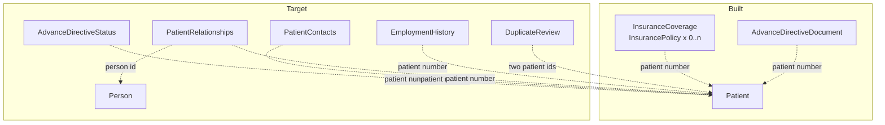
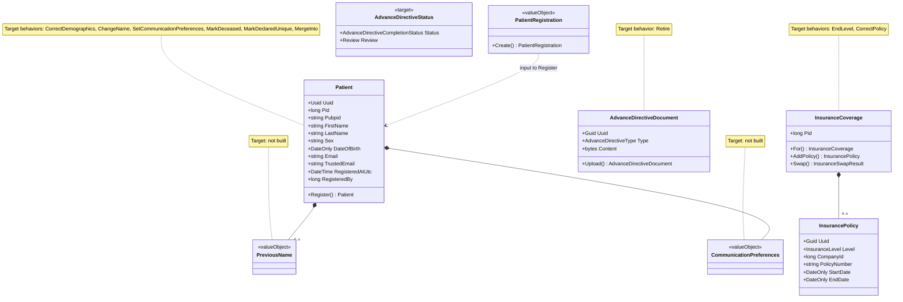
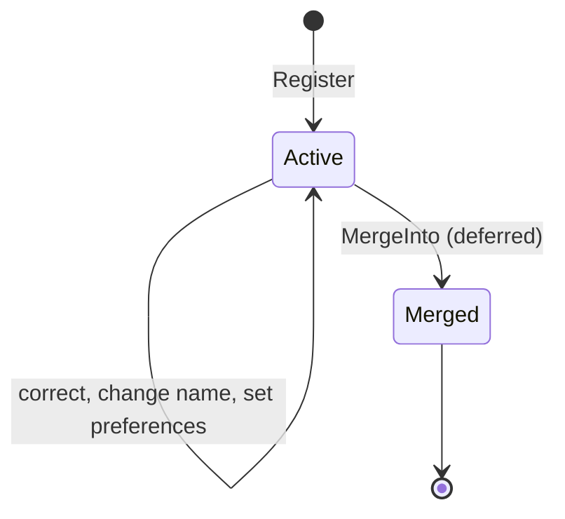

# Patient Management: domain model

- **Status:** Draft for review
- **Perspective:** Target design. **[Built]** means the code matches; **[Target]** is a proposal.
  Proposed rules marked **(new)** are not in legacy and change behavior: each needs a decision.
- **Part of:** the Patient Management design set (`README.md` in this folder)
- **Depends on:** doc 01 (capabilities), doc 02 (terms), doc 03 (boundaries)

## 1. Modeling principles

1. **An aggregate exists to protect a rule that spans more than one thing.** Where no such rule exists,
   do not create one for a table (`docs/domain-driven-design.md`).
2. **Small aggregates, referenced by identity.** Aggregates point at each other by id, never by object.
   Changes across aggregates are eventually consistent and signalled by events.
3. **One transaction changes one aggregate.** The outbox row is written in the same transaction.
4. **Invalid state cannot be constructed.** Private constructors, factory methods, no public setters.
   Already enforced by `InvariantEnforcementTests`; keep it for every new type.
5. **Reads and writes are separate shapes.** Aggregates serve writes. Display, search, and FHIR use
   read models (`Domain.ReadModels`, ADR 0054).
6. **Legacy is read tolerantly and written strictly.** A row this service did not write may break any
   rule; reading it must not throw. A write this service makes must satisfy the rules.
7. **The domain knows no legacy names, no HTTP, no EF** (`LayerDependencyTests`).

## 2. Aggregate catalogue

| # | Aggregate (root) | Consistency boundary | State |
|---|---|---|---|
| A1 | **Patient** | Identity, demographics, lifecycle, previous names, communication preferences | **Built** (register only) |
| A2 | **InsuranceCoverage** | One patient's policies across the three levels | **Built** |
| A3 | **AdvanceDirectiveDocument** | One filed directive file | **Built** |
| A4 | **AdvanceDirectiveStatus** | One patient's directive status and review | **[Target]** (today a pass-through with no model) |
| A5 | **PatientContacts** | One patient's addresses and contact points | **[Target]** |
| A6 | **Person** | One human who may be related to patients | **[Target]** |
| A7 | **PatientRelationships** | The relationships a patient has to persons | **[Target]** |
| A8 | **EmploymentHistory** | One patient's employers over time | **[Target]** |
| A9 | **DuplicateReview** | The decision about one pair of patients | **[Target]**, later |
| P1 | **PatientMerge** (process, not aggregate) | Multi-context merge | **Deferred** |

Every dotted line is a reference by identity, never an object link and never a shared transaction.

## 3. Class model

Static rule holders, all in `Domain`: `EffectiveInsuranceRule` (in `Domain.ReadModels`),
`DuplicateScore`, `PatientGenderMapping`.

## 4. A1. Patient

### 4.1 Responsibility

The patient's **identity**, **demographics**, and **lifecycle**. It is the one aggregate every other
aggregate refers to. It is deliberately **not** the home of contacts, relationships, employer,
insurance, or directives (section 2): those change for different reasons and by different people, and
folding them in would make every address edit contend with registration.

### 4.2 State

| Member | Type | State | Notes |
|---|---|---|---|
| `Uuid` | `Guid` | Built | Identity. Set at registration, never changes. |
| `Pid`, `Pubpid` | `long`, `string` | Built | Assigned at registration. `Pid` is random 63-bit (doc 02, L3). |
| `Id` | `long` | Built | Row id, database-set. Must not leave Infrastructure. |
| `FirstName`, `LastName`, `Sex`, `DateOfBirth` | | Built | From `PatientRegistration`. |
| `Email`, `TrustedEmail` | `string?` | Built | Optional. |
| `RegisteredAtUtc`, `RegisteredBy` | | Built | Audit of creation. |
| Last updated | `DateTime` | Built (private) | Moves on every change. Also the **concurrency token** (see 4.5). |
| `PreviousNames` | `IReadOnlyList<PreviousName>` | **[Target]** | Append-only. |
| `CommunicationPreferences` | value object | **[Target]** | Allow mail, voice, SMS, email, plus notice acknowledgement. |
| `Lifecycle` | `Active` or `MergedInto(uuid)` | **[Target]** | See 4.4. |
| `DeceasedOn`, `DeceasedReason` | `DateOnly?`, `string?` | **[Target]** | Orthogonal to lifecycle. |
| `DuplicateStatus` | `DeclaredUnique: bool` | **[Target]** | The score itself is a derived cache, not aggregate state (4.6). |

### 4.3 Behavior

| Command | Effect | Event | State |
|---|---|---|---|
| `Register(registration, registeredBy, at)` | Creates a patient; assigns identity | `PatientRegistered` | Built |
| `CorrectDemographics(changes, by, at)` | Applies a validated set of field changes; moves last updated | `PatientDemographicsCorrected` | **[Target]** |
| `ChangeName(newName, endedOn, by, at)` | Records the old name as a `PreviousName` and sets the new one, **atomically** | `PatientNameChanged` | **[Target]** |
| `SetCommunicationPreferences(prefs, by, at)` | Replaces preferences | `PatientCommunicationPreferencesChanged` | **[Target]** |
| `MarkDeceased(on, reason, by, at)` | Records death | `PatientMarkedDeceased` | **[Target]** |
| `CorrectDeceased(...)` / `ClearDeceased(...)` | Fixes a mistaken entry | `PatientDeceasedStatusCorrected` | **[Target]** |
| `MarkDeclaredUnique(by, at)` / `ClearDeclaredUnique(...)` | Operator decision on duplicates | `PatientDeclaredUnique` | **[Target]** |
| `MergeInto(survivorUuid, by, at)` | Retires this record in favor of another | `PatientMerged` | **Deferred** |

`CorrectDemographics` does **not** include name. A name change is a fact with history, so it has its own
command. Splitting them is what makes the previous-name rule enforceable.

### 4.4 Lifecycle

- **Merged** is terminal and **never a delete**. The retired record stays, answers `GET` with a
  redirect to the survivor (FHIR `Patient.link` type `replaced-by`), and accepts no further commands.
  Legacy hard-deletes during merge; this context must not (doc 01, section 9).
- **Deceased** is not a lifecycle state. A deceased patient is still readable, may still be billed, and
  may need corrections. It restricts only a few commands (4.5, rule PT-9).

### 4.5 Invariants

| ID | Rule | Source | Enforced | State |
|---|---|---|---|---|
| PT-1 | First name 1 to 255; last name 2 to 255; sex 4 to 30 characters | Legacy `PatientValidator` | `PatientRegistration.Create` | Built |
| PT-2 | Date of birth is a valid calendar date | Legacy | Type (`DateOnly`) | Built |
| PT-3 | If present, email and trusted email are valid addresses | Legacy | `PatientRegistration.Create` | Built |
| PT-4 | `RegisteredBy` is a positive user id | Added during audit | `Patient.Register` | Built |
| PT-5 | `Uuid` is assigned once and never changes; `Pid` likewise | `m4-domain-notes.md` | No public setter (`InvariantEnforcementTests`) | Built |
| PT-6 | Date of birth is not in the future **(new)** | Common sense; legacy only checks the format | Domain | **[Target]** |
| PT-7 | A previous name's end date is not in the future, and not before the date of birth **(new)**. It **may** precede registration (a maiden name used before the patient first registered) | Derived from `patient_history` | Domain | **[Target]** |
| PT-8 | A name change always produces exactly one `PreviousName` with the replaced name | Derived | `ChangeName` is the only way to change a name | **[Target]** |
| PT-9 | Date of death is not before date of birth and not in the future **(new)**; a deceased patient cannot be marked deceased again, only corrected | Derived from `deceased_date` | Domain | **[Target]** |
| PT-10 | A **Merged** patient accepts no commands | Derived | Domain | **Deferred** |
| PT-11 | A change applies only if the patient has not changed since it was read | Shared with legacy writers (doc 03, R1) | Last-updated token | **[Target]** |
| PT-12 | `Pid` is unique across patients | Legacy `UNIQUE KEY` | Database, with a retry on conflict | **Built in DB only**; no retry (doc 02, L3) |

PT-1 to PT-3: legacy's rules at registration time are not guaranteed true of rows legacy wrote
(free-text `sex`, one-character last names exist in old data). Rules apply to **writes by this service**;
reads of old rows must not fail.

### 4.6 Duplicate detection and the aggregate

The duplicate **score** compares one patient against *every other* patient, so it cannot be an
aggregate behavior. It is computed by a bulk query (`IDuplicateScorer`) and cached in `dupscore`. The
aggregate owns only the operator's *decision* (`DeclaredUnique`), because that decision is a fact about
the patient that changes how the score is used. The reserved values `-1` and `-9` stay legacy's storage
encoding and are translated in the anti-corruption layer; the domain sees a boolean and a number.

## 5. A2. InsuranceCoverage  [Built, extended by Target]

### 5.1 Responsibility

One patient's policies across primary, secondary, and tertiary levels. The boundary exists because swap
touches two policies and because "no two policies at the same level and start date" is a rule over the
whole set (ADR 0053).

### 5.2 Entities and values

| Type | Role | Notes |
|---|---|---|
| `InsuranceCoverage` | Root | Loaded by `For(pid, policies)`; has no "create". |
| `InsurancePolicy` | Entity, identity `Uuid` | Factory `Add` is `internal`: only the root can add. `Level` is the one mutable member, changed only by `ChangeLevel` (`internal`). |
| `InsuranceLevel` | Value | Primary, Secondary, Tertiary. |
| `EffectiveInsurancePolicy`, `InsurancePolicyRow` | Read models | Not part of the aggregate. |

### 5.3 Behavior

| Command | Effect | Event (doc 05) | State |
|---|---|---|---|
| `AddPolicy(level, company, number, group, plan, start, end)` | Adds a policy | `InsurancePolicyAdded` | Built |
| `Swap(policyUuid, targetLevel)` | Moves a policy; occupant of the target takes the old level | `InsuranceLevelsSwapped` | Built |
| `EndLevel(level, on)` | Ends coverage at a level from a date. Parity: adds an **Unassigned** policy; alternative: set an end date | `InsuranceCoverageEnded` | **[Target]** |
| `CorrectPolicy(uuid, fields)` | Fixes number, group, plan, or dates of an existing policy | `InsurancePolicyCorrected` | **[Target]** |

### 5.4 Invariants

| ID | Rule | Source | Enforced | State |
|---|---|---|---|---|
| IC-1 | No two policies at the same level with the same start date | Legacy `UNIQUE (pid, type, date)` | `InsuranceCoverage.AddPolicy`; database backstop | Built (`ClusterInvariantEnforcementTests`) |
| IC-2 | Policy number 2 to 255; group and plan, if given, 2 to 255 | Legacy `CoverageValidator` | `InsurancePolicy.Add` | Built |
| IC-3 | End date is not before start date | Derived | `InsurancePolicy.Add` | Built |
| IC-4 | Company id is positive | Derived | `InsurancePolicy.Add` | Built |
| IC-5 | A swap changes both levels or neither; the moved policy ends at the target level | Legacy `swapInsurance()` | `Swap` decides; persistence is transactional | Built |
| IC-6 | A swap to the policy's own level changes nothing | Legacy | `Swap` returns a no-op | Built |
| IC-7 | Policies **may overlap in time**; which is in force is decided by the effective rule, not forbidden | Legacy `EffectiveInsuranceRule` | Not a constraint: a design choice, recorded so nobody adds a "no overlap" rule by reflex | Built |
| IC-8 | The company exists | Derived | Port `IPayerDirectory` | **[Target]** (nothing checks today) |
| IC-9 | Only policies this service can type-check join the cluster; rows with an unknown type or a zero or partial date are skipped, not failed | Resilience finding (`m4-domain-notes.md`) | `GetPoliciesAsync` | Built |

### 5.5 Domain rule: effective policy  [Built]

`EffectiveInsuranceRule.Choose(rows, day)` is a pure function over **raw stored values**, ported
verbatim from legacy: in force when start ≤ day ≤ end (inclusive); blank start means always; blank or
`0000-00-00` end means open; the latest start wins per level, a blank start loses to any stored one, ties
go to the higher id; a winner with no payer means *no coverage at this level*; levels are independent.
It lives in `Domain.ReadModels` because it works on read models, not on the aggregate. It compares dates
**as stored text** on purpose, so zero and partial dates behave exactly as legacy's SQL does.

## 6. A3. AdvanceDirectiveDocument  [Built]

One filed directive file, immutable after upload.

| ID | Rule | Source | Enforced | State |
|---|---|---|---|---|
| AD-1 | `Pid` and `OwnerId` are positive | Derived | `Upload` | Built |
| AD-2 | File name 1 to 255 characters; mime type present | Derived | `Upload` | Built |
| AD-3 | Content is not empty and at most 30 MiB | Legacy production `php.ini` | `Upload` | Built |
| AD-4 | The stored name is `{type display name} - {file name}` so legacy classifies it correctly | Legacy `determineAdvanceDirectiveType()` | Constructor | Built |
| AD-5 | A content hash (SHA3-512) is computed at upload | Derived | Constructor | Built |
| AD-6 | A document is never edited; `Uuid` and `DriveUuid` never change | Derived | No setters | Built |
| AD-7 | Removing a document is a **soft** removal that keeps the file and row, records who and when, and hides it from listings | Retention (doc 01 §9); legacy `documents.deleted` | `Retire` | **[Target]** |

Not an aggregate member: the file bytes' location on disk. That is Infrastructure (doc 06).

## 7. A4. AdvanceDirectiveStatus  [Target]

### 7.1 Why it needs a model

Today `SetAdvanceDirectiveStatusUseCase` is a straight pass-through to the repository. There is no type,
no rule, and `reviewedAt` and `authenticatorUserId` travel as two unrelated nullable values, so a caller
can record "reviewed by user 5" with no time, or a time with no reviewer. Legacy imposes no rule either,
but that is the behavior to improve on, not to preserve.

### 7.2 Shape

`AdvanceDirectiveStatus` (root, one per patient): `Status` (`Yes`, `No`, `Unknown`) and an optional
`Review` value object (`ReviewedAtUtc`, `ReviewedBy`). It **does not contain documents**: legacy never
reconciles status with documents, and the two have different lifecycles and sizes.

| ID | Rule | Source | Enforced | State |
|---|---|---|---|---|
| AS-1 | Status is exactly yes, no, or unknown. Unknown is a real state | Legacy (`''`) | Enum | Built (as an enum only) |
| AS-2 | A review has **both** a time and a reviewer, or neither **(new)** | Derived | `Review` value object | **[Target]** |
| AS-3 | A review's reviewer is a positive user id | Derived | `Review` | **[Target]**, partly built (API range check) |
| AS-4 | Review time is not in the future **(new)** | Derived | `Review` | **[Target]** |
| AS-5 | Setting status back to Unknown clears the review **(new, optional)** | Derived | Domain | **[Target]**, needs a decision |

> **Decision needed.** Is *yes with a document and no reviewer* a state staff really use? Because legacy
> allows it, AS-2 could break an existing workflow. Treat AS-2 and AS-5 as proposals until a domain
> reviewer confirms.

## 8. A5. PatientContacts  [Target]

### 8.1 Responsibility

How to reach the patient: postal addresses and contact points (phone, email, SMS, fax, other), each with
a use (home, work, mobile, temporary), a rank, a primary flag, and an active period.

### 8.2 Shape

| Type | Kind | Members |
|---|---|---|
| `PatientContacts` | Root, one per patient | `Pid`; `Addresses`; `ContactPoints` |
| `PatientAddress` | Entity | `Uuid`, `Use`, `AddressType`, `Lines`, `City`, `State`, `PostalCode`, `Country`, `IsPrimary`, `Period`, `EndedReason` |
| `ContactPoint` | Entity | `Uuid`, `System`, `Use`, `Value`, `Rank`, `IsPrimary`, `Period` |
| `Period` | Value | `Start`, `End?`; end not before start |
| `PostalAddress`, `PhoneNumber`, `EmailAddress` | Values | Validate on construction |

### 8.3 Behavior and invariants

| Command | Effect |
|---|---|
| `AddAddress`, `UpdateAddress`, `EndAddress(reason)` | An address is **ended**, never deleted, so history remains |
| `AddContactPoint`, `UpdateContactPoint`, `EndContactPoint` | Same |
| `MakePrimary(entry)` | Atomically moves the primary flag |

| ID | Rule | Source | Enforced |
|---|---|---|---|
| CT-1 | At most one **active primary** address | Derived from `is_primary` | Root |
| CT-2 | At most one active primary contact point **per system** (phone, email, …) | Derived | Root |
| CT-3 | An ended entry cannot be primary | Derived | Root |
| CT-4 | A period's end is not before its start | Derived | `Period` |
| CT-5 | Active contact points of one system have distinct ranks | Derived from `rank` | Root |
| CT-6 | An entry's value is valid for its system (email shape; phone digits and length) | Derived | Value objects |
| CT-7 | Ending an address requires a reason when it ended because the patient moved or mail was returned | Derived from `inactivated_reason` | Root |

### 8.4 Open modeling question

Legacy keeps a patient's **current** address and phones as plain columns on `patient_data` (`street`,
`city`, `phone_home`, `phone_cell`, …), which the FHIR mapping already reads, **and** also has the richer
`contact_address` and `contact_telecom` tables with periods and ranks. It is **not yet verified which
of the two a running OpenEMR actually populates for patients.**

| Option | Consequence |
|---|---|
| **A.** Map the aggregate onto the `patient_data` columns only (current values, no history) | Parity with what FHIR already shows; no history; smallest. |
| **B.** Map onto `contact_*` tables, with `patient_data` columns kept in step by the adapter | Full history; the adapter must keep two stores consistent, and legacy PHP editing only the columns would drift. |
| **C.** Aggregate holds history in `contact_*`; the adapter **projects** the current primary entries into the `patient_data` columns on every change | Best long-term shape; needs a one-time import of existing column values. |

**Recommendation:** C, after a check against a populated database confirms which tables legacy writes.
Until then the aggregate's rules above stand regardless of the storage choice.

## 9. A6 and A7. Person and PatientRelationships  [Target]

### 9.1 Why two aggregates

In legacy a `person` can be linked to more than one patient (a parent of two children), has its own
demographics and contact points, and may later **become** a patient (`person_patient_link`). So a related
person is not owned by one patient. The **person** and the **relationship** are modeled separately.

| Aggregate | Owns | Does not own |
|---|---|---|
| **Person** (A6) | Name, preferred name, birth date, sex, contact points of one human | Any patient relationship |
| **PatientRelationships** (A7) | The patient's list of relationships: who, what role, priority, permissions, period | The person's own details |

### 9.2 Shape and rules (A7)

`Relationship` (entity): `Uuid`, `PersonId`, `Role` (guardian, parent, spouse, emergency contact, …),
`Relationship` (coded), `Priority`, `IsPrimaryContact`, `IsEmergencyContact`, `CanMakeMedicalDecisions`,
`CanReceiveMedicalInfo`, `Period`, `Notes`.

| ID | Rule | Source | Enforced |
|---|---|---|---|
| RL-1 | At most one active **primary contact** | `is_primary_contact` | Root |
| RL-2 | Active relationships have distinct priorities | `contact_priority` | Root |
| RL-3 | A period's end is not before its start | Derived | `Period` |
| RL-4 | A person cannot be related to **themselves** (a person linked to this patient is not a relationship of this patient) | `person_patient_link` | Root, using the link |
| RL-5 | An **emergency contact** must have at least one reachable contact point | Derived | Application check across A7 and A6; **not** a single-aggregate rule, so it is validated at command time and may become stale (eventual) |
| RL-6 | Ending a relationship is a soft end, never a delete | Retention | Root |
| RL-7 | A medical decision maker's authority has a start date **(new)** | Derived | Root |

RL-5 is the honest example of a rule that crosses aggregates: the design accepts that it can drift
(the person later loses their last phone number) and handles it as a warning, not as an invariant.

### 9.3 Link to patient

`PromotePersonToPatient(personId)` is an **application workflow** (register patient, then
`LinkPerson`): not one aggregate's behavior. It records the link and does **not** copy data silently.

## 10. A8. EmploymentHistory  [Target]

| Type | Members |
|---|---|
| `EmploymentHistory` (root) | `Pid`; `Employments` |
| `Employment` (entity) | `Uuid`, `EmployerName`, `Address`, `Occupation` (coded), `Industry` (coded), `Period` |

| ID | Rule | Source | Enforced |
|---|---|---|---|
| EM-1 | Employer name is required, 1 to 255 | `employer_data.name` | Entity |
| EM-2 | A period's end is not before its start | `start_date`, `end_date` | `Period` |
| EM-3 | At most one **current** (open-ended) employment **(new)** | Derived | Root |
| EM-4 | Occupation and industry, if given, are valid codes from their lists | `OccupationODH`, `IndustryODH` | Port `ICodeLists` |

The `patient_data` table also has `occupation` and `industry` columns of its own. Which is authoritative
is the same question as 8.4 and gets the same answer.

## 11. A9 and P1. Duplicate review and merge  [Target / Deferred]

**DuplicateReview** (later): a decision about one **unordered pair** of patients. State: `Pending`,
`Distinct`, `Same`. Rules: one review per pair; a decision records who and when; `Same` only starts a
merge, never performs it. Legacy only has the patient-level "mark unique", which A1 keeps for parity.
The pair-level review is the better model and a deliberate step beyond parity.

**PatientMerge** is a **process manager**, not an aggregate, because it spans every context holding a
patient reference. Sketch: `Requested → SurvivorValidated → ContextsNotified → AllContextsAcknowledged →
Completed`, or `Failed` with compensation. Each context repoints its own references on a
`PatientMergeRequested` event. Until Clinical Care and others exist there is nothing to repoint, which
is why it is last.

## 12. Value objects

| Value object | Used by | Rule | State |
|---|---|---|---|
| `PatientRegistration` | A1 | PT-1, PT-3 | Built |
| `ResolvedCode` | Read model | Non-blank system and value | Built |
| `InsuranceLevel`, `AdvanceDirectiveType`, `AdvanceDirectiveCompletionStatus`, `DuplicateScoreLevel` | A2 to A4 | Closed sets mirroring legacy | Built |
| `PatientNumber` (wraps `Pid`) | All | Positive | **[Target]**, see 14.1 |
| `StaffUserId` | All | Positive | **[Target]**, see 14.1 |
| `PayerId` | A2 | Positive | **[Target]**, see 14.1 |
| `PersonName`, `PreviousName` | A1, A6 | Required parts, lengths | **[Target]** |
| `CommunicationPreferences` | A1 | Four flags plus acknowledgement | **[Target]** |
| `Period` | A5, A7, A8 | End not before start | **[Target]** |
| `PostalAddress`, `PhoneNumber`, `EmailAddress` | A5, A6 | Shape rules | **[Target]** |
| `Review` | A4 | AS-2 to AS-4 | **[Target]** |

## 13. Domain services and policies

| Type | Responsibility | State |
|---|---|---|
| `EffectiveInsuranceRule` | Which policy is in force | Built |
| `DuplicateScore.Classify` | What a score means | Built |
| `PatientGenderMapping` | Free-text sex to a coded value | Built |
| `IPatientIdentifierAllocator` | Assigns `Pid` and the default `Pubpid` **with a uniqueness guarantee** | **[Target]** |
| `PubpidPolicy` | Whether a chart number may be supplied, and its format | **[Target]**, depends on the MRN decision |
| `ContactReachabilityPolicy` | RL-5 across aggregates | **[Target]** |

## 14. Design findings in the built model

### 14.1 Primitive obsession on identifiers

`Pid`, `CompanyId`, `OwnerId`, `RegisteredBy`, `AuthenticatorUserId`, and `Patient.Id` are all plain
`long`. `AddPolicy(level, long companyId, …)` and `Upload(long pid, …, long ownerId)` can have their
arguments swapped with no compile error. Introduce `PatientNumber`, `StaffUserId`, and `PayerId`
**value objects** and make the wrong call a compile error. Low cost, high safety; do it before adding
more aggregates that take the same arguments.

### 14.2 Identity generated inside the aggregate

`Patient`'s constructor calls `Guid.NewGuid()` and `Random.Shared`, while `registeredAtUtc` is passed in.
Time is injectable but identity is not, so tests cannot assert a specific `Uuid` or force a `Pid`
collision. Inject an identifier source (or take the identifiers as parameters from the application
layer) so the aggregate is deterministic and so PT-12's retry can be tested.

### 14.3 `Patient` has no behavior beyond `Register`

It is currently a validated record. That is acceptable for a registration-only service, but it is the
reason demographics, deceased status, and name history are modeled here as behaviors rather than as
fields to be edited by an update endpoint. Do not add a generic `Update(...)` that takes every field.

### 14.4 Directive status has no model

Section 7. A pass-through use case with no domain type is a signal that a rule is missing.

### 14.5 Sex is free text

Doc 02, L1. `Sex` as a `string` with a length rule carries no meaning the domain can use, and its
mapping to a coded value is silently defaulted. Decide whether to introduce a value object with a
controlled list (and how to read old free-text rows), or keep parity deliberately.

### 14.6 Strengths to keep

- Validate-on-construction with collected errors, enforced by reflection tests.
- A real multi-entity aggregate with a cluster rule, an `internal` child factory, and a test that fails if
  it becomes public.
- The effective-insurance rule as a pure function that tolerates dirty legacy data.
- Read models in a compiler-enforced separate project.
- Layer dependencies enforced by architecture tests.

## 15. Enforcement

| Mechanism | What it guards | State |
|---|---|---|
| `LayerDependencyTests` | Domain references nothing of this service; Application does not reference Infrastructure or Api | Built |
| `InvariantEnforcementTests` | No public constructor or setter on the listed aggregates and value objects | Built; **extend to every new type** |
| `ClusterInvariantEnforcementTests` | Child factories cannot be called from outside the aggregate | Built; extend to A5, A7, A8 |
| Domain unit tests | Every rule ID above has at least one test that names it | Partly; add the IDs to test names |
| Integration tests (Testcontainers MariaDB) | Persistence behavior against the real schema | Built |

Traceability proposal: put the rule id (`IC-1`, `PT-9`) in the name of the test that proves it, so the
tables above can be checked mechanically.

## 16. Open questions

1. **A4, AS-2 and AS-5:** do these break a real workflow? (section 7)
2. **A5:** which contact storage does legacy actually populate for patients? (8.4)
3. **PT-6, PT-7, PT-9, RL-7, EM-3** are new rules. Accept, drop, or soften each.
4. **Sex** as free text or controlled (14.5).
5. **Is a related person ever shared between patients in practice** (justifying A6 as separate), or
   should the first cut keep the person inside the relationship? The split costs a join and a second
   aggregate; keep it only if sharing is real.
6. **Pair-level duplicate review** now or after parity?
