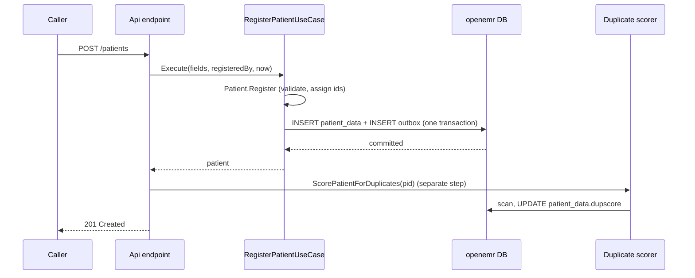
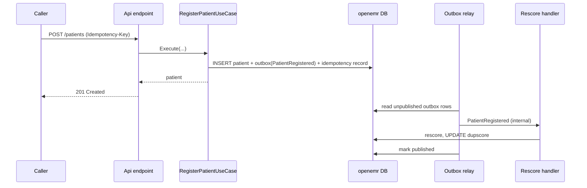
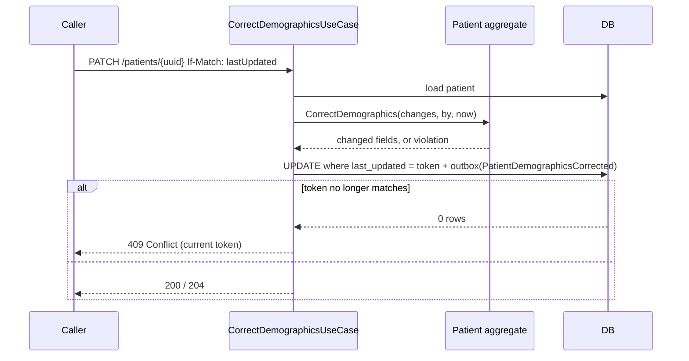
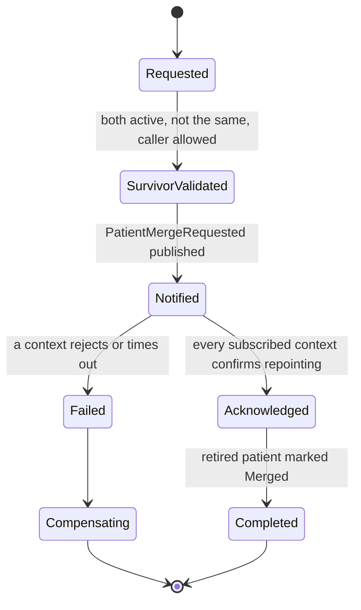

# Patient Management: workflows, commands, queries, and events

- **Status:** Draft for review
- **Perspective:** Target design. **[Built]** matches the code; **[Target]** is a proposal.
- **Part of:** the Patient Management design set (`README.md` in this folder)
- **Depends on:** doc 01 (capabilities), doc 02 (terms), doc 03 (boundaries), doc 04 (aggregates and rules)

Identifiers used here: **CMD-n** command, **QRY-n** query, **EVT-n** event, **WF-n** workflow,
**F-n** finding. Rule ids (`IC-1`, `PT-9`, …) refer to doc 04.

## 1. Conventions

### 1.1 Commands and queries

- A **command** changes one aggregate in one transaction and returns an outcome, not a view. A **query**
  changes nothing.
- Commands are named for **business intent**, not for CRUD (`ChangeName`, not `UpdatePatient`).
- Each command is implemented by one **use case** class in `Application`; the Api layer only parses,
  calls, and shapes the response (doc 04, principle 5).
- Every command carries an **acting user** (`by`) and a **time**. Today the user is caller-supplied and
  unverified (doc 03, M2); the target takes it from the forwarded caller context and removes it from the
  request body.

### 1.2 Response model

| Outcome | REST today | FHIR today | Target change |
|---|---|---|---|
| Created | `201` + `Location` | `201` | none |
| Accepted, no body | `204` | n/a | none |
| Invalid input | `400` validation problem (`errors` list) | `400` `OperationOutcome` | none |
| Rule violated against current state (duplicate policy at a level and date) | `400` (a validation exception) | n/a | `409 Conflict`: it is a state conflict, not malformed input |
| Not found | `404` (empty or message body) | `404` | one `ProblemDetails` body everywhere |
| Stale change | not applicable | not applicable | `409` with the current last-updated token (PT-11) |
| Caller not trusted | `401` (missing shared secret) | `401` | `401`/`403` from real identity |
| Unexpected | `500` `application/problem+json` (ADR 0057) | same | none |

### 1.3 Idempotency

`POST` commands that create something (register, add policy, upload) accept an optional
**`Idempotency-Key`** header **[Target]**. A repeated key within a window returns the original result and
creates nothing. The key and its result are stored in the same transaction as the change. See F-2.

## 2. Command catalogue

| ID | Command | Aggregate | Endpoint | Outcome and event | State |
|---|---|---|---|---|---|
| CMD-1 | Register patient | A1 | `POST /api/v1/patients`; `POST /fhir/Patient` | `Patient` created → EVT-1 | Built |
| CMD-2 | Correct demographics | A1 | `PATCH /api/v1/patients/{uuid}` | fields changed → EVT-2 | **[Target]** |
| CMD-3 | Change name | A1 | `POST /api/v1/patients/{uuid}/name-changes` | previous name recorded → EVT-3 | **[Target]** |
| CMD-4 | Set communication preferences | A1 | `PUT /api/v1/patients/{uuid}/communication-preferences` | → EVT-4 | **[Target]** |
| CMD-5 | Mark deceased / correct / clear | A1 | `PUT /api/v1/patients/{uuid}/deceased` | → EVT-5 | **[Target]** |
| CMD-6 | Declare unique / clear | A1 | `PUT /api/v1/patients/{uuid}/duplicate-status` | → EVT-6 | **[Target]** |
| CMD-7 | Update patient via FHIR | A1 | `PUT /fhir/Patient/{uuid}` | maps to CMD-2/CMD-3 | **[Target]** |
| CMD-8 | Add insurance policy | A2 | `POST /api/v1/patients/{pid}/insurance` | policy added → EVT-7 | Built |
| CMD-9 | Swap insurance levels | A2 | `POST /api/v1/patients/{pid}/insurance/swap` | levels exchanged → EVT-8 | Built |
| CMD-10 | End coverage at a level | A2 | `POST …/insurance/end` | → EVT-9 | **[Target]** |
| CMD-11 | Correct a policy | A2 | `PATCH …/insurance/{policyUuid}` | → EVT-10 | **[Target]** |
| CMD-12 | Set directive status | A4 | `PUT …/advance-directives/status` | → EVT-11 | Built (no model, no event) |
| CMD-13 | Upload directive document | A3 | `POST …/advance-directives/documents` | file filed → EVT-12 | Built (no event) |
| CMD-14 | Retire directive document | A3 | `DELETE …/documents/{uuid}` | soft removal → EVT-13 | **[Target]** |
| CMD-15 | Add, change, end an address or contact point | A5 | `…/contacts/…` | → EVT-14 | **[Target]** |
| CMD-16 | Add, change, end a relationship; add or change a person | A7, A6 | `…/relationships/…`, `/persons/…` | → EVT-15 | **[Target]** |
| CMD-17 | Add, change, end an employment | A8 | `…/employment/…` | → EVT-16 | **[Target]** |
| CMD-18 | Record duplicate review decision | A9 | `POST /api/v1/duplicate-reviews/{id}/decision` | → EVT-17 | **[Target]**, later |
| CMD-19 | Merge patients | P1 | `POST /api/v1/patient-merges` | → EVT-18 | **Deferred** |
| CMD-20 | Rescore duplicates | (derived cache) | internal; after CMD-1 and CMD-2 | updates `dupscore` | Built (inline, see F-1) |

Insurance and directive routes are keyed by **`pid`**, not `uuid` (doc 03, D1). The target keeps `pid`
routes working and adds `uuid` routes, then retires the `pid` ones.

## 3. Query catalogue

| ID | Query | Endpoint | Returns | State |
|---|---|---|---|---|
| QRY-1 | Get patient | `GET /api/v1/patients/{uuid}` | summary (name, ids, date of birth, email) | Built |
| QRY-2 | List and search patients | `GET /api/v1/patients?name=` | whole list | Built; **paging is a pending decision** |
| QRY-3 | Get patient (FHIR) | `GET /fhir/Patient/{uuid}` | US Core Patient | Built |
| QRY-4 | Search patients (FHIR) | `GET /fhir/Patient?…` | `Bundle`; about 15 parameters, ANDed | Built |
| QRY-5 | Effective insurance on a day | `GET …/insurance/effective?day=` | the policy in force per level; `day` defaults to today (UTC) | Built |
| QRY-6 | Insurance **history** (all policies) | `GET …/insurance` | every policy, any level, any date | **[Target]**: nothing exposes this today, only the effective view |
| QRY-7 | List directive documents | `GET …/documents` | summaries | Built |
| QRY-8 | Download directive document | `GET …/documents/{uuid}/content` | bytes | Built |
| QRY-9 | Get directive status | `GET …/advance-directives/status` | status, review | Built |
| QRY-10 | Patient detail | `GET /api/v1/patients/{uuid}/detail` | demographics beyond the summary, **excluding SSN** | **[Target]** (pending decision 3) |
| QRY-11 | Contacts, relationships, employment, previous names | `GET …/contacts` etc. | lists | **[Target]** |
| QRY-12 | Duplicate candidates | `GET /api/v1/duplicate-reviews?level=` | flagged pairs | **[Target]** |
| QRY-13 | Patient number lookup by chart number | `GET /api/v1/patients?pubpid=` | patient | **[Target]** |

Paging target for QRY-2 and QRY-12: `page`, `pageSize`, and a total count (pending decision 5). Queries
read through read models, never through aggregates.

## 4. Workflows

### WF-1. Register a patient  [Built, with a defect]

**As built.** The endpoint runs three separate steps. Only the first two are atomic.



**Defect (F-1).** If the scoring step throws (database blip, timeout), the patient and the outbox row are
**already committed**, yet the caller receives `500`. A caller who retries then registers the **same
person a second time**, and the new registration scores as a probable duplicate of the first.

**Target.**



Scoring becomes a **reaction to the event**, not a step the caller waits on. A failure in scoring is
retried by the relay and never changes the registration's outcome. The score is advisory, so it
arriving a moment later is acceptable, and it matches legacy's intent ("cached for a later report").

**Rules.** PT-1 to PT-5, PT-12. **Failure modes:** invalid input → `400`, nothing written; `pid`
collision (PT-12) → retried inside the use case with a new `pid`; same idempotency key → original `201`.

### WF-2. Correct demographics  [Target]



Legacy still edits `patient_data` (doc 03, R1), so the change is a **conditional update on the
last-updated value** (PT-11). A name goes through WF-3, not here. After a correction that touches a
field the duplicate score uses (email, date of birth, sex), the rescore handler runs as in WF-1.

### WF-3. Change a patient's name  [Target]

One command, one transaction: the current name becomes a `PreviousName` and the new name is set (PT-8).
Event `PatientNameChanged`. The rescore handler runs because last name is a score input.

### WF-4. Add insurance policy  [Built, with a gap]

`AddInsurancePolicyUseCase` loads the patient's policies, builds `InsuranceCoverage`, calls `AddPolicy`
(IC-1 to IC-4), and persists the new policy. A duplicate level and start date returns `400` today.

**Gap (F-3).** Nothing checks that the patient **exists**. The domain message reads "Pid must identify an
existing patient" but the rule only tests `pid > 0`, and legacy has no foreign key to stop an orphan
row. A typo'd `pid` silently creates insurance for nobody. **Target:** the use case asks a patient-lookup
port first (`404` if absent), and checks the payer (IC-8). Also adds the missing event (EVT-7) in the
same transaction.

### WF-5. Swap insurance levels  [Built]

Load, `Swap` decides both new levels (IC-5, IC-6), persist both inside one transaction using the
sentinel-date workaround. Unknown policy → `404`. **Target:** same transaction writes EVT-8; Billing
needs this event to invalidate cached coverage.

### WF-6. Look up effective coverage  [Built]

Reads raw stored rows and runs `EffectiveInsuranceRule.Choose` for a day. Pure read; tolerant of dirty
legacy dates (doc 04, 5.5).

### WF-7. File a directive document  [Built, not atomic]

```mermaid
sequenceDiagram
    participant C as Caller
    participant UC as UploadAdvanceDirectiveDocumentUseCase
    participant FS as Documents volume
    participant DB as openemr DB
    C->>UC: POST …/documents (type, name, mime, bytes)
    UC->>UC: AdvanceDirectiveDocument.Upload (AD-1 to AD-6)
    UC->>FS: write {pid}/{driveUuid}
    UC->>DB: BEGIN; draw id from sequences; INSERT documents; REPLACE categories_to_documents; COMMIT
    alt database step fails
        UC->>FS: best-effort delete of the file
    end
    UC-->>C: 201 Created
```

**Gap (F-4).** File and row are not atomic. A failure handled in code is compensated by a delete; a
process killed between the file write and the commit leaves an **orphan file** that nothing reconciles.
**Target:** a reconciliation job that lists files with no row and reports (never auto-deletes) them,
plus EVT-12 in the same transaction as the row. Also the upload size and encoding decision: base64 in
JSON costs about a third more than the file, so the practical limit is below the 30 MiB domain bound
(pending decision 2).

### WF-8. Set directive status  [Built]

A pass-through today (doc 04, section 7). **Target:** `AdvanceDirectiveStatus` aggregate validates the
review value (AS-2 to AS-4) and records EVT-11.

### WF-9. Review a probable duplicate; merge  [Target / Deferred]

1. The rescore handler (WF-1) marks a patient **WorthReviewing** or **NearCertain**.
2. QRY-12 lists flagged pairs. A reviewer opens both charts (QRY-1, QRY-10, QRY-6).
3. CMD-18 records *distinct* (the pair is not shown again) or *same*.
4. *Same* never merges by itself. It starts WF-10 once merge exists.

### WF-10. Merge patients  [Deferred]

A **process manager**, not a single transaction (doc 04, section 11):



No hard deletes. The retired patient stays, answers with a pointer to the survivor, and accepts no
commands. This is last because there are no other contexts yet to repoint.

### WF-11. Exchange via FHIR  [Built; update Target]

`POST /fhir/Patient` validates against US Core 8.0.0 with Firely, extracts the fields it supports,
and **calls CMD-1**, so FHIR create and REST register share one path and one event. Read and search use
the read model. `$validate` checks a resource without storing it. Update (CMD-7) maps onto CMD-2 and
CMD-3 so no rule is implemented twice. Race, ethnicity, and language are read but not written back,
matching legacy's own admitted gap.

### WF-12. Link a person who becomes a patient  [Target]

An **application workflow**, not an aggregate command: register the patient (WF-1), then record a person
link on A6/A7 (doc 04, 9.3). Nothing is copied silently, and failure after step one leaves a valid
patient with no link, which a retry completes.

## 5. Events

### 5.1 Principles

1. **A domain event is a fact in the past tense** about a state change an aggregate made. It is
   written in the **same transaction** as the change (outbox).
2. **Record always, publish on demand.** Every state change produces a domain event for audit and
   internal reactions. Only events with **a known consumer** are published outside the service
   (**integration events**). The blueprint listed six events with no consumer; do not publish those.
3. **Thin, curated payloads.** Carry the identity and the fields a consumer caches; never the row,
   never SSN. A consumer needing more calls a query. Policy numbers, document content, and clinical
   free text never travel.
4. **Subject is the patient `uuid`**, with `pid` carried as a correlation key while legacy joins on it
   (doc 03, D1).
5. **Each event names who and when**: acting user and occurrence time.

### 5.2 Envelope  [Target]

The built event is a bare record in a JSON column. Wrap every event in a versioned envelope:

| Field | Meaning | Today |
|---|---|---|
| `eventId` | GUID, unique per event; the consumer's idempotency key | missing (outbox row `Id` is a database counter) |
| `eventType` | `PatientRegistered` | present |
| `schemaVersion` | integer, starts at 1 | **missing** |
| `occurredAtUtc` | when the change happened | present |
| `producer` | `patient-management` | missing |
| `subject` | patient `uuid` | inside payload |
| `actor` | acting user id | missing |
| `correlationId`, `causationId` | request trace; the command or event that caused this | missing |
| `payload` | the curated fields | present |

### 5.3 Catalogue

| ID | Event | Raised by | Payload (beyond the envelope) | Published? | Consumers | State |
|---|---|---|---|---|---|---|
| EVT-1 | `PatientRegistered` | CMD-1 | `uuid`, `pid`, `firstName`, `lastName`, `registeredAtUtc` | Yes | Clinical Care; internal rescore | **Built** (v1, no envelope) |
| EVT-2 | `PatientDemographicsCorrected` | CMD-2 | `uuid`, names of changed fields | Yes | Clinical Care, Billing (cache refresh) | Target |
| EVT-3 | `PatientNameChanged` | CMD-3 | `uuid`, new first and last name | Yes | Clinical Care, Billing | Target |
| EVT-4 | `PatientCommunicationPreferencesChanged` | CMD-4 | `uuid`, four allow flags | Yes (Notifications, when built) | Notifications | Target |
| EVT-5 | `PatientMarkedDeceased` / `…StatusCorrected` | CMD-5 | `uuid`, `deceasedOn` | Yes | Clinical Care, Scheduling, Billing | Target |
| EVT-6 | `PatientDeclaredUnique` | CMD-6 | `uuid`, flag | No (internal) | rescore | Target |
| EVT-7 | `InsurancePolicyAdded` | CMD-8 | `patientUuid`, `pid`, `policyUuid`, `level`, `companyId`, `startDate`, `endDate` | Yes | Billing | Target |
| EVT-8 | `InsuranceLevelsSwapped` | CMD-9 | `patientUuid`, `policyUuid`, `newLevel`, `displacedPolicyUuid?`, `displacedNewLevel?` | Yes | Billing | Target |
| EVT-9 | `InsuranceCoverageEnded` | CMD-10 | `patientUuid`, `level`, `on` | Yes | Billing | Target |
| EVT-10 | `InsurancePolicyCorrected` | CMD-11 | `patientUuid`, `policyUuid`, changed field names | Yes | Billing | Target |
| EVT-11 | `AdvanceDirectiveStatusSet` | CMD-12 | `patientUuid`, `status`, `reviewedAtUtc?` | Maybe: Clinical Care shows an alert | Clinical Care | Target |
| EVT-12 | `AdvanceDirectiveDocumentFiled` | CMD-13 | `patientUuid`, `documentUuid`, `type` | No at first | audit | Target |
| EVT-13 | `AdvanceDirectiveDocumentRetired` | CMD-14 | `patientUuid`, `documentUuid` | No | audit | Target |
| EVT-14 | `PatientContactsChanged` | CMD-15 | `patientUuid`, `kind` (address, contact point) | No at first | audit | Target |
| EVT-15 | `PatientRelationshipsChanged` | CMD-16 | `patientUuid` | No at first | audit | Target |
| EVT-16 | `PatientEmploymentChanged` | CMD-17 | `patientUuid` | No at first | audit | Target |
| EVT-17 | `DuplicateReviewDecided` | CMD-18 | `patientUuidA`, `patientUuidB`, `decision` | No | merge | Target |
| EVT-18 | `PatientMergeRequested` / `PatientMerged` | CMD-19 | `retiredUuid`, `survivorUuid` | **Yes, critical**: every context must repoint | all | Deferred |

Rows marked "No" are **domain events only**: they feed audit and internal handlers, and become
integration events the day a consumer needs them.

Removed from the blueprint: `PortalCredentialsIssued` (portal excluded); `DocumentUploaded` (narrowed to
EVT-12); `InsurancePolicyTerminated` (replaced by EVT-9, which names what actually happens in legacy);
`PatientDemographicsUpdated` (replaced by the intent-named EVT-2 and EVT-3).

### 5.4 Privacy

| Event | Sensitivity | Rule |
|---|---|---|
| EVT-1, EVT-3 | Contains names: identifying PHI | Broker and relay must be access-controlled and encrypted in transit; do not log payloads |
| EVT-5 | Reveals death | Same |
| EVT-7 to EVT-10 | Reveals insurance relationship | Same; no policy numbers |
| EVT-11 | Reveals a care preference | Minimal flag only |

A review of whether EVT-1 needs names at all is open (section 9). Consumers that only need to *refer* to
the patient need `uuid` and `pid`.

### 5.5 Delivery, ordering, and versioning rules

- **Delivery:** at least once. Consumers **must** be idempotent on `eventId`.
- **Ordering:** guaranteed **per patient** (events for one `subject` are published in outbox order);
  no ordering across patients.
- **Compatibility:** adding an optional field is compatible. Removing, renaming, or changing the meaning
  of a field means a **new `schemaVersion`**, published alongside the old one for an agreed window.
- **Tests:** each published event has a **consumer-driven contract test** in the consumer's repository
  once the consumer exists, and a schema snapshot test here until then.

## 6. Outbox and relay

### 6.1 Built

- Table `patient_management_outbox` in the `openemr` database: `Id`, `EventType`, `Payload`,
  `OccurredAtUtc`, `PublishedAtUtc`.
- Written in the **same transaction** as the patient insert (`EfPatientRegistry`, one `SaveChanges`).
- Only **registration** writes an event. Insurance changes and directive changes open their own
  transactions and write **none** (F-5).
- **Nothing reads the table.** `PublishedAtUtc` is never set. No relay exists.

### 6.2 Target design

**Table additions:** `EventId` (GUID, unique), `SchemaVersion`, `Subject` (uuid), `Actor`,
`CorrelationId`, `CausationId`, `Attempts`, `LastError`, `NextAttemptAtUtc`. Index on
`(PublishedAtUtc, Id)` for the relay.

**Relay.** A hosted background service in this process:

1. Select a batch of unpublished rows in id order, locking them so two instances never take the same
   row (`FOR UPDATE SKIP LOCKED`).
2. For each, deliver to internal handlers (rescore) and, where it is an integration event, to the
   broker through a port (`IEventPublisher`).
3. On success, set `PublishedAtUtc`. On failure, increment `Attempts`, record the error, and set
   `NextAttemptAtUtc` with exponential back-off.
4. After a maximum number of attempts, mark the row **dead** and raise an alert. Never drop it.
5. A retention job removes published rows older than a window (for example 30 days).

**Crash behavior.** If the process dies after publishing but before marking, the row publishes again.
That is why consumers are idempotent on `eventId` (section 5.5).

**Order within a patient.** The relay processes rows in `Id` order and does not skip a failing row
**for the same subject** (it may continue with other subjects), so a patient's events never overtake
each other.

### 6.3 Transport options

| Option | Fit | Cost |
|---|---|---|
| **A. Message broker** (RabbitMQ via MassTransit, as the blueprint says) | Standard for several consumers; decouples availability | New infrastructure; one more thing to run and secure |
| **B. Relay calls the consumer over HTTP** | Smallest for one consumer (Clinical Care) | Couples availability; poor with several consumers |
| **C. Consumer reads the outbox table directly** | None | Shares the database across services; defeats the point of M5 owning its data |

**Recommendation:** put the transport behind `IEventPublisher` and choose **A** when Clinical Care is
built, using **B** only as a stopgap. Reject **C**. The relay, the envelope, and the idempotency rules
are the same whichever transport wins, so they can be built now without the decision.

## 7. Consistency and concurrency summary

| Concern | Mechanism | State |
|---|---|---|
| Change and event | Same local transaction (outbox) | Built for registration only |
| Concurrent changes with legacy writers | Conditional update on last-updated (PT-11) | Target |
| Concurrent changes within this service | Same token | Target |
| Retried commands | `Idempotency-Key` | Target |
| Cross-aggregate rules | Validated at command time, warning on drift (RL-5) | Target |
| File and row | Compensating delete now; reconciliation job later | Partly built |
| Transient database faults | `EnableRetryOnFailure` with execution strategy (ADR 0056) | Built |
| Cross-context change | Events, eventual consistency | Target |

## 8. Findings

| ID | Finding | Evidence | Severity | Fix |
|---|---|---|---|---|
| F-1 | **Registration reports failure after it has already committed.** Scoring runs in the endpoint after the transaction; if it throws, the caller sees `500` but the patient exists, and a retry registers a second copy. | `PatientEndpoints.RegisterPatient` calls `scoreUseCase.ExecuteAsync` after `useCase.ExecuteAsync`; same shape in `FhirPatientEndpoints.CreatePatient` | **High** | Move scoring to an event handler (WF-1 target) or at minimum swallow and log a scoring failure |
| F-2 | **No idempotency.** A retried or double-submitted registration, policy, or upload creates a second record. A double-clicked button does this today. | No key or de-duplication anywhere in the use cases | High | `Idempotency-Key` (section 1.3) |
| F-3 | **No patient existence check** on insurance and directive routes. Orphan rows are possible and legacy has no foreign key to catch them. | `AddInsurancePolicyUseCase` has no lookup; domain rule tests only `pid > 0` | Medium | Patient-lookup port, `404`; fix the misleading message |
| F-4 | **Directive file and row are not atomic.** | Doc 06; `EfAdvanceDirectiveRepository` compensates only handled failures | Low to medium | Reconciliation report |
| F-5 | **Only registration produces an event.** Insurance and directive changes are invisible to every consumer and to audit. | `EfInsurancePolicyRepository` and `EfAdvanceDirectiveRepository` write no outbox row | Medium | Section 6.2 |
| F-6 | **No relay and no `eventId`.** `PatientRegistered` can never reach Clinical Care. | `OutboxMessage`; no reader | Medium, blocks M5 | Section 6.2 |
| F-7 | **A state conflict is returned as `400`.** A duplicate policy at a level and date is a conflict with existing state, not a malformed request. | `InsuranceEndpoints` maps the validation exception | Low | `409` (section 1.2) |
| F-8 | **No way to read insurance history.** Only the effective view is exposed, so a clerk cannot see an ended or superseded policy. | Endpoint list | Low | QRY-6 |
| F-9 | **Whole-list query.** QRY-2 returns every patient. | `patient-view-pending-decisions.md` item 5 | Medium at scale | Paging |

## 9. Open questions

1. **Does EVT-1 need names?** A consumer that only refers to the patient needs `uuid` and `pid`.
   Dropping names makes the event safer; keeping them saves Clinical Care a query. Decide with the first
   consumer.
2. **Transport** (section 6.3): broker now, or a stopgap, or defer until M5 starts?
3. **F-1 fix scope:** move scoring to an event handler (cleaner, needs the relay) or a one-line
   containment now? Recommend containment now, handler with the relay.
4. **Idempotency window and storage:** how long are keys honored, and where are they kept?
5. **Should the audit trail be the events, or a separate audit log?** Outbox rows are purged after
   publishing, so they cannot be the long-term audit record. Doc 07 should decide.
6. **`pid` routes:** how long do they live beside `uuid` routes? (doc 03, D1)
