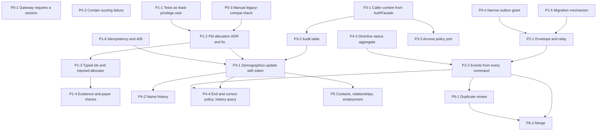

# Patient Management: gaps, evolution, and decisions

- **Status:** Draft for review
- **Part of:** the Patient Management design set (`README.md` in this folder)
- **Depends on:** docs 01 to 06. This document adds no new analysis. It **consolidates** the findings and
  open questions from the other six, removes duplicates, ranks them, orders the work by dependency, and
  lists every decision that needs a human.

Effort sizes are rough: **S** under a day, **M** one to three days, **L** more than three. They are
estimates to rank work, not commitments.

## 1. Where the context stands

| Measure | Count |
|---|---|
| Capabilities (doc 01) | 15: **5 built** (registration, identifiers, insurance, advance directives, FHIR API), **2 partial** (duplicate detection, search), **7 target**, **1 deferred** (merge) |
| Aggregates (doc 04) | 9 plus one process: **3 built**, **6 target** |
| Commands (doc 05) | 20: **6 built** (5 state-changing, plus the inline rescore) |
| Rules with an id (doc 04) | 51 |
| Events (doc 05) | 18: **1 built**, with no relay and no envelope |
| Findings in this register | 37 (section 3) |

**One-sentence assessment.** The built slice is a clean, well-tested core: validate-on-construction
aggregates, a real multi-entity aggregate with a cluster rule, a tolerant insurance rule, enforced layer
boundaries. Its weaknesses are at the **edges**: who is calling (security), how identity is allocated,
what happens when a step fails after commit, and nothing recording what changed.

## 2. Gap summary by theme

| Theme | The gap | Docs |
|---|---|---|
| **Security and identity** | Anyone reaching the Gateway can use the patient API without signing in; the acting user is client-supplied; there is no authorization policy | 03 (M1, M2), 05 |
| **Audit** | Nothing records who changed or read what; legacy's `log` is bypassed; `updated_by` never written | 06 (G-8), 05 |
| **Data integrity** | Random 19-digit pids and unhandled collision; no patient-existence check; no concurrency token; two writers on shared rows | 06 (G-2, G-3), 05 (F-3) |
| **Reliability** | Registration reports failure after committing; no idempotency; directive file and row not atomic | 05 (F-1, F-2, F-4) |
| **Integration** | One event, no relay, no envelope, no version; only registration emits | 05 (F-5, F-6), 03 (M4) |
| **Legacy compatibility** | Rows created here may not open cleanly in legacy screens (unverified); legacy REST still inserts | 06 (G-3, G-10) |
| **Domain model** | Primitive-obsessed ids; identity generated in the aggregate; directive status has no model; free-text sex | 04 (14.x), 02 (L1) |
| **Capability** | No update, no history view, no contacts, relationships, employment, review, merge | 01, 04 |
| **Contract** | Whole-list endpoint, summary-only detail, `pid` routes, state conflicts as `400` | 05, 03, pending decisions |
| **Process** | Tests do not use the real least-privilege user; outbox schema cannot migrate; no rule-id traceability | 06 (G-1, G-5), 04 |

## 3. Findings register

Severity: **Critical** can expose data or lose it now. **High** is a correctness or compliance problem
in built behavior. **Medium** blocks planned work or is a likely future defect. **Low** is hygiene.
IDs keep their original document prefix.

### 3.1 Security and identity

| ID | Finding | Sev | Effort | Fix |
|---|---|---|---|---|
| M1 | Gateway attaches the shared secret unconditionally; the patient API is reachable with no sign-in | **Critical** | M | Require a valid AuthFacade session on patient routes (section 5, P0-1) |
| M2 / L5 | Acting user (`registeredBy`, `ownerId`, `authenticatorUserId`) is client-supplied and unverified | High | L | Caller context from AuthFacade; remove the fields from request bodies |
| M-az | No authorization policy: any caller may do anything to any patient | High | L | `IPatientAccessPolicy` port; policy owned by an Authorization context |
| G-3 | Legacy REST `POST /api/patient` is an enabled second insert path, browser-reachable through the BFF proxy | Medium | S | Decide whether to disable it (DEC-9) |

### 3.2 Audit and compliance

| ID | Finding | Sev | Effort | Fix |
|---|---|---|---|---|
| G-8 | No record of changes or reads; `updated_by` never set; legacy `log` bypassed | **High** | M | Append-only audit table in the same transaction; decide on legacy `log` (DEC-8) |
| 05-Q5 | Outbox events are purged, so they cannot be the audit trail | Medium | n/a | Separate audit store (same fix as G-8) |

### 3.3 Data integrity and identity allocation

| ID | Finding | Sev | Effort | Fix |
|---|---|---|---|---|
| G-2 | Random 63-bit `pid` as the public chart number; collision is a raw `500`; breaks legacy `MAX(pid)+1` | **High** | M | Locked `MAX(pid)+1` in the registration transaction (ADR first) |
| F-3 | No patient-existence check on insurance and directive routes; legacy has no foreign key | Medium | S | Patient-lookup port, `404` |
| PT-11 | No concurrency token; legacy edits can interleave | Medium | M | Conditional update on last-updated (needed before any update command) |
| G-4 | Loading `Patient` through EF throws on dirty legacy rows | Medium | M | Tolerant raw read, as insurance already does |
| IC-8 | Payer id is never validated | Medium | S | `IPayerDirectory` port |
| G-11 | `sequences` is a shared counter touched by one idiom | Low | n/a | Keep the idiom; add a test that pins it |

### 3.4 Reliability

| ID | Finding | Sev | Effort | Fix |
|---|---|---|---|---|
| F-1 | Scoring runs after commit in the endpoint; failure returns `500` for a created patient; retry duplicates it | **High** | S then M | Containment now; event handler with the relay |
| F-2 | No idempotency | High | M | `Idempotency-Key` |
| F-4 / G-9 | Directive file and row not atomic; orphan and missing files undetected | Low to medium | M | Reconciliation report |
| F-7 | A state conflict is returned as `400` | Low | S | `409` |

### 3.5 Integration and events

| ID | Finding | Sev | Effort | Fix |
|---|---|---|---|---|
| F-6 / M4 | No relay, no `eventId`, no version: `PatientRegistered` cannot reach Clinical Care | Medium, blocks M5 | M | Envelope plus relay |
| F-5 | Only registration emits | Medium | M | Emit from every command, same transaction |
| G-5 | Outbox schema cannot evolve (`CREATE TABLE IF NOT EXISTS`) | Medium, blocks F-6 | S | Real migration step |
| G-6 | Outbox grant is `ALL PRIVILEGES` | Low | S | `SELECT, INSERT, UPDATE, DELETE` |
| D1 | Cross-context patient reference undecided (`uuid` vs `pid`) | Medium | S (decision) | `uuid` identity, `pid` correlation key |

### 3.6 Legacy compatibility and process

| ID | Finding | Sev | Effort | Fix |
|---|---|---|---|---|
| G-10 | Rows created here (insurance without subscriber data, `updated_by` empty) may not open cleanly in legacy screens | Medium | S | **Manual check first** |
| G-1 | Integration tests do not use the real least-privilege user | High (process) | S | Run the fixture as the seeded user |
| G-7 | Two clocks (UTC and server local) | Low to medium | S | Rule plus startup assertion |
| M3 | Single-writer assumption false for updates | Medium | n/a | Addressed by PT-11 and DEC-9 |

### 3.7 Domain model

| ID | Finding | Sev | Effort | Fix |
|---|---|---|---|---|
| 14.1 | All identifiers are plain `long`; arguments can be swapped silently | Medium | S | `PatientNumber`, `StaffUserId`, `PayerId` |
| 14.2 | Identity generated inside the aggregate; collision untestable | Medium | S | Inject an allocator (pairs with G-2) |
| 14.4 | Directive status has no domain model | Medium | M | `AdvanceDirectiveStatus` aggregate |
| L1 | Sex is free text, mapped silently to a code | Medium | S (decision) | DEC-6 |
| L3 | `Pid` is random, not sequential | see G-2 | | see G-2 |
| L4 | Directive type inferred from a document's name | Low | n/a | Keep for parity; do not extend |
| 04-trace | No rule-id traceability in tests | Low | S | Put rule ids in test names |

### 3.8 Contract and API

| ID | Finding | Sev | Effort | Fix |
|---|---|---|---|---|
| F-9 | Whole-list patient query | Medium at scale | M | Server-side paging (pending decision 5) |
| PD-3 | Detail endpoint returns summary only | Medium | M | `PatientDetailResponse`, excluding SSN (pending decision 3) |
| F-8 | No insurance history query | Low | S | QRY-6 |
| PD-6 | Optional query parameter generated as non-nullable | Low | S | Fix the OpenAPI output |
| PD-2 | Upload cap 20 MB in the webapp, 30 MiB in the domain, base64 overhead | Low | M | Multipart or raise the limit (pending decision 2) |

## 4. Dependency graph

P0 items have no dependencies and should not wait for anything else.

## 5. Evolution plan

### Phase 0: close the open holes (small, independent)

| # | Work | Fixes | Effort |
|---|---|---|---|
| P0-1 | **Gateway requires a valid AuthFacade session** before routing to the patient cluster. Options: (a) forward-auth: the Gateway asks AuthFacade `GET /api/v1/me` with the caller's cookie, routes on `200`; (b) share data-protection keys and validate the cookie in the Gateway; (c) wait for real token validation. Recommend **(a)**: no shared keys, small, and it needs no identity-forwarding design. Needs an ADR because it partly supersedes ADR 0048's deferral. | M1 | M |
| P0-2 | Contain scoring failures: catch and log in `RegisterPatient` and FHIR `CreatePatient` so a scoring error cannot change the registration result | F-1 | S |
| P0-3 | **Manual check**: open a service-created patient and policy in legacy's UI | G-10 | S |
| P0-4 | Narrow the outbox grant | G-6 | S |
| P0-5 | Decide whether to disable legacy REST | G-3 | S |

### Phase 1: foundations (before any new capability)

| # | Work | Fixes | Effort |
|---|---|---|---|
| P1-1 | Run the integration fixture as the real least-privilege user | G-1 | S |
| P1-2 | Pid allocation: write the ADR, then implement locked `MAX+1` behind `IPatientIdentifierAllocator`, with the duplicate-key retry as a backstop | G-2, 14.2 | M |
| P1-3 | Typed ids | 14.1 | S |
| P1-4 | Patient-existence and payer checks; `404` | F-3, IC-8 | S |
| P1-5 | A real migration step for the outbox (and later the audit table) | G-5 | S |
| P1-6 | `Idempotency-Key`; `409` for state conflicts | F-2, F-7 | M |
| P1-7 | Time rule and startup assertion | G-7 | S |
| P1-8 | Rule ids in test names | 04-trace | S |

### Phase 2: eventing (unblocks M5)

| # | Work | Effort |
|---|---|---|
| P2-1 | Envelope, `eventId`, `schemaVersion`; outbox relay with `SKIP LOCKED`, back-off, dead-letter, purge; `IEventPublisher` port | M to L |
| P2-2 | Rescore as an event handler (replaces P0-2's containment) | S |
| P2-3 | Emit events from insurance and directive commands in the same transaction | M |
| P2-4 | Transport decision and consumer-driven contract test with Clinical Care | M |

### Phase 3: identity, audit, authorization

| # | Work | Effort |
|---|---|---|
| P3-1 | Caller context (subject, numeric user id, name) published by AuthFacade, forwarded by the Gateway; remove client-supplied user ids | L |
| P3-2 | Append-only audit table, same transaction; PHI read access log | M |
| P3-3 | `IPatientAccessPolicy` port and an initial policy | M |

### Phase 4: capabilities on the existing aggregates

| # | Work | Effort |
|---|---|---|
| P4-1 | `Patient`: tolerant load, concurrency token, `CorrectDemographics`, FHIR `PUT` | L |
| P4-2 | Name history, deceased, communication preferences | M |
| P4-3 | `AdvanceDirectiveStatus` aggregate; `Retire` for documents | M |
| P4-4 | Insurance: end level, correct policy, history query | M |
| P4-5 | Paging, patient detail, insurance history in the API; client regeneration | M |

### Phase 5: new aggregates

Contacts, related persons and `Person`, employment (doc 04, 8 to 10). **Gate:** first verify which legacy
storage is populated (doc 04, 8.4) and whether related persons are shared. **L** overall.

### Phase 6: duplicate review and merge

Duplicate review needs events and paging. Merge needs Clinical Care and at least one more consumer to
exist (ROADMAP M5+). **L**, last.

## 6. Decision register

Every open decision from the set, in one place. **Default** is what this design assumes if you do not
answer; none of the defaults is irreversible.

| ID | Decision | Options | Recommendation (default) | Blocks | Source |
|---|---|---|---|---|---|
| DEC-1 | Is the context **Core or Supporting**? | Core; Supporting; split | Core, per blueprint; split noted | nothing | 01 |
| DEC-2 | Is **`pubpid` the MRN**? | Yes; separate MRN term | Yes until a clinician says otherwise | MRN term, QRY-13 | 01, pending decision 4 |
| DEC-3 | **New rules** beyond legacy | Accept, drop, or soften each of PT-6, PT-7, PT-9, RL-7, EM-3 | Accept PT-6 and PT-9; defer the rest | Phase 4 to 5 | 04 |
| DEC-4 | **Is a related person shared between patients?** | Yes (`Person` separate); no (inside the relationship) | Verify first; keep separate if yes | Phase 5 | 04 |
| DEC-5 | **Directive status rules** AS-2, AS-5 | Enforce; do not enforce | Do not enforce AS-2 until a reviewer confirms (legacy allows it) | P4-3 | 04 |
| DEC-6 | **Sex** free text or controlled | Keep parity; controlled list with tolerant read | Keep parity now; revisit with P4-1 | P4-1 | 02, 04 |
| DEC-7 | **Pid allocation** | A random plus retry; **B locked MAX+1**; C counter; D sequence | **B** | P1-2 | 06 |
| DEC-8 | **Audit store** | Own audit table only; also write legacy `log` | Own table; add `log` only if legacy screens stay in use | P3-2 | 06 |
| DEC-9 | **Legacy REST API on or off** | Off; on | Off, if nothing depends on it | G-3 | 06 |
| DEC-10 | **Gateway session requirement** mechanism | (a) forward-auth; (b) shared keys; (c) wait | **(a)** | P0-1 | 03 |
| DEC-11 | **Cross-context patient reference** | `uuid`; `pid`; both | Both, `uuid` is identity (D1) | P2-4 | 03 |
| DEC-12 | **Event transport** | Broker; HTTP stopgap; shared table (rejected) | Interface now; broker at M5 | P2-4 | 05 |
| DEC-13 | **`PatientRegistered` carries names?** | Yes; `uuid` and `pid` only | Yes for now; review with the first consumer | P2-1 | 05 |
| DEC-14 | **Scoring failure fix scope** | Containment now; handler with the relay | Containment now (P0-2), handler at P2-2 | P0-2 | 05 |
| DEC-15 | **Contact storage** | Columns only; `contact_*` tables; history in tables, project current into columns | Third, after verification | Phase 5 | 04 |
| DEC-16 | **Pair-level duplicate review** | Parity (patient-level) only; pair-level | Pair-level, after parity | Phase 6 | 04 |
| DEC-17 | **Shared kernel** content | `PatientId` only; more | `PatientId` only | P2-4 | 03 |
| DEC-18 | **FHIR location** | Inside this context; separate Interoperability context | Inside for Patient | nothing now | 03 |
| DEC-19 | **Identity resolution owner** | AuthFacade; this context | AuthFacade | P3-1 | 03 |
| DEC-20 | **Reference data access** | Direct reads; ports | Ports | P1-4 | 03 |
| DEC-21 | **Idempotency window and storage** | Hours or days; same database table | 24 hours, own table | P1-6 | 05 |
| DEC-22 | **Webapp tests and dev-data browser checks** | Approve; defer | Ask before running (your standing preference) | pending decisions 7 and 8 | pending decisions |

Existing `patient-view-pending-decisions.md` items map as: item 1 → DEC-19 and P3-1; item 2 → upload
size (section 3.8); item 3 → P4-5; item 4 → DEC-2; item 5 → P4-5; item 6 → section 3.8; items 7 and 8 →
DEC-22.

## 7. What was not verified

These statements in the set rest on reading code or schema, not on running anything. Treat them as
hypotheses until checked.

| Claim | Why unverified | How to verify |
|---|---|---|
| Legacy screens open and save a policy or patient this service created (G-10) | Not exercised | Phase 0 manual check |
| `patient_related_persons` exists on a running install | No SQL file in the checkout creates it | Query a running database |
| Which contact storage legacy populates for patients (doc 04, 8.4) | Schema shows both | Inspect a populated database |
| Legacy REST and UI patient creation write to `log` (G-8) | Not traced | Read the controller path and run one |
| Both clocks are UTC in this compose stack (G-7) | Not asserted anywhere | Check the server time zone |
| `AS-2` would not break a real workflow | No stakeholder input | Domain reviewer |
| All Target capabilities (C2, C7 to C12) are wanted | Derived from legacy, not interviews | Stakeholders |
| Effort sizes | Estimates | Spike the first of each phase |

## 8. Success measures

From `docs/domain-driven-design.md` (Evaluation), with the baseline from this review.

| Measure | Baseline (from the code today) | Target |
|---|---|---|
| Legacy table or column names inside `Domain` | **0** (enforced by `LayerDependencyTests`) | stays 0 |
| Business rules with a test that names the rule id | **0 of 51** (ids are new; tests exist for many but do not cite them) | all |
| Aggregates with no public constructor or setter, test enforced | **5 types covered** | every new type |
| Commands that write an event in their own transaction | **1 of 5** | all |
| Commands whose acting user is verified | **0 of 5** | all |
| Commands recording an audit entry | **0 of 5** | all |
| Integration tests run as the production database user | **no** | yes |
| Patients creatable with no sign-in through the Gateway | **yes** | no |

## 9. Keeping the set current

1. **Each decision becomes an ADR** (`docs/architecture/`) in the same change that implements it, and
   the decision register entry links to it.
2. **The glossary changes with the code.** A new term or renamed member updates doc 02 in the same
   commit (your standing rule: document before commit).
3. **Rule ids are permanent.** A removed rule keeps its id, marked retired.
4. **Status flips from Target to Built** only when code and test exist.
5. **Review date:** revisit the whole set at the end of each phase.
6. **Supersession.** When this set is accepted, add a pointer from `docs/openemr-ddd-design.md` section
   3.2 to it, and from `ROADMAP.md` M4, so there is one place to look.
